# ECIFIT Backend

Backend de la plataforma de gamificación deportiva y bienestar de ECI FIT.

- **QA:** https://ecifit-qa-bxhdd4a0dkc4bma0.canadacentral-01.azurewebsites.net/swagger-ui/index.html
- **PROD:** https://ecifit-prod-e9fafke4eyebbxh2.canadacentral-01.azurewebsites.net/swagger-ui/index.html
- **Documento de arquitectura (HLD):** [docs/arquitectura-hld.md](docs/arquitectura-hld.md) · [PDF](docs/ECI_FIT_Arquitectura_Backend_v1.0.pdf)
- **Frontend:** https://github.com/ECI-FIT/ecifit-frontend.git

## Índice
1. [Objetivo](#objetivo)
2. [Arquitectura](#arquitectura)
3. [Estructura del proyecto](#estructura-del-proyecto)
4. [Stack tecnológico](#stack-tecnológico)
5. [Patrones de diseño (GoF)](#patrones-de-diseño-gof)
6. [Diagramas](#diagramas)
7. [Base de datos](#base-de-datos)
8. [Seguridad](#seguridad)
9. [Cómo levantar localmente](#cómo-levantar-localmente)
10. [Variables de entorno](#variables-de-entorno)
11. [Ejecución de pruebas](#ejecución-de-pruebas)
12. [Limitaciones conocidas](#limitaciones-conocidas)
13. [CI/CD](#cicd)
14. [Despliegue](#despliegue)
15. [Integrantes](#integrantes)

## Objetivo

Proveer la lógica de negocio, la persistencia y la API REST para gestionar:

- estudiantes y sus personajes
- actividades físicas con validación anti-cheat
- misiones diarias y semanales
- clanes, invitaciones y retos colectivos
- temporadas, rankings y ligas
- asistencia al gimnasio
- registro de comidas con evaluación nutricional (Google Gemini) y menú del comedor

## Arquitectura

La aplicación sigue una arquitectura en capas (Controller → Service → Validator → Repository) con un dominio independiente de la base de datos y patrones GoF en el núcleo. El detalle completo está en el [documento de arquitectura](docs/arquitectura-hld.md): diagramas explicados, catálogo de endpoints, manejo de errores, diagramas de secuencia, despliegue y limitaciones.

## Estructura del proyecto

```text
ecifit-backend/
├── src/main/java/co/edu/eci/dosw/ecifit/
│   ├── config/          ← Swagger y Gemini
│   ├── controller/      ← endpoints REST (docs/ con los contratos de Swagger)
│   ├── dto/             ← request, response e ia
│   ├── exception/       ← excepciones de negocio y GlobalExceptionHandler
│   ├── mapper/          ← MapStruct: DTO ↔ dominio ↔ entidad
│   ├── model/           ← dominio y patrones (strategy, chain, factory, observer, state)
│   ├── persistence/     ← entidades JPA
│   ├── repository/      ← repositorios Spring Data
│   ├── scheduler/       ← corte semanal de ligas y reintento de evaluaciones nutricionales
│   ├── security/        ← JWT, usuarios y roles
│   ├── service/         ← casos de uso (ia/ con el adaptador de Gemini)
│   └── validator/       ← reglas de negocio
├── src/test/            ← pruebas unitarias y de integración
├── docs/
│   ├── arquitectura-hld.md
│   ├── diagramas/
│   └── evidencias/
├── postman/             ← colección y ambientes de QA y PROD
├── .github/workflows/   ← pipelines de QA y PROD
├── Dockerfile
├── docker-compose.yml
└── pom.xml
```

## Stack tecnológico

| Tecnología | Versión |
|---|---|
| Java | 21 LTS |
| Spring Boot (Web, Data JPA, Validation, Security) | 3.5.16 |
| PostgreSQL | 16 |
| JJWT | 0.12.3 |
| MapStruct | 1.6.3 |
| Lombok | 1.18.48 |
| springdoc-openapi (Swagger) | 2.8.17 |
| JaCoCo | 0.8.15 |
| Google Gemini API | gemini-2.5-flash-lite |
| Docker, GitHub Actions y Azure App Service | — |

## Patrones de diseño (GoF)

| Patrón | Problema que resuelve | Clases | Uso actual |
|---|---|---|---|
| Strategy | Cada rol calcula los puntos de una actividad con su propio multiplicador, sin condicionales anidados | `RolTemporada`, `Tanque`, `Corredor`, `Estratega` | En uso al registrar actividades |
| Chain of Responsibility | Validar una actividad (fechas futuras, duración, intensidad, máximo 300 min) en eslabones independientes | `ActividadHandler`, `SanctionStatusHandler`, `DataIntegrityHandler`, `PhysiologicalLimitsHandler` | En uso en `ActividadValidator` |
| Abstract Factory | Crear misiones diarias y semanales sin acoplar el servicio a cada tipo | `FabricaMisiones`, `FabricaMisionesEstandar`, `Mision`, `MisionDiaria`, `MisionSemanal` | En uso al generar misiones |
| Observer | Avisar cuando se registra una actividad | `ActividadObserver`, `GestorLigas`, `TorreClan` | En uso para calcular puntos; `GestorLigas` y `TorreClan` definidos sin conectar |
| State | Reglas distintas en semana regular y de parciales | `EstadoTemporada`, `SemanaRegular`, `SemanaParciales` | Definido, sin conectar |

## Diagramas

Cada diagrama está explicado en el [documento de arquitectura](docs/arquitectura-hld.md#4-diagramas-arquitectónicos).

### Diagrama de contexto
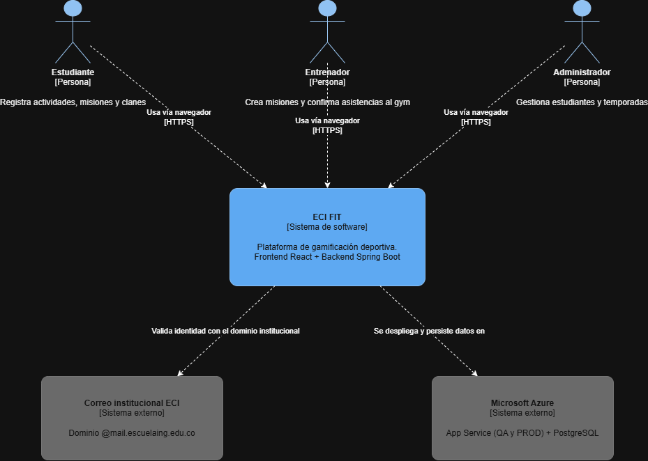

### Diagrama de clases
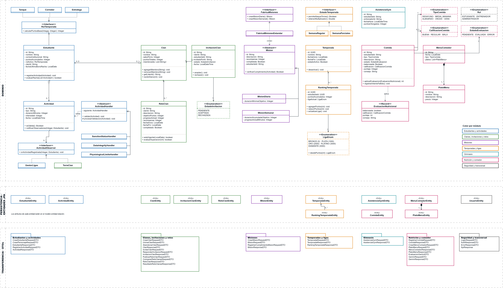

### Diagrama de componentes general
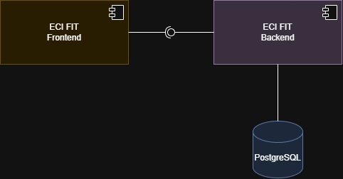

### Diagrama de componentes específico
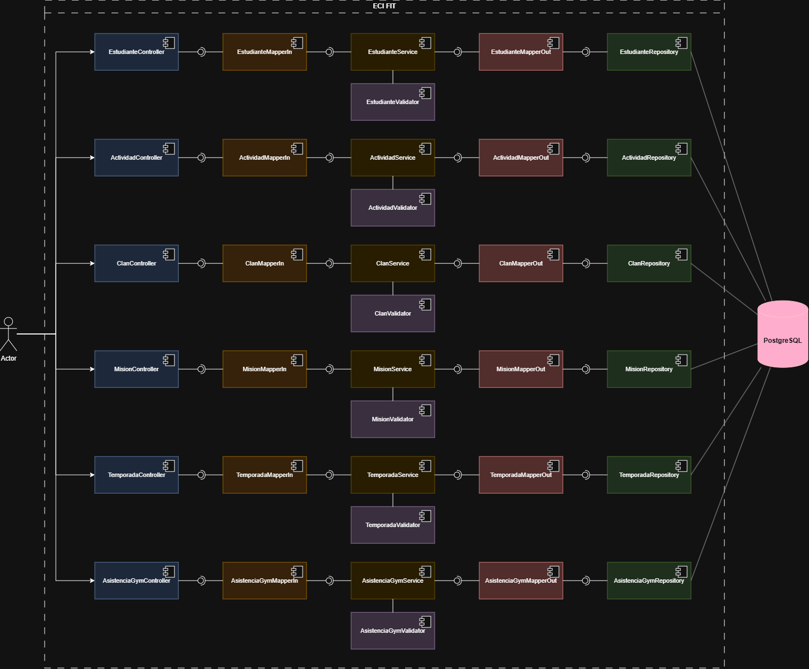

Cada fila es un módulo con el mismo recorrido: Controller → Mapper → Service (con su Validator) → EntityMapper → Repository → PostgreSQL. Antes de cualquier controlador, `JwtAuthFilter` valida el token.

## Base de datos
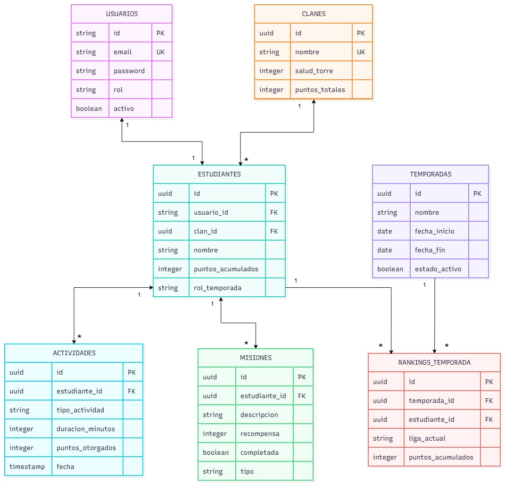
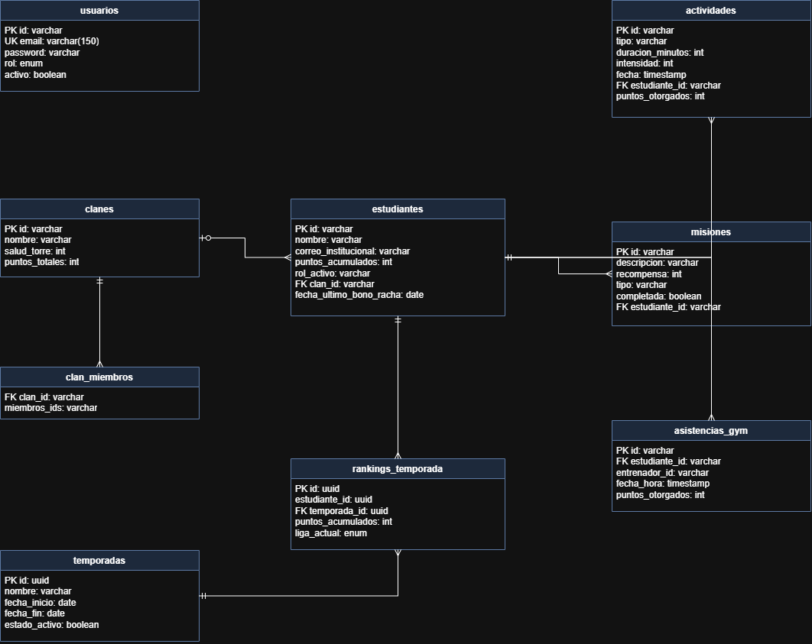

### Decisión de persistencia
Se usa PostgreSQL por su cumplimiento del estándar ACID, necesario para mantener la consistencia en el cálculo concurrente de puntos de clanes y daño a las torres. Además, garantiza integridad mediante restricciones de unicidad (por ejemplo, sobre el correo institucional o la pareja fecha–tipo del menú) y sus índices optimizan las consultas de rankings. El detalle de las 15 tablas está en el [documento de arquitectura](docs/arquitectura-hld.md#41-modelo-entidad-relación-de-base-de-datos-erd).

## Seguridad
La API usa autenticación stateless con JWT (JJWT 0.12.3). `JwtAuthFilter` valida el token en cada petición con un secreto definido en la variable de entorno `JWT_SECRET`. Los usuarios se guardan en la tabla `usuarios`, separada del dominio, con contraseñas cifradas con BCrypt.

Las credenciales inválidas devuelven 401 y el acceso con un rol sin permisos devuelve 403. Ambos casos se manejan con `CustomAuthenticationEntryPoint`, `CustomAccessDeniedHandler` y `GlobalExceptionHandler`, y responden con `ErrorResponseDTO`.

### Evidencia de Validación de Seguridad (RBAC)
- **Sin Token / Token Inválido:** Devuelve `401 Unauthorized` (`CP-02`).
- **Rol Incorrecto (Estudiante accediendo a recurso de Admin):** Devuelve `403 Forbidden` (`CP-04`).
- **Rol Correcto (Administrador o Estudiante autorizado):** Devuelve `200 OK` / `201 Created` (`CP-01`, `CP-03`).

#### 1. Sin Token / No Autenticado (401 Unauthorized)
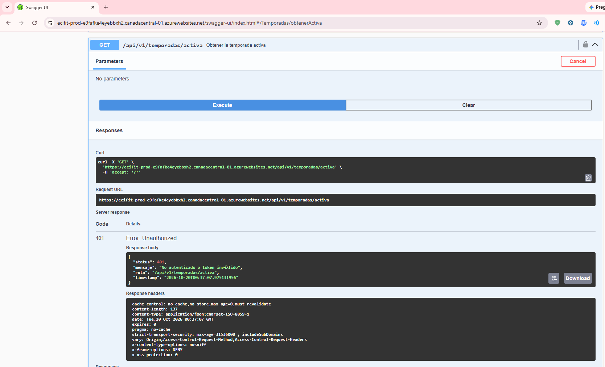

#### 2. Acceso Denegado por Rol Insuficiente (403 Forbidden)
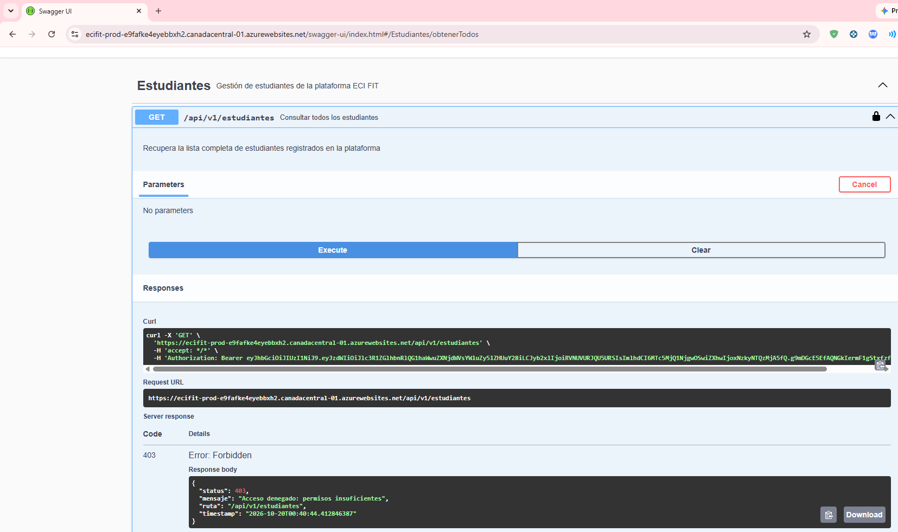

#### 3. Acceso Autorizado con Rol Válido (200 OK)
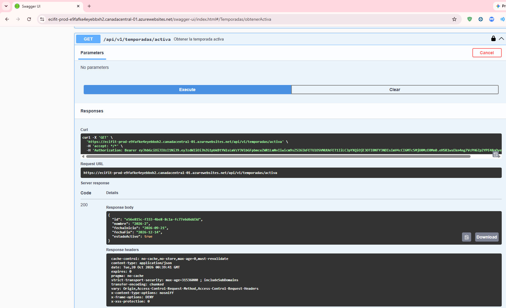

### Roles y permisos
| Módulo | Método | Endpoint | Público | Roles permitidos |
|---|---|---|---|---|
| Autenticación | POST | `/api/v1/auth/login` | Sí | - |
| Documentación | GET | `/swagger-ui/**`, `/v3/api-docs/**` | Sí | - |
| Monitoreo | GET | `/api/v1/health` | Sí | - |
| Estudiantes | POST | `/api/v1/estudiantes` | No | ADMINISTRADOR |
| Estudiantes | POST | `/api/v1/estudiantes/personaje` | No | ESTUDIANTE |
| Estudiantes | GET | `/api/v1/estudiantes` | No | ENTRENADOR, ADMINISTRADOR |
| Estudiantes | GET | `/api/v1/estudiantes/{id}` | No | ESTUDIANTE, ENTRENADOR, ADMINISTRADOR |
| Actividades | POST | `/api/v1/actividades` | No | ESTUDIANTE |
| Actividades | GET | `/api/v1/actividades/estudiante/{estudianteId}` | No | ESTUDIANTE, ENTRENADOR, ADMINISTRADOR |
| Clanes | POST | `/api/v1/clanes` | No | ESTUDIANTE, ADMINISTRADOR |
| Clanes | POST | `/api/v1/clanes/unirse` | No | ESTUDIANTE |
| Clanes | POST | `/api/v1/clanes/abandonar` | No | ESTUDIANTE |
| Clanes | GET | `/api/v1/clanes` | No | ESTUDIANTE, ENTRENADOR, ADMINISTRADOR |
| Clanes | GET | `/api/v1/clanes/{id}` | No | ESTUDIANTE, ENTRENADOR, ADMINISTRADOR |
| Invitaciones | POST | `/api/v1/clanes/invitaciones` | No | ESTUDIANTE |
| Invitaciones | POST | `/api/v1/clanes/invitaciones/{id}/responder` | No | ESTUDIANTE |
| Invitaciones | GET | `/api/v1/clanes/invitaciones/estudiante/{estudianteId}` | No | ESTUDIANTE, ADMINISTRADOR |
| Retos de clan | POST | `/api/v1/clanes/retos` | No | ENTRENADOR, ADMINISTRADOR |
| Retos de clan | POST | `/api/v1/clanes/{clanId}/retos/{retoId}/calcular` | No | ENTRENADOR, ADMINISTRADOR |
| Retos de clan | POST | `/api/v1/clanes/retos/comparar-duelo` | No | ENTRENADOR, ADMINISTRADOR |
| Retos de clan | GET | `/api/v1/clanes/{clanId}/retos` | No | ESTUDIANTE, ENTRENADOR, ADMINISTRADOR |
| Misiones | POST | `/api/v1/misiones/diarias` | No | ENTRENADOR, ADMINISTRADOR |
| Misiones | POST | `/api/v1/misiones/semanales` | No | ENTRENADOR, ADMINISTRADOR |
| Misiones | POST | `/api/v1/misiones/{id}/cumplimiento` | No | ESTUDIANTE, ADMINISTRADOR |
| Misiones | POST | `/api/v1/misiones/{id}/completar` | No | ESTUDIANTE, ADMINISTRADOR |
| Misiones | GET | `/api/v1/misiones/estudiante/{estudianteId}` | No | ESTUDIANTE, ENTRENADOR, ADMINISTRADOR |
| Temporadas | POST | `/api/v1/temporadas` | No | ADMINISTRADOR |
| Temporadas | GET | `/api/v1/temporadas/{id}` | No | ESTUDIANTE, ENTRENADOR, ADMINISTRADOR |
| Temporadas | GET | `/api/v1/temporadas/activa` | No | ESTUDIANTE, ENTRENADOR, ADMINISTRADOR |
| Temporadas | GET | `/api/v1/temporadas/{temporadaId}/ranking` | No | ESTUDIANTE, ENTRENADOR, ADMINISTRADOR |
| Gimnasio | POST | `/api/v1/gimnasio/asistencias` | No | ENTRENADOR, ADMINISTRADOR |
| Nutrición | POST | `/api/v1/nutricion/comidas` | No | ESTUDIANTE, ADMINISTRADOR |
| Nutrición | POST | `/api/v1/nutricion/comidas/{id}/evaluar` | No | ESTUDIANTE, ADMINISTRADOR |
| Nutrición | GET | `/api/v1/nutricion/comidas/{id}` | No | ESTUDIANTE, ENTRENADOR, ADMINISTRADOR |
| Nutrición | GET | `/api/v1/nutricion/comidas/estudiante/{estudianteId}` | No | ESTUDIANTE, ENTRENADOR, ADMINISTRADOR |
| Comedor | POST | `/api/v1/comedor/menus` | No | ADMINISTRADOR |
| Comedor | GET | `/api/v1/comedor/menus` | No | ESTUDIANTE, ENTRENADOR, ADMINISTRADOR |
| Comedor | GET | `/api/v1/comedor/menus/hoy` | No | ESTUDIANTE, ENTRENADOR, ADMINISTRADOR |

## Cómo levantar localmente
**Prerrequisitos:** Java 21, Maven y Docker.

1. Clonar el repositorio.
2. Copiar `.env.example` como `.env` y completar los valores.
3. Ejecutar `docker compose up --build -d`.
4. Abrir `http://localhost:8080/swagger-ui.html`.

## Variables de entorno
Referencia: `.env.example`.

| Variable | Descripción | Ejemplo |
|---|---|---|
| DB_URL | URL de conexión a PostgreSQL | jdbc:postgresql://localhost:5432/ecifit |
| DB_USER | Usuario de la base de datos | ecifit |
| DB_PASSWORD | Contraseña de la base de datos | ****** |
| JWT_SECRET | Clave para firmar los tokens (mínimo 44 caracteres Base64) | ****** |
| JWT_EXPIRATION | Duración del token en milisegundos | 86400000 |
| GEMINI_API_KEY | Llave de la API de Google Gemini para evaluar comidas | ****** |

## Ejecución de pruebas

### 1. Pruebas Unitarias y Cobertura JaCoCo
Ejecutar `mvn clean test`. El reporte detallado de JaCoCo se genera en `target/site/jacoco/index.html`.

- **Total de pruebas:** **329 pruebas**, **0 fallos**, **0 errores**, **0 omitidas**.
- **Cobertura global de instrucciones:** **88.81%** (7.390 / 8.321 instrucciones).
- **Cobertura en ramas:** **70.44%** (448 / 636 ramas).
- **Cobertura en capa de servicios:** **95.59%** (2.340 / 2.448 instrucciones).
- **Cobertura en validadores y anti-cheat:** **94.65%** en `validator` y **100%** en `chain`.
- **Cobertura en controladores:** **81.57%** (447 / 548 instrucciones).

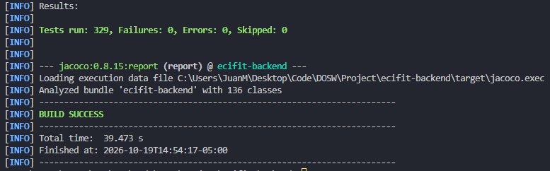

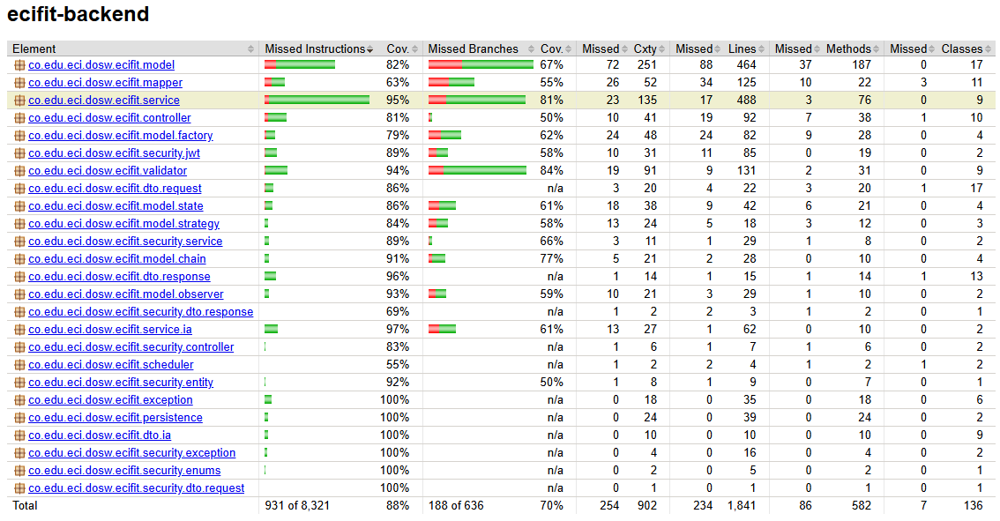

---

### 2. Set de Pruebas de Funcionamiento (Caja Negra con Postman)
Ubicación de la colección oficial: [`postman/ecifit-collection.json`](postman/ecifit-collection.json), con los ambientes [`qa`](postman/qa.postman_environment.json) y [`prod`](postman/prod.postman_environment.json).

**Cómo correrlo:** importar la colección y el ambiente en Postman, seleccionar el ambiente (QA o PROD) y ejecutar la colección completa con el **Collection Runner**. Cada request valida automáticamente el código de respuesta.

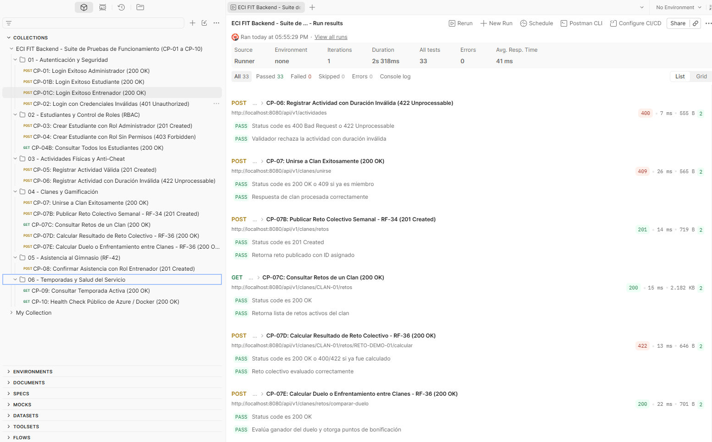

| ID | Funcionalidad (RF) | Escenario de Prueba | Método y Request | Esperado | Obtenido | Evidencia |
|:---:|---|---|---|:---:|:---:|:---:|
| **CP-01** | RF-01 Login | Autenticación exitosa Administrador | `POST /api/v1/auth/login` | 200 OK + JWT Admin | ✅ 200 OK | `docs/evidencias/cp01-login-admin.png` |
| **CP-01B** | RF-01 Login | Autenticación exitosa Estudiante | `POST /api/v1/auth/login` | 200 OK + JWT Estudiante | ✅ 200 OK | `docs/evidencias/cp01b-login-est.png` |
| **CP-01C** | RF-01 Login | Autenticación exitosa Entrenador | `POST /api/v1/auth/login` | 200 OK + JWT Entrenador | ✅ 200 OK | `docs/evidencias/cp01c-login-coach.png` |
| **CP-02** | RF-01 Login | Login con contraseña errónea | `POST /api/v1/auth/login` | 401 Unauthorized | ✅ 401 Unauthorized | `docs/evidencias/cp02-login-fail.png` |
| **CP-03** | RF-02 Estudiantes | Crear estudiante con rol ADMIN | `POST /api/v1/estudiantes` | 201 Created | ✅ 201 Created | `docs/evidencias/cp03-crear-estudiante.png` |
| **CP-04** | RF-02 Estudiantes | Crear estudiante con rol ESTUDIANTE | `POST /api/v1/estudiantes` | 403 Forbidden | ✅ 403 Forbidden | `docs/evidencias/cp04-rbac-forbidden.png` |
| **CP-04B** | RF-02 Estudiantes | Consultar colección de estudiantes | `GET /api/v1/estudiantes` | 200 OK + Listado | ✅ 200 OK | `docs/evidencias/cp04b-get-todos.png` |
| **CP-05** | RF-06/07/10 Actividades | Registrar entrenamiento válido | `POST /api/v1/actividades` | 201 Created + Pts | ✅ 201 Created | `docs/evidencias/cp05-actividad-ok.png` |
| **CP-06** | RF-09 Anti-Cheat | Registrar duración inválida (< 10m) | `POST /api/v1/actividades` | 422 Unprocessable | ✅ 422 Unprocessable | `docs/evidencias/cp06-anticheat.png` |
| **CP-07** | RF-31 Clanes | Unirse a clan con cupo disponible | `POST /api/v1/clanes/unirse` | 200 OK + Miembro | ✅ 200 OK | `docs/evidencias/cp07-unirse-clan.png` |
| **CP-07B** | RF-34 Retos Clan | Publicar reto colectivo semanal | `POST /api/v1/clanes/retos` | 201 Created | ✅ 201 Created | `docs/evidencias/cp07b-reto-semanal.png` |
| **CP-07C** | RF-37 Retos Clan | Consultar retos de un clan | `GET /api/v1/clanes/{id}/retos` | 200 OK + Lista | ✅ 200 OK | `docs/evidencias/cp07c-consultar-retos.png` |
| **CP-07D** | RF-36 Retos Clan | Calcular resultado de reto de clan | `POST /api/v1/clanes/{cId}/retos/{rId}/calcular` | 200 OK + Progreso | ✅ 200 OK | `docs/evidencias/cp07d-calcular-reto.png` |
| **CP-07E** | RF-36 Retos Clan | Calcular duelo entre clanes rivales | `POST /api/v1/clanes/retos/comparar-duelo` | 200 OK + Ganador | ✅ 200 OK | `docs/evidencias/cp07e-duelo-clanes.png` |
| **CP-08** | RF-42 Asistencia Gym | Validar asistencia con Entrenador | `POST /api/v1/gimnasio/asistencias` | 201 Created (+20 pts) | ✅ 201 Created | `docs/evidencias/cp08-asistencia-gym.png` |
| **CP-09** | RF-28 Temporadas | Consultar temporada activa | `GET /api/v1/temporadas/activa` | 200 OK | ✅ 200 OK | `docs/evidencias/cp09-temporada-activa.png` |
| **CP-10** | Monitoreo | Health check sin autenticación | `GET /api/v1/health` | 200 OK (Probe Azure) | ✅ 200 OK | `docs/evidencias/cp10-health-azure.png` |

---

### 3. Video de Respaldo del Demo (Plan B Obligatorio)
- **Grabación de respaldo:** [Enlace al Video de Respaldo en OneDrive/Teams](https://escuelaing-my.sharepoint.com/:v:/g/personal/juan_munar_mail_escuelaing_edu_co/VideoDemoRespaldoECIFIT) *(Disponible descargado localmente en los equipos de la Estación 3).*

## Limitaciones conocidas

Lo que no alcanzó a cerrarse, con su impacto y cómo se resolvería, está en la [sección 9 del documento de arquitectura](docs/arquitectura-hld.md#9-limitaciones-conocidas). En resumen:

- **RF-05:** las estadísticas del personaje no se separan por atributo (Fuerza, Cardio, Flexibilidad, Nutrición).
- **RF-38:** los clanes no tienen niveles.
- **RF-39, RF-40 y RF-41:** no hay reporte ni consulta de la ocupación del gimnasio.
- Los patrones Observer (`GestorLigas`, `TorreClan`) y State están definidos, pero no conectados al flujo de actividades.

## CI/CD
- **ci-qa.yml:** push a `main` o `develop`, ejecuta pruebas, construye la imagen y despliega en QA.
- **ci-prod.yml:** tag `v*.*.*`, despliega en PROD con aprobación manual.

**Secrets configurados:** `DOCKERHUB_USERNAME`, `DOCKERHUB_TOKEN`, `AZURE_CREDENTIALS`, `JWT_SECRET_QA`, `JWT_SECRET_PROD`, `DB_PASSWORD_QA`, `DB_PASSWORD_PROD`, `AZURE_WEBAPP_NAME_QA`, `AZURE_WEBAPP_NAME_PROD`

[Ver ejecuciones en GitHub Actions](https://github.com/ECI-FIT/ecifit-backend/actions)

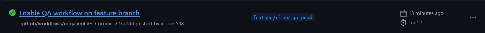

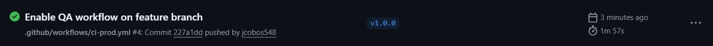

## Despliegue
- **Swagger en Producción (Azure):** [https://ecifit-prod-e9fafke4eyebbxh2.canadacentral-01.azurewebsites.net/swagger-ui/index.html](https://ecifit-prod-e9fafke4eyebbxh2.canadacentral-01.azurewebsites.net/swagger-ui/index.html)
- **Health Check Azure (Probe):** [https://ecifit-prod-e9fafke4eyebbxh2.canadacentral-01.azurewebsites.net/api/v1/health](https://ecifit-prod-e9fafke4eyebbxh2.canadacentral-01.azurewebsites.net/api/v1/health)
- **Imagen Docker en Docker Hub:** [https://hub.docker.com/r/cobos1/ecifit-backend](https://hub.docker.com/r/cobos1/ecifit-backend)

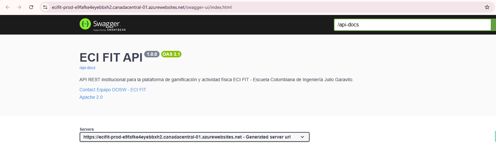

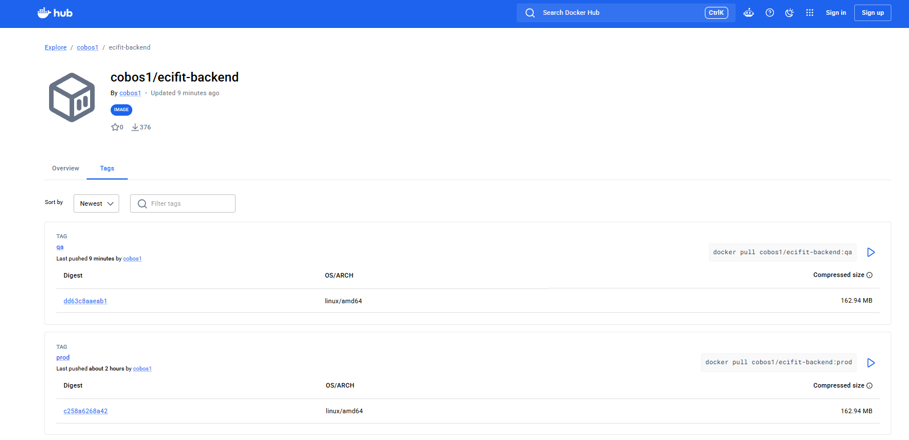

### Diagrama de despliegue
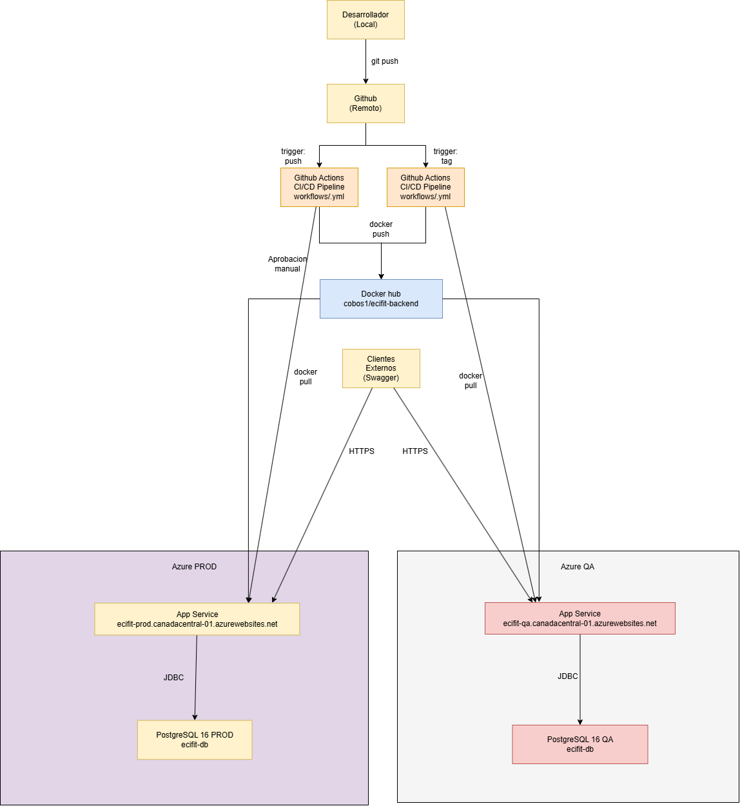

## Integrantes
### Sprint 4 (Cierre Final y Feria de Proyectos)

| Nombre | Rol en el Sprint 4 | Qué implementó en el Sprint 4 |
|------------------------------------|---|--------------------------------------------------------------------------------------------------------------------------------------------|
| Juan David Munar Chaparro          | Backend: Seguridad, QA & Arquitectura | Consolidación exhaustiva del Documento de Arquitectura HLD, pruebas de seguridad RBAC (401/403/200), diseño y ejecución de la suite de pruebas de funcionamiento en Postman (CP-01 a CP-10), aseguramiento de 329 tests unitarios y semillero de datos. |
| Sebastián Camilo Granados López    | Líder técnico e Integración | Coordinación de sprint en Jira, revisión y aprobación de Pull Requests, sincronización de ramas `develop`/`main` y verificación de despliegues. |
| Daniel Jose Villamizar Castellanos | Backend: Negocio y Persistencia | Implementación y estabilización de reglas de negocio en clanes, retos colectivos y misiones, validadores de dominio y manejo transaccional. |
| Julian Camilo Giral Cobos          | DevOps: CI/CD y Cloud | Automatización de pipelines de GitHub Actions (QA y PROD), construcción y etiquetado de imágenes en Docker Hub, configuración de secrets y soporte de Azure. |
| Daniel Alfredo Barrera Aranque     | Frontend & Experiencia de Usuario | Integración cliente-servidor con el backend en Azure, refinamiento de vistas gamificadas y preparación de material interactivo para la Feria de Proyectos. |

### Histórico Sprint 3

| Nombre | Rol en el Sprint 3 | Qué implementó en el Sprint 3 |
|------------------------------------|---|--------------------------------------------------------------------------------------------------------------------------------------------|
| Sebastián Camilo Granados López    | Líder técnico | Gestión del sprint en Jira, diagrama de flujo de pantallas, integración y verificación de QA y PROD, README del backend.                   |
| Daniel Jose Villamizar Castellanos | Backend: funcionalidades y Docker | Funcionalidades pendientes, manejo global de excepciones, pruebas, Dockerización, imagen en Docker Hub, diagramas de clases y componentes. |
| Juan David Munar Chaparro          | Backend: seguridad | Autenticación JWT, roles y permisos por endpoint, pruebas de seguridad, funcionalidades pendientes, diagrama de base de datos.             |
| Julian Camilo Giral Cobos          | Backend: CI/CD y Azure | Pipelines de QA y PROD, despliegue en Azure, secrets y variables de entorno, diagrama de despliegue.                                       |
| Daniel Alfredo Barrera Aranque     | Frontend | Mascota, manual de identidad, mockups finales en Figma, README del frontend.                                                               |
