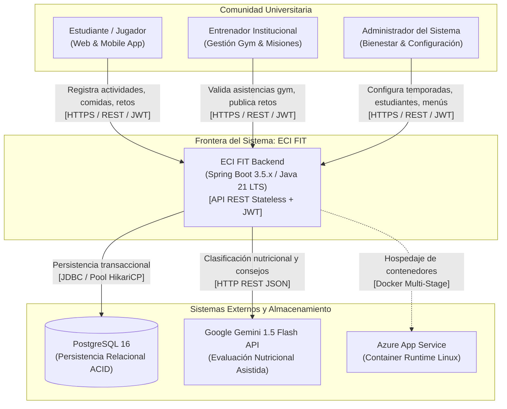
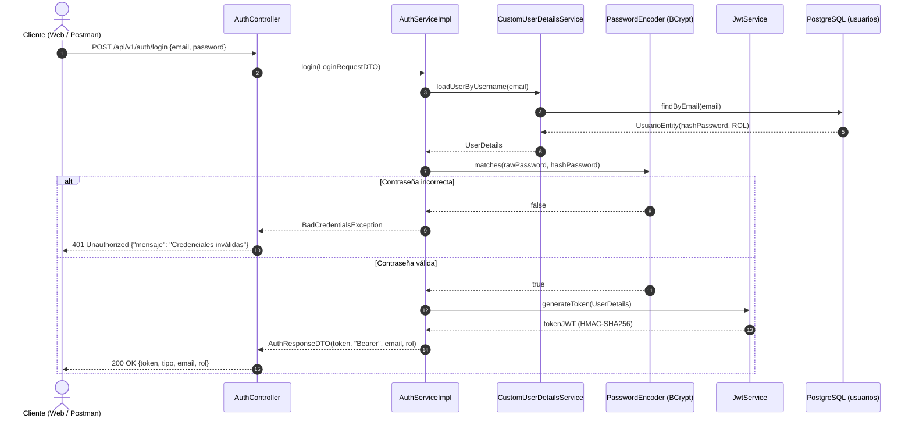
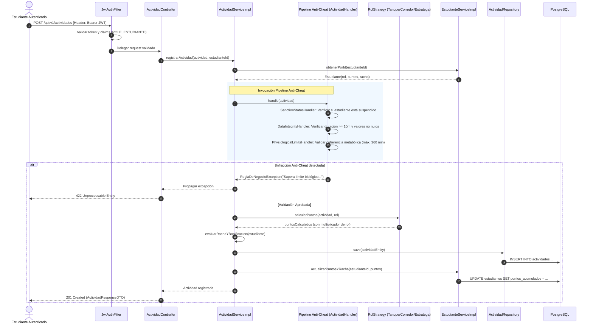
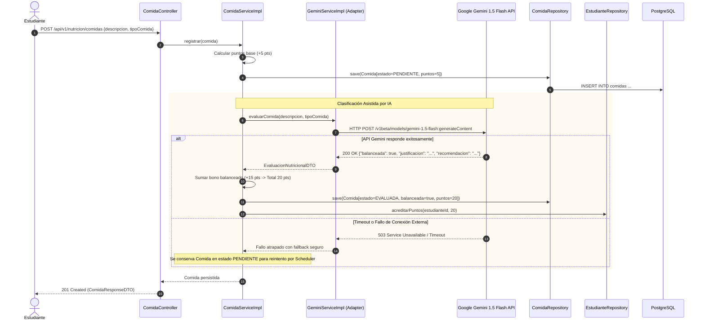
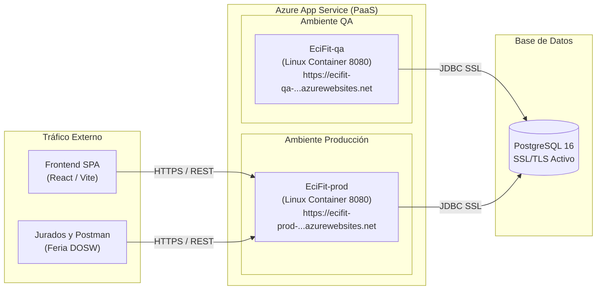

# ECI FIT Backend – Documento de Arquitectura de Alto Nivel (HLD)

---

## 1. Descripción del Servicio y Diagrama de Contexto

### 1.1 Propósito y Alcance del Sistema
**ECI FIT Backend** es el núcleo de cómputo, reglas de negocio y orquestación de la plataforma institucional de gamificación deportiva y bienestar para la **Escuela Colombiana de Ingeniería Julio Garavito**. El sistema combate el sedentarismo universitario convirtiendo el entrenamiento físico, la constancia de hábitos y la nutrición balanceada en una experiencia competitiva inspirada en juegos de rol (RPG) y batallas de campus.

Sus responsabilidades esenciales abarcan:
1. **Gestión de Personajes y Progresión:** Creación de atletas institucionales bajo arquetipos de juego (*Tanque*, *Corredor*, *Estratega*) y trazabilidad de estadísticas.
2. **Pipeline Anti-Fraude de Actividades:** Validación fisiológica estricta y blindaje contra registros ficticios mediante el patrón *Chain of Responsibility*.
3. **Misiones Gamificadas:** Generación desacoplada de objetivos diarios y semanales mediante *Factory Method*.
4. **Guerras de Clanes y Asedios:** Gestión de clanes (límite estricto de 5 miembros), defensa reactiva de la torre (*Observer*), publicación de retos colectivos (**RF-34**) y resolución de duelos entre clanes (**RF-36**).
5. **Ciclo de Ligas y Temporadas:** Control de calendario académico (*State*) y recálculo semanal de ascensos y descensos (*Bronce*, *Plata*, *Oro*, *Diamante*).
6. **Nutrición Asistida por Inteligencia Artificial (RF-12, RF-13, RF-14):** Evaluación dietética automática y consejos nutricionales conectando de forma resiliente con Google Gemini 1.5 Flash.
7. **Menú del Comedor Institucional (RF-15):** Exposición del menú saludable diario publicado por bienestar universitario.
8. **Asistencia Verificada al Gimnasio (RF-42):** Registro presencial validado exclusivamente por entrenadores institucionales.
9. **Seguridad Stateless y RBAC:** Protección perimetral con tokens JWT y control de acceso basado en roles (*Estudiante*, *Entrenador*, *Administrador*).

### 1.2 Diagrama de Contexto del Sistema (C4 Nivel 1)

El siguiente diagrama delimita las fronteras del backend con los actores del campus y los subsistemas externos:



---

## 2. Tecnologías a Usar

La selección tecnológica prioriza componentes LTS con soporte corporativo, compatibilidad nativa con contenedores y bajo consumo de recursos en Azure:

| Tecnología | Versión | Rol Arquitectónico | Justificación Técnica de Selección |
|---|---|---|---|
| **Java** | 21 LTS | Lenguaje de desarrollo backend | Aprovechamiento de Records (DTOs inmutables), Pattern Matching en switch, colecciones secuenciadas y soporte nativo para Virtual Threads. |
| **Spring Boot** | 3.5.16 | Framework de infraestructura | Estándar de la industria; contenedor IoC/DI, soporte transaccional `@Transactional`, integración de properties dinámicas y métricas. |
| **Spring Security** | 6.x | Perímetro de seguridad y RBAC | Control de acceso declarativo en controladores mediante `@PreAuthorize`, filtros en cadena sin estado (*Stateless*) y codificación BCrypt. |
| **Spring Data JPA** | 3.5.x | Abstracción de persistencia relacional | Implementación ORM sobre Hibernate; consultas optimizadas mediante JPQL y métodos derivados para auditoría de integridad. |
| **PostgreSQL** | 16 | Motor de base de datos relacional | Cumplimiento estricto de propiedades ACID, soporte nativo de tipos temporales ISO-8601, índices compuestos únicos y transacciones concurrentes. |
| **Google Gemini API** | 1.5 Flash | Inteligencia Artificial generativa | Clasificación dietética de alta velocidad, bajo costo y estructuración JSON para validación de comidas balanceadas. |
| **JJWT (io.jsonwebtoken)** | 0.12.3 | Generación y validación de tokens | Creación y firma criptográfica HMAC-SHA256 de JSON Web Tokens con validación estricta de claims y tiempos de expiración. |
| **MapStruct** | 1.6.3 | Mapeo entre capas de datos | Transformación tipo-segura en tiempo de compilación entre DTOs, Entidades de Dominio y Entidades JPA con costo de reflexión cero (*Zero-Overhead*). |
| **Lombok** | 1.18.48 | Reducción de código repetitivo | Generación automática de Getters, Setters, Builders inmutables y trazabilidad de logs estructurados con `@Slf4j`. |
| **Springdoc OpenAPI** | 2.8.17 | Documentación viva y contratos Swagger | Generación automatizada de OpenAPI 3.0 mediante interfaces desacopladas (`*Api.java`) y UI interactiva en `/swagger-ui.html`. |
| **JUnit 5 & Mockito** | 5.10 / 5.11 | Pruebas unitarias y de integración | Validación de lógica pura con patrón AAA (*Arrange, Act, Assert*), aislamiento de servicios con `@MockitoBean` y pruebas MVC con `MockMvc`. |
| **JaCoCo** | 0.8.15 | Medición de cobertura de pruebas | Auditoría automatizada de cobertura de instrucciones y ramas durante el ciclo de empaquetado Maven, exigiendo umbral mínimo del 80%. |
| **Docker** | Multi-Stage | Empaquetamiento y aislamiento | Construcción liviana en dos etapas (`build` y `runtime` con JRE Alpine) reduciendo la imagen a menos de 180 MB y eliminando vulnerabilidades. |
| **GitHub Actions** | — | Automatización CI/CD | Orquestación de pipelines automatizados de calidad, ejecución de pruebas, auditoría JaCoCo y despliegue continuo a Azure. |
| **Azure App Service** | Linux PaaS | Entorno de ejecución en la nube | Plataforma administrada de alta disponibilidad con monitoreo integrado, gestión de probes de health check y soporte de variables secretas. |

---

## 3. Funcionalidades y Matriz de Trazabilidad (RF-01 a RF-42)

Alineación formal entre el catálogo de requerimientos funcionales del proyecto y su implementación real en el código fuente:

| RF | Requisito Funcional | Módulo Resolutor | Endpoint / Componente | Estado Real |
|:---:|---|---|---|:---:|
| **RF-01** | Iniciar sesión con correo institucional | Autenticación | `POST /api/v1/auth/login` | **Implementado** |
| **RF-02** | Crear personaje de estudiante y consultar perfil | Estudiantes | `POST /api/v1/estudiantes`<br>`GET /api/v1/estudiantes/{id}`<br>`GET /api/v1/estudiantes` | **Implementado** |
| **RF-03** | Elegir rol arquetípico (Tanque, Corredor, Estratega) | Estudiantes | `CrearEstudianteRequestDTO.rol` | **Implementado** |
| **RF-04** | Aplicar bonificación de puntos según rol | Actividades | `ActividadServiceImpl` / `RolStrategy` | **Implementado** |
| **RF-05** | Actualizar estadísticas base del personaje | Estudiantes | `Estudiante.puntosAcumulados` | **Implementado** |
| **RF-06** | Registrar sesión de entrenamiento de fuerza | Actividades | `POST /api/v1/actividades` (`FUERZA`) | **Implementado** |
| **RF-07** | Registrar actividad cardiovascular | Actividades | `POST /api/v1/actividades` (`CARDIO`) | **Implementado** |
| **RF-08** | Registrar sesión de movilidad y flexibilidad | Actividades | `POST /api/v1/actividades` (`FLEXIBILIDAD`) | **Implementado** |
| **RF-09** | Validar duración mínima fisiológica (10 min) | Anti-Cheat | `DataIntegrityHandler` / `ActividadValidator` | **Implementado** |
| **RF-10** | Otorgar puntos ponderados por actividad válida | Actividades | `ActividadResponseDTO.puntosOtorgados` | **Implementado** |
| **RF-11** | Otorgar puntos extra por ir al gimnasio | Asistencia Gimnasio | `POST /api/v1/gimnasio/asistencias` (+20 pts) | **Implementado** |
| **RF-12** | Registrar comida consumida en cafetería | Nutrición | `POST /api/v1/nutricion/comidas` | **Implementado** |
| **RF-13** | Clasificar comida balanceada con IA (Gemini) | Nutrición / IA | `GeminiEvaluadorNutricional` / `ComidaService` | **Implementado** |
| **RF-14** | Otorgar puntos por registro nutricional | Nutrición | `ComidaServiceImpl` (+5 base, +15 balanceada) | **Implementado** |
| **RF-15** | Consultar menú del comedor institucional | Comedor | `GET /api/v1/comedor/menus/hoy`<br>`GET /api/v1/comedor/menus` | **Implementado** |
| **RF-16** | Generar misiones diarias dinámicas | Misiones | `POST /api/v1/misiones/diarias` (Factory) | **Implementado** |
| **RF-17** | Generar misiones semanales dinámicas | Misiones | `POST /api/v1/misiones/semanales` (Factory) | **Implementado** |
| **RF-18** | Registrar cumplimiento de misión | Misiones | `POST /api/v1/misiones/{id}/completar` | **Implementado** |
| **RF-19** | Otorgar puntos por misión completada | Misiones | `MisionServiceImpl.completarMision` | **Implementado** |
| **RF-20** | Calcular racha consecutiva de actividad física | Actividades | `ActividadServiceImpl.calcularRacha` | **Implementado** |
| **RF-21** | Otorgar bonificación por racha de 7 días | Actividades | `ActividadServiceImpl.evaluarBonoRacha` (+100 pts) | **Implementado** |
| **RF-22** | Crear temporada académica semestral | Temporadas | `POST /api/v1/temporadas` | **Implementado** |
| **RF-23** | Acumular puntos del estudiante a la temporada | Temporadas | `TemporadaServiceImpl.recalcularLigas` | **Parcial** |
| **RF-24** | Clasificar estudiante en liga inicial | Temporadas | `RankingTemporadaEntity.ligaActual` | **Implementado** |
| **RF-25** | Recalcular ligas periódicamente (corte semanal) | Scheduler | `TemporadaServiceImpl.recalcularLigas` | **Implementado** |
| **RF-26** | Promover de liga por alto rendimiento | Temporadas | `Temporada.determinarLiga` | **Implementado** |
| **RF-27** | Degradar de liga por inactividad | Temporadas | `Temporada.determinarLiga` | **Implementado** |
| **RF-28** | Consultar tabla de clasificación (Ranking) | Temporadas | `GET /api/v1/temporadas/{id}/ranking` | **Implementado** |
| **RF-29** | Crear clan de estudiantes | Clanes | `POST /api/v1/clanes` | **Implementado** |
| **RF-30** | Invitar estudiante a un clan | Clanes | — | *Limitación Conocida* |
| **RF-31** | Aceptar o declinar invitación a clan | Clanes | `POST /api/v1/clanes/unirse` | **Parcial** |
| **RF-32** | Restringir membresía a máximo 5 integrantes | Clanes | `ClanValidator.validarCupoDisponible` | **Implementado** |
| **RF-33** | Abandonar un clan voluntariamente | Clanes | `POST /api/v1/clanes/abandonar` | **Implementado** |
| **RF-34** | Publicar reto colectivo semanal para clanes | Clanes / Retos | `POST /api/v1/clanes/retos` | **Implementado** |
| **RF-35** | Acumular progreso colectivo del clan | Clanes / Retos | `RetoClan.evaluarSuperacion` | **Implementado** |
| **RF-36** | Calcular resultado del reto entre clanes / duelos | Clanes / Retos | `POST /api/v1/clanes/{id}/retos/{rId}/calcular`<br>`POST /api/v1/clanes/retos/comparar-duelo` | **Implementado** |
| **RF-37** | Consultar resultados y retos de clanes | Clanes / Retos | `GET /api/v1/clanes/{clanId}/retos` | **Implementado** |
| **RF-38** | Subir o bajar de nivel a un clan | Clanes | — | *Limitación Conocida* |
| **RF-39** | Reportar aforo y ocupación del gimnasio | Gimnasio IoT | — | *Limitación Conocida* |
| **RF-40** | Consultar estado de aforo en tiempo real | Gimnasio IoT | — | *Limitación Conocida* |
| **RF-41** | Visualizar mapa térmico de ocupación | Gimnasio IoT | — | *Limitación Conocida* |
| **RF-42** | Confirmar asistencia al gimnasio por entrenador | Asistencia Gimnasio | `POST /api/v1/gimnasio/asistencias` | **Implementado** |

> **Consolidado Oficial de Alcance:**
> - **Completamente Implementados:** 30 requerimientos.
> - **Implementación Parcial:** 2 requerimientos (RF-23 acumulación asíncrona, RF-31 adhesión directa sin buzón de invitaciones).
> - **Limitaciones Declaradas:** 10 requerimientos (asociados a hardware IoT de aforo, nivel de clanes y sistema de mensajería).

---

## 4. Diagramas Arquitectónicos

> [!IMPORTANT]
> **Estándar de Calidad Gráfica para Feria y Auditoría:**
> Los diagramas estructurales del sistema han sido elaborados en draw.io y Lucidchart bajo la paleta institucional de DOSW, fondo blanco puro `#FFFFFF`, tipografía sin serifa legible y exportados en resolución vectorial SVG o PNG de alta densidad (2x).

### 4.1 Modelo Entidad-Relación de Base de Datos (ERD)
Representación de las 11 tablas en PostgreSQL 16 normalizadas en Tercera Forma Normal (3FN), con tipos de datos, llaves primarias y foráneas:


#### Tablas y Restricciones Principales:
- `usuarios`: `id` (PK, UUID/VARCHAR), `email` (UNIQUE), `password` (BCrypt Hash), `rol` (VARCHAR), `activo` (BOOLEAN).
- `estudiantes`: `id` (PK, VARCHAR), `nombre` (VARCHAR), `correo_institucional` (UNIQUE), `rol_activo` (VARCHAR), `puntos_acumulados` (INT), `clan_id` (FK nullable hacia `clanes.id`).
- `clanes`: `id` (PK, VARCHAR), `nombre` (UNIQUE), `salud_torre` (INT), `puntos_totales` (INT), `lider_id` (VARCHAR).
- `retos_clan`: `id` (PK, VARCHAR), `clan_id` (FK hacia `clanes.id`), `descripcion` (VARCHAR), `objetivo_puntos` (INT), `progreso_actual` (INT), `recompensa` (INT), `fecha_inicio` (DATE), `fecha_fin` (DATE), `completado` (BOOLEAN).
- `actividades`: `id` (PK, VARCHAR), `estudiante_id` (FK hacia `estudiantes.id`), `tipo` (VARCHAR), `duracion_minutos` (INT), `intensidad` (INT), `puntos_otorgados` (INT), `fecha` (TIMESTAMP).
- `comidas`: `id` (PK, VARCHAR), `estudiante_id` (FK hacia `estudiantes.id`), `descripcion` (VARCHAR), `tipo_comida` (VARCHAR), `fecha_hora` (TIMESTAMP), `estado_evaluacion` (VARCHAR), `balanceada` (BOOLEAN), `justificacion_ia` (TEXT), `recomendacion_ia` (TEXT), `puntos_otorgados` (INT).
- `menus_comedor`: `id` (PK, VARCHAR), `fecha` (DATE), `tipo_comida` (VARCHAR).
- `platos_menu`: `id` (PK, VARCHAR), `menu_id` (FK hacia `menus_comedor.id`), `nombre` (VARCHAR), `categoria` (VARCHAR), `calorias_aproximadas` (INT).
- `misiones`: `id` (PK, VARCHAR), `estudiante_id` (FK hacia `estudiantes.id`), `descripcion` (VARCHAR), `recompensa` (INT), `tipo` (VARCHAR), `completada` (BOOLEAN).
- `temporadas`: `id` (PK, UUID), `nombre` (VARCHAR), `fecha_inicio` (DATE), `fecha_fin` (DATE), `estado_activo` (BOOLEAN).
- `rankings_temporada`: `id` (PK, UUID), `temporada_id` (FK), `estudiante_id` (FK), `puntos_acumulados` (INT), `liga_actual` (VARCHAR). Restricción `UNIQUE(temporada_id, estudiante_id)`.
- `asistencias_gym`: `id` (PK, VARCHAR), `estudiante_id` (FK), `entrenador_id` (VARCHAR), `fecha` (DATE). Restricción `UNIQUE(estudiante_id, fecha)`.

---

### 4.2 Diagrama de Clases del Dominio
Modelo orientado a dominio puro (DDD) libre de anotaciones de frameworks o persistencia:


---

### 4.3 Diagrama de Componentes General (Arquitectura en Capas)
Flujo de dependencias desacoplado y unidireccional:


---

### 4.4 Diagrama de Componentes Específico (Servicios, Mappers y Anti-Cheat)
Desacoplamiento entre interfaces de controlador, adaptadores de IA, cadena de validación y repositorios:


---

## 5. Funcionalidades Expuestas (Catálogo Exhaustivo de Endpoints REST)

Cada endpoint está asegurado con Spring Security. Las peticiones autenticadas exigen:  
`Authorization: Bearer <token_jwt>`

### 5.1 Módulo de Autenticación (`/api/v1/auth`)

#### `POST /api/v1/auth/login`
- **Autorización:** Público (PermitAll).
- **Descripción:** Autentica credenciales institucionales y expide token JWT firmado con HMAC-SHA256 (validez 24 horas).
- **Request Body (`LoginRequestDTO`):**
  | Campo | Tipo | Obligatorio | Restricciones | Descripción |
  |---|---|:---:|---|---|
  | `email` | String | Sí | Formato email `@mail.escuelaing.edu.co` | Correo institucional del usuario |
  | `password` | String | Sí | No vacío | Contraseña en texto plano |
- **Response Exitosa (`AuthResponseDTO` - 200 OK):**
  ```json
  {
    "token": "eyJhbGciOiJIUzI1NiIsInR5cCI6IkpXVCJ9...",
    "tipo": "Bearer",
    "email": "estudiante@mail.escuelaing.edu.co",
    "rol": "ROLE_ESTUDIANTE"
  }
  ```
- **Errores:** 400 (Bad Request), 401 (Credenciales inválidas).

---

### 5.2 Módulo de Estudiantes (`/api/v1/estudiantes`)

#### `POST /api/v1/estudiantes`
- **Autorización:** `@PreAuthorize("hasRole('ADMINISTRADOR')")`.
- **Descripción:** Registra un nuevo personaje de estudiante en la plataforma.
- **Request Body (`CrearEstudianteRequestDTO`):**
  | Campo | Tipo | Obligatorio | Restricciones | Descripción |
  |---|---|:---:|---|---|
  | `nombre` | String | Sí | 3 a 100 caracteres | Nombre completo del estudiante |
  | `correoInstitucional` | String | Sí | Regex institucional ECI | Correo único institucional |
  | `rol` | String | Sí | Valores: `TANQUE`, `CORREDOR`, `ESTRATEGA` | Arquetipo competitivo inicial |
- **Response Exitosa (`EstudianteResponseDTO` - 201 Created):**
  ```json
  {
    "id": "EST-01",
    "nombre": "Laura Torres",
    "correoInstitucional": "laura.torres@mail.escuelaing.edu.co",
    "rolActivo": "TANQUE",
    "puntosAcumulados": 0,
    "clanId": null
  }
  ```
- **Errores:** 400, 401, 403, 409 (Correo duplicado), 422 (Rol inválido).

#### `GET /api/v1/estudiantes/{id}`
- **Autorización:** `@PreAuthorize("hasAnyRole('ESTUDIANTE', 'ENTRENADOR', 'ADMINISTRADOR')")`.
- **Response:** `EstudianteResponseDTO` (200 OK).

#### `GET /api/v1/estudiantes`
- **Autorización:** `@PreAuthorize("hasAnyRole('ADMINISTRADOR', 'ENTRENADOR')")`.
- **Descripción:** Colección completa de estudiantes registrados para control administrativo.
- **Response:** `List<EstudianteResponseDTO>` (200 OK).

---

### 5.3 Módulo de Actividades Físicas (`/api/v1/actividades`)

#### `POST /api/v1/actividades`
- **Autorización:** `@PreAuthorize("hasRole('ESTUDIANTE')")`.
- **Descripción:** Procesa e ingesta una sesión deportiva atravesando el pipeline anti-cheat.
- **Request Body (`RegistrarActividadRequestDTO`):**
  | Campo | Tipo | Obligatorio | Restricciones | Descripción |
  |---|---|:---:|---|---|
  | `estudianteId` | String | Sí | No nulo ni vacío | Identificador del estudiante |
  | `tipo` | String | Sí | Enum: `FUERZA`, `CARDIO`, `FLEXIBILIDAD` | Categoría deportiva |
  | `duracionMinutos` | Integer | Sí | Rango [10, 360] | Duración de la sesión en minutos |
  | `intensidad` | Integer | Sí | Rango [1, 10] | Escala de esfuerzo percibido |
- **Response Exitosa (`ActividadResponseDTO` - 201 Created):**
  ```json
  {
    "id": "ACT-DEMO-01",
    "estudianteId": "EST-01",
    "tipo": "CARDIO",
    "duracionMinutos": 30,
    "intensidad": 8,
    "puntosOtorgados": 336,
    "fecha": "2026-10-18T10:30:00"
  }
  ```
- **Errores:** 400, 401, 403, 404, 422 (Infracción de pipeline anti-cheat o sanción activa).

#### `GET /api/v1/actividades/estudiante/{estudianteId}`
- **Autorización:** `@PreAuthorize("hasAnyRole('ESTUDIANTE', 'ENTRENADOR', 'ADMINISTRADOR')")`.
- **Response:** `List<ActividadResponseDTO>` (200 OK).

---

### 5.4 Módulo de Clanes y Retos (`/api/v1/clanes`)

#### `POST /api/v1/clanes`
- **Autorización:** `@PreAuthorize("hasAnyRole('ESTUDIANTE', 'ADMINISTRADOR')")`.
- **Request Body (`CrearClanRequestDTO`):**
  | Campo | Tipo | Obligatorio | Restricciones | Descripción |
  |---|---|:---:|---|---|
  | `nombre` | String | Sí | 3 a 50 caracteres | Nombre único del clan |
  | `liderId` | String | Sí | No vacío | ID del estudiante fundador |
- **Response Exitosa (`ClanResponseDTO` - 201 Created):**
  ```json
  {
    "id": "CLAN-01",
    "nombre": "Guerreros ECI",
    "saludTorre": 5000,
    "puntosTotales": 0,
    "miembrosIds": ["EST-01"],
    "liderId": "EST-01"
  }
  ```

#### `POST /api/v1/clanes/unirse`
- **Autorización:** `@PreAuthorize("hasRole('ESTUDIANTE')")`.
- **Request Body (`UnirseClanRequestDTO`):** `clanId` (String), `estudianteId` (String).
- **Response:** `ClanResponseDTO` (200 OK).
- **Errores:** 404, 409 (Estudiante ya tiene clan), 422 (Clan lleno, máx. 5 miembros).

#### `POST /api/v1/clanes/abandonar` (RF-33)
- **Autorización:** `@PreAuthorize("hasRole('ESTUDIANTE')")`.
- **Request Body (`AbandonarClanRequestDTO`):** `clanId` (String), `estudianteId` (String).
- **Descripción:** Desvincula al estudiante del clan; si era el líder, promueve automáticamente al siguiente miembro más antiguo. Si era el único miembro, disuelve el clan.
- **Response:** `ClanResponseDTO` (200 OK).

#### `GET /api/v1/clanes` y `GET /api/v1/clanes/{id}`
- **Autorización:** `@PreAuthorize("hasAnyRole('ESTUDIANTE', 'ENTRENADOR', 'ADMINISTRADOR')")`.
- **Response:** `List<ClanResponseDTO>` / `ClanResponseDTO` (200 OK).

#### `POST /api/v1/clanes/retos` (RF-34)
- **Autorización:** `@PreAuthorize("hasAnyRole('ENTRENADOR', 'ADMINISTRADOR')")`.
- **Descripción:** Publica un reto semanal colectivo asignado a un clan específico.
- **Request Body (`PublicarRetoClanRequestDTO`):**
  | Campo | Tipo | Obligatorio | Restricciones | Descripción |
  |---|---|:---:|---|---|
  | `clanId` | String | Sí | No vacío | Identificador del clan participante |
  | `descripcion` | String | Sí | 5 a 200 caracteres | Objetivo del reto semanal |
  | `objetivoPuntos` | Integer | Sí | > 0 | Meta colectiva de puntos |
  | `recompensa` | Integer | Sí | > 0 | Puntos extra asignables si se supera |
  | `fechaInicio` | LocalDate | Sí | Formato `AAAA-MM-DD` | Inicio de vigencia |
  | `fechaFin` | LocalDate | Sí | Posterior a fechaInicio | Fin de vigencia |
- **Response Exitosa (`RetoClanResponseDTO` - 201 Created):**
  ```json
  {
    "id": "RETO-01",
    "clanId": "CLAN-01",
    "descripcion": "Acumular 600 puntos colectivos en fuerza",
    "objetivoPuntos": 600,
    "progresoActual": 0,
    "recompensa": 200,
    "fechaInicio": "2026-10-18",
    "fechaFin": "2026-10-25",
    "completado": false
  }
  ```

#### `POST /api/v1/clanes/{clanId}/retos/{retoId}/calcular` (RF-36)
- **Autorización:** `@PreAuthorize("hasAnyRole('ENTRENADOR', 'ADMINISTRADOR')")`.
- **Descripción:** Evalúa si el progreso colectivo del clan superó el objetivo del reto y acredita la recompensa atómicamente.
- **Response:** `RetoClanResponseDTO` (200 OK).

#### `POST /api/v1/clanes/retos/comparar-duelo` (RF-36)
- **Autorización:** `@PreAuthorize("hasAnyRole('ENTRENADOR', 'ADMINISTRADOR')")`.
- **Descripción:** Compara el rendimiento y puntos entre dos clanes rivales en un duelo semanal y adjudica bonificación al clan vencedor.
- **Request Body (`CompararRetoClanesRequestDTO`):** `clanId1` (String), `clanId2` (String), `bonificacionVictoria` (Integer).
- **Response Exitosa (`ResultadoRetoClanesResponseDTO` - 200 OK):**
  ```json
  {
    "clanGanadorId": "CLAN-01",
    "clanPerdedorId": "CLAN-02",
    "puntosClan1": 770,
    "puntosClan2": 210,
    "diferenciaPuntos": 560,
    "bonificacionAdjudicada": 150,
    "empate": false
  }
  ```

#### `GET /api/v1/clanes/{clanId}/retos` (RF-37)
- **Autorización:** `@PreAuthorize("hasAnyRole('ESTUDIANTE', 'ENTRENADOR', 'ADMINISTRADOR')")`.
- **Response:** `List<RetoClanResponseDTO>` (200 OK).

---

### 5.5 Módulo de Nutrición e IA (`/api/v1/nutricion/comidas`)

#### `POST /api/v1/nutricion/comidas` (RF-12, RF-13, RF-14)
- **Autorización:** `@PreAuthorize("hasAnyRole('ESTUDIANTE', 'ADMINISTRADOR')")`.
- **Descripción:** Registra el plato consumido, otorga +5 puntos base y despacha la evaluación nutricional hacia Google Gemini. Si Gemini califica la comida como balanceada, suma +15 puntos adicionales.
- **Request Body (`RegistrarComidaRequestDTO`):**
  | Campo | Tipo | Obligatorio | Restricciones | Descripción |
  |---|---|:---:|---|---|
  | `estudianteId` | String | Sí | No vacío | ID del estudiante consumidor |
  | `descripcion` | String | Sí | 3 a 500 caracteres | Detalle de alimentos consumidos |
  | `tipoComida` | String | Sí | `DESAYUNO`, `MEDIA_MANANA`, `ALMUERZO`, `ONCES`, `CENA` | Tiempo de comida |
  | `fotoUrl` | String | No | Formato URL válido | Enlace opcional a foto del plato |
- **Response Exitosa (`ComidaResponseDTO` - 201 Created):**
  ```json
  {
    "id": "COM-01",
    "estudianteId": "EST-01",
    "descripcion": "Pechuga de pollo a la plancha con quinoa, ensalada verde y agua",
    "tipoComida": "ALMUERZO",
    "fechaHora": "2026-10-18T13:15:00",
    "estadoEvaluacion": "EVALUADA",
    "balanceada": true,
    "justificacionIa": "Excelente equilibrio de proteína magra, fibra vegetal y carbohidratos complejos.",
    "recomendacionIa": "Mantener adecuada hidratación post-almuerzo.",
    "puntosOtorgados": 20
  }
  ```

#### `POST /api/v1/nutricion/comidas/{id}/evaluar`
- **Autorización:** `@PreAuthorize("hasAnyRole('ESTUDIANTE', 'ADMINISTRADOR')")`.
- **Descripción:** Reintenta la clasificación con Gemini si la comida había quedado en estado `PENDIENTE`.
- **Response:** `ComidaResponseDTO` (200 OK).

#### `GET /api/v1/nutricion/comidas/estudiante/{estudianteId}`
- **Autorización:** `@PreAuthorize("hasAnyRole('ESTUDIANTE', 'ENTRENADOR', 'ADMINISTRADOR')")`.
- **Query Params:** `fecha` (opcional, formato `AAAA-MM-DD`).
- **Response:** `List<ComidaResponseDTO>` (200 OK).

---

### 5.6 Módulo del Comedor Institucional (`/api/v1/comedor/menus`)

#### `POST /api/v1/comedor/menus`
- **Autorización:** `@PreAuthorize("hasRole('ADMINISTRADOR')")`.
- **Request Body (`CrearMenuComedorRequestDTO`):** `fecha` (LocalDate), `tipoComida` (String), `platos` (`List<PlatoMenuDTO>`).
- **Response:** `MenuComedorResponseDTO` (201 Created).

#### `GET /api/v1/comedor/menus/hoy` (RF-15)
- **Autorización:** `@PreAuthorize("hasAnyRole('ESTUDIANTE', 'ENTRENADOR', 'ADMINISTRADOR')")`.
- **Response:** `List<MenuComedorResponseDTO>` (200 OK).

#### `GET /api/v1/comedor/menus`
- **Autorización:** `@PreAuthorize("hasAnyRole('ESTUDIANTE', 'ENTRENADOR', 'ADMINISTRADOR')")`.
- **Query Params:** `fecha` (opcional, `AAAA-MM-DD`).
- **Response:** `List<MenuComedorResponseDTO>` (200 OK).

---

### 5.7 Módulo de Misiones Gamificadas (`/api/v1/misiones`)

- `POST /api/v1/misiones/diarias` (`ENTRENADOR`, `ADMINISTRADOR`) $\rightarrow$ `MisionResponseDTO` (201).
- `POST /api/v1/misiones/semanales` (`ENTRENADOR`, `ADMINISTRADOR`) $\rightarrow$ `MisionResponseDTO` (201).
- `POST /api/v1/misiones/{id}/completar` (`ESTUDIANTE`, `ADMINISTRADOR`) $\rightarrow$ `MisionResponseDTO` (200).
- `GET /api/v1/misiones/estudiante/{estudianteId}` (`ESTUDIANTE`, `ENTRENADOR`, `ADMINISTRADOR`) $\rightarrow$ `List<MisionResponseDTO>` (200).

---

### 5.8 Módulo de Temporadas y Ligas (`/api/v1/temporadas`)

- `POST /api/v1/temporadas` (`ADMINISTRADOR`) $\rightarrow$ `TemporadaResponseDTO` (201).
- `GET /api/v1/temporadas/{id}` (`ESTUDIANTE`, `ENTRENADOR`, `ADMINISTRADOR`) $\rightarrow$ `TemporadaResponseDTO` (200).
- `GET /api/v1/temporadas/activa` (`ESTUDIANTE`, `ENTRENADOR`, `ADMINISTRADOR`) $\rightarrow$ `TemporadaResponseDTO` (200).
- `GET /api/v1/temporadas/{id}/ranking` (`ESTUDIANTE`, `ENTRENADOR`, `ADMINISTRADOR`) $\rightarrow$ `List<RankingTemporadaResponseDTO>` (200).

---

### 5.9 Módulo de Asistencia al Gimnasio (`/api/v1/gimnasio/asistencias`)

#### `POST /api/v1/gimnasio/asistencias` (RF-42)
- **Autorización:** `@PreAuthorize("hasAnyRole('ENTRENADOR', 'ADMINISTRADOR')")`.
- **Descripción:** Confirma asistencia física del estudiante en el gimnasio y acredita 20 puntos diarios de bonificación.
- **Request Body (`AsistenciaGymRequestDTO`):** `estudianteId` (String), `entrenadorId` (String).
- **Response:** `AsistenciaGymResponseDTO` (201 Created).
- **Errores:** 404 (Estudiante no existe), 409 (Asistencia ya registrada en la fecha actual).

---

### 5.10 Diagnóstico y Monitoreo Cloud (`/api/v1/health`)

#### `GET /api/v1/health`
- **Autorización:** Público (PermitAll).
- **Descripción:** Liveness y Readiness probe para Azure App Service y contenedores Docker.
- **Response:** Texto plano `"ECI FIT backend is running"` (200 OK).

---

## 6. Manejo Global de Errores

El sistema intercepta cualquier error mediante un `@RestControllerAdvice` centralizado ([`GlobalExceptionHandler.java`](file:///c:/Users/JuanM/Desktop/Code/DOSW/Project/ecifit-backend/src/main/java/co/edu/eci/dosw/ecifit/exception/GlobalExceptionHandler.java)), garantizando que el cliente reciba siempre un contrato uniforme sin exponer volcados de pila (*stack traces*):

### 6.1 Estructura Estándar de Error (`ErrorResponseDTO`)

```json
{
  "codigo": 409,
  "mensaje": "El estudiante ya pertenece a un clan activo",
  "ruta": "/api/v1/clanes/unirse"
}
```

### 6.2 Matriz Formal de Excepciones del Sistema

| Código HTTP | Nombre HTTP | Excepción Origen de Spring / Dominio | Causa de Negocio / Técnica | Mensaje Retornado al Cliente |
|:---:|---|---|---|---|
| **400** | Bad Request | `MethodArgumentNotValidException` | Fallo de validación sintáctica `@Valid` en DTO de entrada | `"campo: mensaje de restricción fallida"` |
| **400** | Bad Request | `HttpMessageNotReadableException`, `MethodArgumentTypeMismatchException` | Payload JSON malformado o incompatibilidad de tipos | `"La solicitud tiene un formato inválido"` |
| **401** | Unauthorized | `BadCredentialsException`, `InternalAuthenticationServiceException` | Credenciales inválidas o token expirado/alterado | `"Credenciales inválidas"` |
| **403** | Forbidden | `AccessDeniedException` | Token válido con rol insuficiente en `@PreAuthorize` | `"Acceso denegado: permisos insuficientes"` |
| **404** | Not Found | `RecursoNoEncontradoException`, `NoResourceFoundException` | Identificador no encontrado en la base de datos | `"No se encontró el recurso solicitado: <detalle>"` |
| **409** | Conflict | `ConflictoException` | Violación de restricciones de unicidad (correo, nombre de clan, asistencia duplicada) | `"Ya existe un registro con esos datos: <detalle>"` |
| **422** | Unprocessable Entity | `ReglaDeNegocioException`, `EstadoInvalidoException` | Infracción de límites de juego o pipeline anti-cheat | Mensaje explícito de la regla violada |
| **500** | Internal Server Error | `Exception.class` | Falla imprevista no capturada en tiempo de ejecución | `"Error interno del servidor"` *(Stack trace confinado en log del servidor)* |

---

## 7. Diagramas de Secuencia de Flujos Clave

### 7.1 Flujo A: Autenticación, Firma de Token JWT y Control Perimetral



---

### 7.2 Flujo B: Registro de Actividad Física con Pipeline Anti-Cheat (*Chain of Responsibility*)



---

### 7.3 Flujo C: Registro y Evaluación Nutricional Asistida por IA (*Google Gemini*)



---

## 8. Despliegue y Seguridad

### 8.1 Topología en Azure Cloud y Entornos

El sistema opera bajo una arquitectura de contenedores Docker en Azure App Service (Linux B1):



### 8.2 URLs Oficiales de Producción y QA
- **Swagger UI Producción:** https://ecifit-prod-e9fafke4eyebbxh2.canadacentral-01.azurewebsites.net/swagger-ui/index.html
- **API Base Producción:** https://ecifit-prod-e9fafke4eyebbxh2.canadacentral-01.azurewebsites.net/api/v1
- **Health Check Probe:** https://ecifit-prod-e9fafke4eyebbxh2.canadacentral-01.azurewebsites.net/api/v1/health
- **Swagger UI QA:** https://ecifit-qa-bxhdd4a0dkc4bma0.canadacentral-01.azurewebsites.net/swagger-ui/index.html

### 8.3 Estrategia de Ramificación (Git Flow) y CI/CD
- `main`: Refleja el código en Producción. Cada release se marca con un tag semántico `vX.Y.Z` que dispara el workflow `.github/workflows/ci-prod.yml`.
- `develop`: Rama troncal de integración de características. Cada push dispara `.github/workflows/ci-qa.yml` ejecutando `mvn clean verify` antes del despliegue.
- `feature/*`: Ramas de desarrollo temporal con merges vía Pull Request y revisión obligatoria.

---

## 9. Limitaciones Conocidas (Deuda Técnica Declarada)

En estricto cumplimiento de la **Regla 3 de Deuda Técnica** del Sprint 4, el equipo declara con transparencia técnica los elementos de alcance diferidos para versiones posteriores:

1. **Telemetría y Mapas Térmicos de Ocupación del Gimnasio (RF-39, RF-40, RF-41):**
   - *Impacto:* El aforo en tiempo real y mapa de calor requieren sensores físicos de torniquete e infraestructura IoT que no formaron parte del alcance de software del MVP.
   - *Solución Futura:* Integración de un broker MQTT / WebSockets y persistencia temporal en Redis para transmitir conteo de presencia sin sobrecargar PostgreSQL.
2. **Sistema Asíncrono de Invitaciones a Clanes (RF-30, RF-31):**
   - *Impacto:* Los estudiantes se adhieren directamente a clanes con cupo disponible (`/api/v1/clanes/unirse`) en lugar de pasar por un buzón formal de invitaciones pendientes.
   - *Solución Futura:* Creación de la entidad `InvitacionClan` con estados `PENDIENTE`, `ACEPTADA`, `RECHAZADA` y vencimiento temporal a los 3 días.
3. **Escalamiento de Nivel de Clanes (RF-38):**
   - *Impacto:* Los clanes acumulan puntos colectivos y salud de torre, pero no poseen un árbol de habilidades o niveles desbloqueables.
   - *Solución Futura:* Extensión del modelo `Clan` con experiencia acumulada y multiplicadores grupales de defensa de torre.

---

## 10. Bibliografía y Justificación de Patrones GoF

### 10.1 Tabla de Patrones GoF y Arquitectónicos Implementados en el Código Real

| Patrón GoF | Tipo | Clase / Paquete Concreto | Problema que Resuelve en ECI FIT |
|---|---|---|---|
| **Chain of Responsibility** | Comportamiento | `ActividadHandler`, `SanctionStatusHandler`, `DataIntegrityHandler`, `PhysiologicalLimitsHandler` ([`co.edu.eci.dosw.ecifit.model.chain`](file:///c:/Users/JuanM/Desktop/Code/DOSW/Project/ecifit-backend/src/main/java/co/edu/eci/dosw/ecifit/model/chain)) | Pipeline desacoplado de anti-cheat para ingesta deportiva. Permite inyectar nuevas validaciones biológicas o de fraude sin alterar el servicio principal. |
| **Strategy** | Comportamiento | `RolStrategy`, `Tanque`, `Corredor`, `Estratega` ([`co.edu.eci.dosw.ecifit.model.strategy`](file:///c:/Users/JuanM/Desktop/Code/DOSW/Project/ecifit-backend/src/main/java/co/edu/eci/dosw/ecifit/model/strategy)) | Cálculo dinámico de bonificaciones de experiencia según arquetipo deportivo, eliminando condicionales `if-else` o `switch` dispersos (Principio OCP). |
| **Observer** | Comportamiento | `TorreClan`, `GestorLigas`, `ActividadObserver` ([`co.edu.eci.dosw.ecifit.model.observer`](file:///c:/Users/JuanM/Desktop/Code/DOSW/Project/ecifit-backend/src/main/java/co/edu/eci/dosw/ecifit/model/observer)) | Notificación reactiva ante entrenamientos válidos para actualizar daño en la torre rival y recálculo de posición en ligas de forma desacoplada. |
| **State** | Comportamiento | `EstadoTemporada`, `SemanaRegular`, `SemanaParciales` ([`co.edu.eci.dosw.ecifit.model.state`](file:///c:/Users/JuanM/Desktop/Code/DOSW/Project/ecifit-backend/src/main/java/co/edu/eci/dosw/ecifit/model/state)) | Transición de reglas de juego según el calendario semestral (en semana de parciales se congela el ataque a torres y se flexibiliza el bono de constancia). |
| **Abstract Factory / Factory Method** | Creacional | `FabricaMisiones`, `FabricaMisionesEstandar`, `MisionDiaria`, `MisionSemanal` ([`co.edu.eci.dosw.ecifit.model.factory`](file:///c:/Users/JuanM/Desktop/Code/DOSW/Project/ecifit-backend/src/main/java/co/edu/eci/dosw/ecifit/model/factory)) | Creación encapsulada de familias coherentes de misiones (diarias vs. semanales) desacoplando al servicio de la lógica de instanciación con `new`. |
| **Adapter** | Estructural | `GeminiServiceImpl`, `IEvaluadorNutricional` ([`co.edu.eci.dosw.ecifit.service.ia`](file:///c:/Users/JuanM/Desktop/Code/DOSW/Project/ecifit-backend/src/main/java/co/edu/eci/dosw/ecifit/service/ia)) | Aísla la API REST externa de Google Gemini 1.5 Flash detrás de un contrato interno del dominio, permitiendo sustituir el proveedor de IA sin impacto. |
| **Data Transfer Object (DTO)** | Arquitectónico | Paquetes `dto.request` y `dto.response` con records inmutables | Oculta la estructura relacional JPA, previene sobreexposición de datos y elimina recursión en serialización Jackson. |

### 10.2 Referencias Bibliográficas
1. Gamma, E., Helm, R., Johnson, R., & Vlissides, J. (1994). *Design Patterns: Elements of Reusable Object-Oriented Software*. Addison-Wesley.
2. Evans, E. (2003). *Domain-Driven Design: Tackling Complexity in the Heart of Software*. Addison-Wesley Professional.
3. Walls, C. (2022). *Spring in Action* (6th ed.). Manning Publications.
4. Martin, R. C. (2017). *Clean Architecture: A Craftsman's Guide to Software Structure and Design*. Prentice Hall.
5. Freeman, E., & Robson, E. (2020). *Head First Design Patterns* (2nd ed.). O'Reilly Media.
6. Documentation Oficial de Spring Framework 6 y Spring Boot 3.5.x: https://docs.spring.io/spring-boot/
7. Guía Oficial de DOSW — Sprint 4: Cierre, Documentación, Marketing y Feria de Proyectos. Escuela Colombiana de Ingeniería Julio Garavito (2026).
