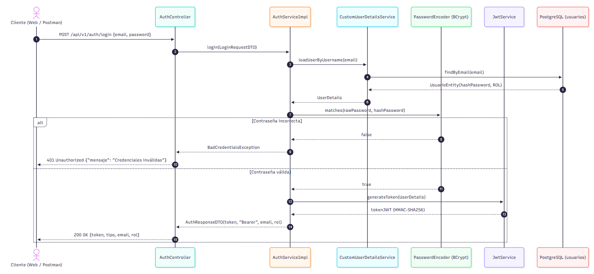
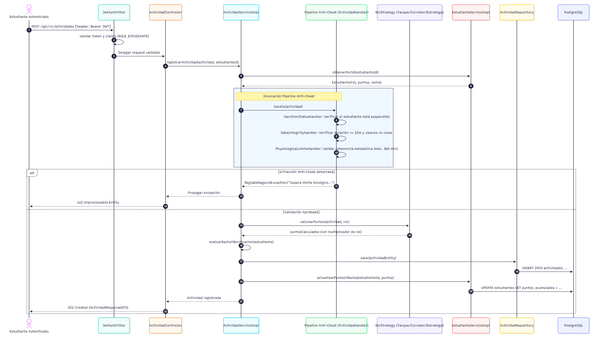
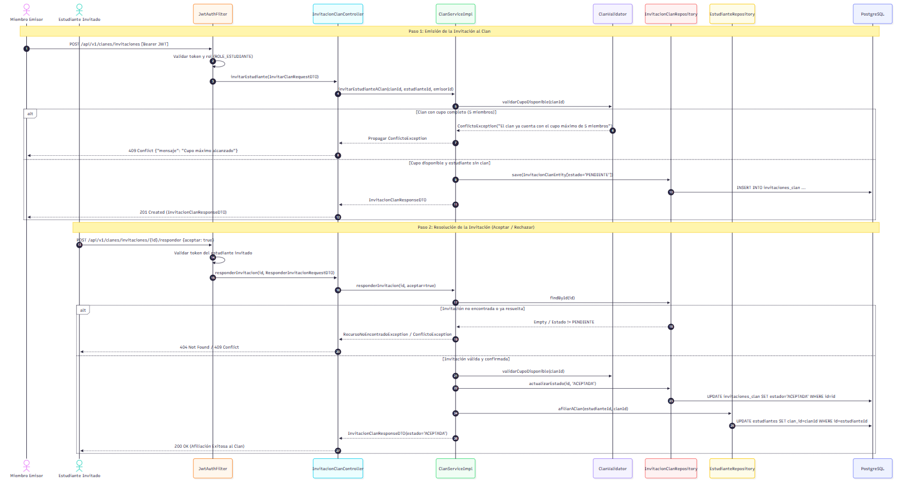
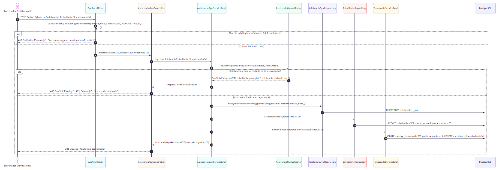

# ECI FIT Backend – Documento de Arquitectura de Alto Nivel (HLD)

---

## 1. Descripción del Servicio y Diagrama de Contexto

### 1.1 Propósito y Alcance del Sistema
**ECI FIT Backend** es el núcleo de cómputo, reglas de negocio y orquestación de la plataforma institucional de gamificación deportiva y bienestar para la **Escuela Colombiana de Ingeniería Julio Garavito**. El sistema combate el sedentarismo universitario convirtiendo el entrenamiento físico, la constancia de hábitos y la nutrición balanceada en una experiencia competitiva inspirada en juegos de rol (RPG) y batallas de campus.

Sus responsabilidades esenciales abarcan:
1. **Gestión de Personajes y Progresión:** Creación de atletas institucionales bajo arquetipos de juego (*Tanque*, *Corredor*, *Estratega*) y trazabilidad de estadísticas.
2. **Pipeline Anti-Fraude de Actividades:** Validación fisiológica estricta y blindaje contra registros ficticios mediante el patrón *Chain of Responsibility*.
3. **Misiones Gamificadas:** Generación desacoplada de objetivos diarios y semanales mediante *Abstract Factory*.
4. **Guerras de Clanes y Asedios:** Gestión de clanes (límite estricto de 5 miembros), defensa reactiva de la torre (*Observer*), publicación de retos colectivos (**RF-34**) y resolución de duelos entre clanes (**RF-36**).
5. **Gobernanza de Membresía e Invitaciones a Clanes (RF-30, RF-31, RF-33):** Sistema completo de invitaciones directas por miembros, aceptación/rechazo y abandono con reasignación automática de líder.
6. **Ciclo de Ligas y Temporadas:** Temporadas semestrales, ranking por temporada y recálculo semanal de ascensos y descensos (*Bronce*, *Plata*, *Oro*, *Platino*, *Diamante*).
7. **Nutrición Asistida por Inteligencia Artificial y Heurística (RF-12, RF-13, RF-14):** Evaluación dietética automática y consejos nutricionales mediante adaptador resiliente compatible con **Google Gemini 2.5 Flash Lite** y evaluación determinística local.
8. **Menú del Comedor Institucional (RF-15):** Exposición del menú saludable diario publicado por bienestar universitario.
9. **Asistencia Verificada al Gimnasio (RF-42):** Registro presencial validado exclusivamente por entrenadores institucionales.
10. **Seguridad Stateless y RBAC:** Protección perimetral con tokens JWT y control de acceso basado en roles (*Estudiante*, *Entrenador*, *Administrador*).

### 1.2 Diagrama de Contexto del Sistema (C4 Nivel 1)

El sistema se ve como una caja negra: tres tipos de usuario lo usan desde el navegador y él se apoya en tres sistemas externos. Siguiendo la convención del modelo C4, el sistema que se construye va en azul y los sistemas externos que ya existen, en rojo.


- **Estudiante:** registra actividades, comidas y misiones, y participa en clanes y retos.
- **Entrenador:** confirma asistencias al gimnasio, crea misiones y publica retos de clan.
- **Administrador:** registra estudiantes, crea temporadas y publica el menú del comedor.
- **Google Gemini API:** recibe la descripción de una comida y responde si es balanceada (con soporte determinístico si no hay token configurado).
- **PostgreSQL 16:** guarda toda la información del sistema.
- **Microsoft Azure:** aloja la API en dos ambientes (QA y PROD) mediante contenedores Docker.

El acceso con correo institucional se controla dentro del propio sistema: solo se aceptan cuentas `@mail.escuelaing.edu.co`.

---

## 2. Tecnologías a Usar

La selección tecnológica prioriza componentes LTS con soporte corporativo, compatibilidad nativa con contenedores y bajo consumo de recursos en Azure:

| Tecnología | Versión | Rol Arquitectónico | Justificación Técnica de Selección |
|---|---|---|---|
| **Java** | 21 LTS | Lenguaje de desarrollo backend | Aprovechamiento de Records (DTOs inmutables), Pattern Matching en switch, colecciones secuenciadas y soporte nativo para Virtual Threads. |
| **Spring Boot** | 3.5.16 | Framework de infraestructura | Estándar de la industria; contenedor IoC/DI, soporte transaccional `@Transactional`, integración de properties dinámicas y métricas. |
| **Spring Security** | 6.x | Perímetro de seguridad y RBAC | Control de acceso declarativo en controladores mediante `@PreAuthorize`, filtros en cadena sin estado (*Stateless*) y codificación BCrypt. |
| **Spring Data JPA** | 3.5.x | Abstracción de persistencia relacional | Implementación ORM sobre Hibernate; consultas optimizadas mediante JPQL y métodos derivados para auditoría de integridad. |
| **PostgreSQL** | 16 | Motor de base de datos relacional | Cumplimiento estricto de propiedades ACID, soporte nativo de tipos temporales ISO-8601, índices compuestos únicos y transacciones concurrentes. |
| **Google Gemini API** | 2.5 Flash Lite | Inteligencia Artificial generativa | Clasificación dietética de alta velocidad, bajo costo y estructuración JSON para validación de comidas balanceadas (`gemini-2.5-flash-lite`), con soporte de evaluación por frases y palabras clave. |
| **JJWT (io.jsonwebtoken)** | 0.12.3 | Generación y validación de tokens | Creación y firma criptográfica HMAC-SHA256 de JSON Web Tokens con validación estricta de claims y tiempos de expiración. |
| **MapStruct** | 1.6.3 | Mapeo entre capas de datos | Transformación tipo-segura en tiempo de compilación entre DTOs, Entidades de Dominio y Entidades JPA con costo de reflexión cero (*Zero-Overhead*). |
| **Lombok** | 1.18.48 | Reducción de código repetitivo | Generación automática de Getters, Setters, Builders inmutables y trazabilidad de logs estructurados con `@Slf4j`. |
| **Springdoc OpenAPI** | 2.8.17 | Documentación viva y contratos Swagger | Generación automatizada de OpenAPI 3.0 mediante interfaces desacopladas (`*Api.java`) y UI interactiva en `/swagger-ui.html`. |
| **JUnit 5 & Mockito** | Spring Boot Test | Pruebas unitarias e integración | Validación de lógica pura con patrón AAA (*Arrange, Act, Assert*), aislamiento de servicios con `@MockitoBean` y pruebas MVC con `MockMvc`. |
| **JaCoCo** | 0.8.15 | Medición de cobertura de pruebas | Genera el reporte HTML de cobertura de instrucciones y ramas en cada `mvn test` (`target/site/jacoco/index.html`). |
| **Docker** | Multi-Stage | Empaquetamiento y aislamiento | Construcción en dos etapas: compilación con `maven:3.9.9-eclipse-temurin-21` y ejecución con `eclipse-temurin:21-jre`, sin incluir el código fuente ni Maven en la imagen final. |
| **GitHub Actions** | — | Automatización CI/CD | Orquestación de pipelines automatizados de calidad, ejecución de pruebas, auditoría JaCoCo y despliegue continuo a Azure. |
| **Azure App Service** | Linux PaaS | Entorno de ejecución en la nube | Plataforma administrada de alta disponibilidad con monitoreo integrado, gestión de probes de health check y soporte de variables secretas. |

---

## 3. Funcionalidades y Matriz de Trazabilidad (RF-01 a RF-42)

Alineación formal y exhaustiva entre el catálogo canónico de los 42 requerimientos funcionales del proyecto y su estado real en el código fuente:

| RF | Requisito Funcional | Módulo Resolutor | Componente / Endpoint | Estado Real |
|:---:|---|---|---|:---:|
| **RF-01** | Autenticar estudiante mediante correo institucional | Autenticación / Auth | `POST /api/v1/auth/login` | **Implementado** |
| **RF-02** | Crear personaje del estudiante | Estudiantes | `POST /api/v1/estudiantes/personaje`<br>`POST /api/v1/estudiantes` | **Implementado** |
| **RF-03** | Seleccionar rol de temporada (Tanque, Corredor, Estratega) | Estudiantes | `CrearEstudianteRequestDTO.rol` | **Implementado** |
| **RF-04** | Aplicar bonificación según el rol seleccionado | Actividades / Strategy | `RolTemporada` (Strategy: Tanque, Corredor, Estratega) | **Implementado** |
| **RF-05** | Actualizar estadísticas del personaje (Fuerza, Cardio, etc.) | Estudiantes / Dominio | `Estudiante.puntosAcumulados` | **Limitación Conocida** |
| **RF-06** | Registrar sesión de entrenamiento de fuerza | Actividades | `POST /api/v1/actividades` (campo `tipo`) | **Implementado** |
| **RF-07** | Registrar actividad cardiovascular | Actividades | `POST /api/v1/actividades` (campo `tipo`) | **Implementado** |
| **RF-08** | Registrar sesión de flexibilidad o movilidad | Actividades | `POST /api/v1/actividades` (campo `tipo`) | **Implementado** |
| **RF-09** | Validar duración mínima de una actividad (10 min) | Anti-Cheat / Chain | `DataIntegrityHandler` / `ActividadValidator` | **Implementado** |
| **RF-10** | Otorgar puntos por actividad física válida | Actividades | `ActividadResponseDTO.puntosOtorgados` | **Implementado** |
| **RF-11** | Otorgar puntos adicionales por asistencia al gimnasio | Asistencia Gimnasio | `POST /api/v1/gimnasio/asistencias` (+20 pts) | **Implementado** |
| **RF-12** | Registrar comida consumida por el estudiante | Nutrición | `POST /api/v1/nutricion/comidas` | **Implementado** |
| **RF-13** | Clasificar un registro como comida balanceada (IA Gemini) | Nutrición / IA | `GeminiEvaluadorNutricional` (Evaluador con clasificación por frases e ingredientes si no hay API Key) | **Implementado** |
| **RF-14** | Otorgar puntos por registro nutricional válido | Nutrición | `ComidaServiceImpl` (+5 base, +15 balanceada) | **Implementado** |
| **RF-15** | Consultar menú disponible del comedor ECI | Comedor | `GET /api/v1/comedor/menus/hoy`<br>`GET /api/v1/comedor/menus` | **Implementado** |
| **RF-16** | Generar misiones diarias para los estudiantes | Misiones / Factory | `POST /api/v1/misiones/diarias` | **Implementado** |
| **RF-17** | Generar misiones semanales | Misiones / Factory | `POST /api/v1/misiones/semanales` | **Implementado** |
| **RF-18** | Registrar cumplimiento de una misión | Misiones | `POST /api/v1/misiones/{id}/cumplimiento`<br>`POST /api/v1/misiones/{id}/completar` | **Implementado** |
| **RF-19** | Otorgar puntos al completar una misión | Misiones | `MisionServiceImpl.completarMision` | **Implementado** |
| **RF-20** | Calcular racha de actividad consecutiva | Actividades | `Estudiante.evaluarRacha` | **Implementado** |
| **RF-21** | Otorgar bonificación por alcanzar racha de 7 días | Actividades | `Estudiante.evaluarRacha` (+200 pts) | **Implementado** |
| **RF-22** | Crear temporada asociada al semestre académico | Temporadas | `POST /api/v1/temporadas` | **Implementado** |
| **RF-23** | Acumular puntos del estudiante durante la temporada | Temporadas | `TemporadaServiceImpl.sumarPuntosTemporadaActiva` | **Implementado** |
| **RF-24** | Calcular liga individual del estudiante | Temporadas | `RankingTemporada.actualizarLiga` / `LigaEnum.desdePuntos` | **Implementado** |
| **RF-25** | Recalcular semanalmente la liga (corte semanal) | Scheduler / Temporadas | `TemporadaServiceImpl.recalcularLigasSemanal` | **Implementado** |
| **RF-26** | Ascender estudiante de liga al cumplir el umbral | Temporadas | `RankingTemporada.agregarPuntos` → `actualizarLiga` | **Implementado** |
| **RF-27** | Descender estudiante de liga cuando corresponda | Temporadas | `TemporadaServiceImpl.recalcularLigasSemanal` (−50 pts semanales) | **Implementado** |
| **RF-28** | Consultar ranking de la temporada | Temporadas | `GET /api/v1/temporadas/{id}/ranking` | **Implementado** |
| **RF-29** | Crear clan | Clanes | `POST /api/v1/clanes` | **Implementado** |
| **RF-30** | Invitar estudiante a un clan | Clanes / Invitaciones | `POST /api/v1/clanes/invitaciones` | **Implementado** |
| **RF-31** | Aceptar o rechazar invitación a clan | Clanes / Invitaciones | `POST /api/v1/clanes/invitaciones/{id}/responder`<br>`POST /api/v1/clanes/unirse` | **Implementado** |
| **RF-32** | Limitar el clan a máximo cinco integrantes | Clanes / Validator | `ClanValidator.validarCupoDisponible` | **Implementado** |
| **RF-33** | Abandonar un clan voluntariamente | Clanes | `POST /api/v1/clanes/abandonar` | **Implementado** |
| **RF-34** | Publicar reto colectivo semanal | Clanes / Retos | `POST /api/v1/clanes/retos` | **Implementado** |
| **RF-35** | Acumular progreso colectivo del clan | Clanes / Retos | `RetoClan.evaluarSuperacion` | **Implementado** |
| **RF-36** | Calcular resultado de reto entre clanes / duelos | Clanes / Retos | `POST /api/v1/clanes/{id}/retos/{rId}/calcular`<br>`POST /api/v1/clanes/retos/comparar-duelo` | **Implementado** |
| **RF-37** | Publicar resultados semanales de clanes | Clanes / Retos | `GET /api/v1/clanes/{clanId}/retos` | **Implementado** |
| **RF-38** | Aplicar ascenso o descenso del clan según resultado | Clanes | — | **Limitación Conocida** |
| **RF-39** | Reportar ocupación actual del gimnasio | Gimnasio | — | **Limitación Conocida** |
| **RF-40** | Consultar ocupación reportada del gimnasio | Gimnasio | — | **Limitación Conocida** |
| **RF-41** | Actualizar mapa colaborativo de ocupación | Gimnasio | — | **Limitación Conocida** |
| **RF-42** | Confirmar asistencia de estudiante por entrenador | Asistencia Gimnasio | `POST /api/v1/gimnasio/asistencias` | **Implementado** |


> ### Balance de Requerimientos:
> **37 implementados + 0 parciales + 5 limitaciones conocidas = 42 requerimientos.**
> 
> * **Completamente Implementados (37):** RF-01, RF-02, RF-03, RF-04, RF-06, RF-07, RF-08, RF-09, RF-10, RF-11, RF-12, RF-13, RF-14, RF-15, RF-16, RF-17, RF-18, RF-19, RF-20, RF-21, RF-22, RF-23, RF-24, RF-25, RF-26, RF-27, RF-28, RF-29, RF-30, RF-31, RF-32, RF-33, RF-34, RF-35, RF-36, RF-37, RF-42.
> * **Parciales (0):** Ninguno (todos los requerimientos parciales fueron completados y verificados con pruebas automatizadas).
> * **Limitaciones Conocidas (5):** RF-05 (estadísticas desglosadas por atributo), RF-38 (niveles de clan), RF-39 (reportar ocupación del gimnasio), RF-40 (consultar ocupación) y RF-41 (mapa colaborativo de ocupación).

---

## 4. Diagramas Arquitectónicos

Todos los diagramas están hechos en draw.io, con fondo y recuadros blancos. Cada módulo tiene un color de borde que se mantiene igual en el diagrama de clases, en el de componentes específico y en el modelo entidad-relación:

| Color | Módulo |
|---|---|
| Azul `#1F6FB2` | Estudiantes y actividades |
| Verde `#2E7D32` | Clanes, invitaciones y retos |
| Morado `#7B1FA2` | Misiones |
| Naranja `#E07B00` | Temporadas y ligas |
| Turquesa `#00838F` | Gimnasio |
| Magenta `#C2185B` | Nutrición y comedor |
| Gris `#424242` | Seguridad y elementos transversales |
| Oscuro `#0F1923` | Base de datos y sistemas externos |

### 4.1 Modelo Entidad-Relación de Base de Datos (ERD)


La base de datos tiene **15 tablas** en PostgreSQL 16. Las relaciones entre módulos se hacen por identificador (por ejemplo, `estudiante_id`), lo que mantiene cada módulo independiente; las únicas llaves foráneas declaradas en JPA son `rankings_temporada.temporada_id` y `platos_menu.menu_id`.

| Tabla | Qué guarda |
|---|---|
| `usuarios` | Credenciales de acceso: correo único, contraseña cifrada con BCrypt, rol y estado |
| `estudiantes` | Perfil del jugador: nombre, correo institucional, rol de temporada, puntos, clan y fecha del último bono de racha |
| `clanes` | Nombre, salud de la torre (inicia en 5000) y puntos totales |
| `clan_miembros` | Integrantes de cada clan; el primero de la lista es el líder |
| `invitaciones_clan` | Invitaciones a clanes con su estado: `PENDIENTE`, `ACEPTADA` o `RECHAZADA` |
| `retos_clan` | Retos semanales: objetivo, progreso, recompensa, vigencia y si se completó |
| `actividades` | Sesiones de ejercicio: tipo, duración, intensidad, fecha y puntos obtenidos |
| `misiones` | Misiones diarias y semanales asignadas a cada estudiante |
| `asistencias_gym` | Asistencias al gimnasio confirmadas por un entrenador |
| `comidas` | Comidas registradas y el resultado de la evaluación de Gemini |
| `comida_recomendaciones` | Recomendaciones de Gemini para cada comida |
| `menus_comedor` | Menú del comedor por fecha y tipo de comida (sin repetir la pareja fecha–tipo) |
| `platos_menu` | Platos de cada menú: nombre, descripción y precio |
| `temporadas` | Temporadas semestrales con sus fechas y si están activas |
| `rankings_temporada` | Puntos y liga de cada estudiante en una temporada |

---

### 4.2 Diagrama de Clases del Dominio


El diagrama tiene tres franjas: **Dominio** (entidades de negocio, enumeraciones y clases de los patrones, sin dependencias de Spring ni de la base de datos), **Persistencia** (las entidades JPA que se guardan en PostgreSQL; sus atributos están en el modelo entidad-relación) y **Transferencia** (los DTOs de entrada y salida de la API, agrupados en un paquete por módulo; sus campos están en el catálogo de endpoints de la sección 5). En el dominio cada clase muestra su visibilidad (`+` pública, `-` privada, `#` protegida), y las relaciones indican multiplicidad, agregación (◇, un clan agrupa estudiantes) y composición (◆, un menú está compuesto por sus platos). Las implementaciones de los patrones aparecen solo con su nombre porque implementan el método de su interfaz. Los estereotipos `«Interface»`, `«Abstract»`, `«Enumeration»`, `«Record»` y `«Entity»` identifican el tipo de cada clase.

| Patrón | Clases | Qué resuelve |
|---|---|---|
| Strategy | `RolTemporada`, `Tanque`, `Corredor`, `Estratega` | Cada rol calcula los puntos de una actividad con su propio multiplicador |
| Chain of Responsibility | `ActividadHandler`, `SanctionStatusHandler`, `DataIntegrityHandler`, `PhysiologicalLimitsHandler` | Validación anti-cheat en eslabones: sin fechas futuras, duración e intensidad válidas y máximo 300 minutos por sesión |
| Abstract Factory | `FabricaMisiones`, `FabricaMisionesEstandar`, `Mision`, `MisionDiaria`, `MisionSemanal` | Crear misiones diarias y semanales sin acoplar el servicio a cada tipo |
| Observer | `ActividadObserver`, `GestorLigas`, `TorreClan` | Avisar cuando se registra una actividad; se usa para calcular sus puntos |
| State | `EstadoTemporada`, `SemanaRegular`, `SemanaParciales` | Reglas distintas en semana regular y de parciales |

El dominio recibe el resultado de Gemini como un `EvaluacionNutricional`; la llamada HTTP vive en el servicio `GeminiEvaluadorNutricional`, que por ser un componente de Spring aparece en el diagrama de componentes específico y no en este.

---

### 4.3 Diagrama de Componentes General


Los tres tipos de usuario usan el frontend, que consume la API REST del backend (interfaz provista por el backend y requerida por el frontend). El backend guarda los datos en PostgreSQL mediante JPA y consulta a Google Gemini por HTTPS para evaluar las comidas.

---

### 4.4 Diagrama de Componentes Específico


El diagrama usa la notación UML de componentes: cada componente tiene **puertos** (cuadros en el borde) y se conecta por **interfaces**; el círculo (lollipop) es la interfaz que un componente provee y el semicírculo (socket) es la que otro requiere, con el nombre real de la interfaz (`IActividadService`, `IActividadValidator`, `JpaRepository`…). Toda petición pasa primero por `JwtAuthFilter`, que valida el token. Después, cada módulo sigue el mismo recorrido por capas, con las dependencias que Spring inyecta en el código:

| Componente | Responsabilidad |
|---|---|
| Controller | Recibe la petición, valida el DTO con `@Valid`, revisa el rol con `@PreAuthorize` y devuelve el código HTTP |
| Mapper (`XMapper`) | Convierte el DTO de entrada en un objeto de dominio y el dominio en el DTO de respuesta |
| Service (`XServiceImpl`) | Ejecuta el caso de uso con objetos de dominio |
| Validator | Aplica las reglas de negocio y lanza excepciones tipadas (404, 409, 422) |
| Mapper de persistencia (`XEntityMapper`) | Convierte el dominio en entidad JPA y viceversa |
| Repository | Consulta y guarda en PostgreSQL |

Las flechas punteadas entre módulos muestran dependencias reales: Actividad, Misión y Asistencia usan `ITemporadaService` para sumar puntos al ranking, e Invitación usa `IClanService` para unir al estudiante. `ComidaServiceImpl` requiere `IEvaluadorNutricional`, que provee el adaptador `GeminiEvaluadorNutricional` hacia la API de Gemini, y `ActividadValidator` usa la **cadena anti-cheat**.

---

### 4.5 Organización del Código

| Carpeta | Qué contiene |
|---|---|
| `controller` y `controller/docs` | Endpoints REST y sus contratos de Swagger |
| `dto` | Datos de entrada (`request`), salida (`response`) y de la integración con Gemini (`ia`) |
| `mapper` | Conversión entre DTO, dominio y entidades (MapStruct) |
| `service` y `service/ia` | Casos de uso y el adaptador de Gemini |
| `validator` | Reglas de negocio de cada módulo |
| `model` | Dominio y patrones (`strategy`, `chain`, `factory`, `observer`, `state`) |
| `persistence` y `repository` | Entidades JPA y repositorios |
| `security` | JWT, usuarios, roles y configuración de Spring Security |
| `scheduler` | Corte semanal de ligas (lunes 00:00) y reintento de evaluaciones nutricionales pendientes |
| `exception` | Excepciones de negocio y `GlobalExceptionHandler` |
| `config` | Configuración de Swagger y de Gemini |

---

## 5. Funcionalidades Expuestas (Catálogo Exhaustivo de Endpoints REST)

Cada endpoint operativo está asegurado con Spring Security 6. Las peticiones a rutas protegidas exigen la cabecera HTTP:  
`Authorization: Bearer <token_jwt>`

---

### 5.1 Módulo de Autenticación (`/api/v1/auth`)

#### `POST /api/v1/auth/login` · Rol: Público (`PermitAll`) · Respuesta exitosa: `200 OK`
Autentica las credenciales del usuario y genera un token JWT firmado con algoritmo HMAC-SHA256 (validez de 24 horas).

| Campo | Tipo | Obligatorio | Restricciones | Descripción |
|---|---|:---:|---|---|
| `email` | String | Sí | No vacío, formato de correo válido | Correo del usuario registrado |
| `password` | String | Sí | No vacío | Contraseña en texto plano; se compara con el hash BCrypt |

```json
{
  "token": "eyJhbGciOiJIUzI1NiJ9.eyJzdWIiOiJjYXJsb3MucmFtaXJleiIsImF1dGhvcml0aWVzIjpbIlJPTEVfRVNUVURJQU5URSJdfQ.ex...",
  "tipo": "Bearer",
  "email": "carlos.ramirez@mail.escuelaing.edu.co",
  "rol": "ROLE_ESTUDIANTE",
  "expiresIn": 86400000
}
```

---

### 5.2 Módulo de Estudiantes (`/api/v1/estudiantes`)

#### `POST /api/v1/estudiantes` · Rol: `ADMINISTRADOR` · Respuesta exitosa: `201 Created`
Registra un nuevo estudiante en el sistema y le asigna su arquetipo deportivo.

| Campo | Tipo | Obligatorio | Restricciones | Descripción |
|---|---|:---:|---|---|
| `nombre` | String | Sí | No vacío | Nombre completo del estudiante |
| `correoInstitucional` | String | Sí | Formato de correo; debe terminar en `@mail.escuelaing.edu.co` (422) y no estar registrado (409) | Correo electrónico de la Escuela |
| `rol` | String | Sí | `TANQUE · CORREDOR · ESTRATEGA` (otro valor → 422) | Arquetipo deportivo asignado al atleta |

```json
{
  "id": "cd9fbaf4-2cf6-4b58-91f1-147329b84d90",
  "nombre": "Carlos Ramirez",
  "correoInstitucional": "carlos.ramirez@mail.escuelaing.edu.co",
  "puntosAcumulados": 0,
  "rolActivo": "TANQUE",
  "clanId": null
}
```

#### `POST /api/v1/estudiantes/personaje` · Rol: `ESTUDIANTE` · Respuesta exitosa: `201 Created`
Crea y vincula el personaje del estudiante en su primer ingreso (**RF-02**). Lanza HTTP 409 si el estudiante autenticado ya posee un personaje creado.

| Campo | Tipo | Obligatorio | Restricciones | Descripción |
|---|---|:---:|---|---|
| `nombre` | String | Sí | No vacío | Nombre visible del personaje del jugador |
| `rol` | String | Sí | `TANQUE · CORREDOR · ESTRATEGA` (otro valor → 422) | Rol o especialidad deportiva para la temporada activa |

```json
{
  "id": "cd9fbaf4-2cf6-4b58-91f1-147329b84d90",
  "nombre": "Carlos Ramirez",
  "correoInstitucional": "carlos.ramirez@mail.escuelaing.edu.co",
  "puntosAcumulados": 0,
  "rolActivo": "CORREDOR",
  "clanId": null
}
```

#### `GET /api/v1/estudiantes/{id}` · Rol: `ESTUDIANTE`, `ENTRENADOR`, `ADMINISTRADOR` · Respuesta exitosa: `200 OK`
Consulta el perfil detallado y puntos acumulados de un estudiante específico.

| Parámetro Ruta | Tipo | Obligatorio | Restricciones | Descripción |
|---|---|:---:|---|---|
| `id` | String | Sí | UUID o ID alfanumérico registrado | Identificador único del estudiante |

```json
{
  "id": "cd9fbaf4-2cf6-4b58-91f1-147329b84d90",
  "nombre": "Carlos Ramirez",
  "correoInstitucional": "carlos.ramirez@mail.escuelaing.edu.co",
  "puntosAcumulados": 350,
  "rolActivo": "TANQUE",
  "clanId": "CLAN-01"
}
```

#### `GET /api/v1/estudiantes` · Rol: `ADMINISTRADOR`, `ENTRENADOR` · Respuesta exitosa: `200 OK`
Retorna el listado completo de estudiantes registrados en la plataforma. *(Sin cuerpo de solicitud)*.

```json
[
  {
    "id": "cd9fbaf4-2cf6-4b58-91f1-147329b84d90",
    "nombre": "Carlos Ramirez",
    "correoInstitucional": "carlos.ramirez@mail.escuelaing.edu.co",
    "puntosAcumulados": 350,
    "rolActivo": "TANQUE",
    "clanId": "CLAN-01"
  },
  {
    "id": "e3171714-53a0-4558-af20-a61d983623d3",
    "nombre": "Laura Gomez",
    "correoInstitucional": "laura.gomez@mail.escuelaing.edu.co",
    "puntosAcumulados": 520,
    "rolActivo": "CORREDOR",
    "clanId": null
  }
]
```

---

### 5.3 Módulo de Actividades Físicas (`/api/v1/actividades`)

#### `POST /api/v1/actividades` · Rol: `ESTUDIANTE` · Respuesta exitosa: `201 Created`
Registra un entrenamiento físico. Pasa obligatoriamente por el pipeline Anti-Cheat (*Chain of Responsibility*) y aplica multiplicador según rol (*Strategy*).

| Campo | Tipo | Obligatorio | Restricciones | Descripción |
|---|---|:---:|---|---|
| `estudianteId` | String | Sí | ID de estudiante registrado | Identificador del estudiante que entrenó |
| `tipo` | String | Sí | No vacío (por ejemplo `CARDIO`, `FUERZA`, `FLEXIBILIDAD`) | Tipo de entrenamiento realizado |
| `duracionMinutos` | Integer | Sí | Mínimo 10 (400); máximo 300 según la cadena anti-cheat (422) | Duración continua de la sesión deportiva |
| `intensidad` | Integer | Sí | Entre 1 y 10 | Escala de esfuerzo percibido |

```json
{
  "id": "840e819d-4aa8-4397-bd7f-17f6388c1e97",
  "tipo": "CARDIO",
  "duracionMinutos": 45,
  "intensidad": 8,
  "fecha": "2026-10-19T07:30:00",
  "estudianteId": "cd9fbaf4-2cf6-4b58-91f1-147329b84d90",
  "puntosOtorgados": 67
}
```

#### `GET /api/v1/actividades/estudiante/{estudianteId}` · Rol: `ESTUDIANTE`, `ENTRENADOR`, `ADMINISTRADOR` · Respuesta exitosa: `200 OK`
Consulta el historial de sesiones físicas registradas por un estudiante.

| Parámetro Ruta | Tipo | Obligatorio | Restricciones | Descripción |
|---|---|:---:|---|---|
| `estudianteId` | String | Sí | ID de estudiante existente | Identificador del atleta |

```json
[
  {
    "id": "840e819d-4aa8-4397-bd7f-17f6388c1e97",
    "tipo": "CARDIO",
    "duracionMinutos": 45,
    "intensidad": 8,
    "fecha": "2026-10-19T07:30:00",
    "estudianteId": "cd9fbaf4-2cf6-4b58-91f1-147329b84d90",
    "puntosOtorgados": 67
  }
]
```

---

### 5.4 Módulo de Clanes y Retos Colectivos (`/api/v1/clanes`)

#### `POST /api/v1/clanes` · Rol: `ESTUDIANTE`, `ADMINISTRADOR` · Respuesta exitosa: `201 Created`
Funda un nuevo clan estudiantil en la plataforma y designa al creador como líder fundador (**RF-29**).

| Campo | Tipo | Obligatorio | Restricciones | Descripción |
|---|---|:---:|---|---|
| `nombre` | String | Sí | No vacío; no puede repetirse (409) | Nombre identificador del clan |
| `liderEstudianteId` | String | Sí | No vacío | Identificador del estudiante que funda y lidera el clan |

```json
{
  "id": "CLAN-01",
  "nombre": "Espartanos ECI",
  "saludTorre": 5000,
  "puntosTotales": 0,
  "cantidadMiembros": 1,
  "liderId": "cd9fbaf4-2cf6-4b58-91f1-147329b84d90"
}
```

#### `POST /api/v1/clanes/unirse` · Rol: `ESTUDIANTE` · Respuesta exitosa: `200 OK`
Afilia a un estudiante a un clan existente. Valida que el estudiante no pertenezca ya a un clan y que el clan destino tenga cupo disponible ($< 5$ miembros, **RF-32**).

| Campo | Tipo | Obligatorio | Restricciones | Descripción |
|---|---|:---:|---|---|
| `estudianteId` | String | Sí | Estudiante registrado sin clan | Identificador del estudiante que ingresa |
| `clanId` | String | Sí | Clan existente con cupo disponible | Identificador del clan destino |

```json
{
  "id": "CLAN-01",
  "nombre": "Espartanos ECI",
  "saludTorre": 5000,
  "puntosTotales": 120,
  "cantidadMiembros": 2,
  "liderId": "cd9fbaf4-2cf6-4b58-91f1-147329b84d90"
}
```

#### `POST /api/v1/clanes/abandonar` · Rol: `ESTUDIANTE` · Respuesta exitosa: `200 OK`
Permite a un estudiante retirarse voluntariamente de su clan (**RF-33**). Si quien abandona es el líder, el sistema transfiere automáticamente el liderazgo al miembro más antiguo.

| Campo | Tipo | Obligatorio | Restricciones | Descripción |
|---|---|:---:|---|---|
| `estudianteId` | String | Sí | Estudiante perteneciente al clan | Identificador del estudiante que se retira |
| `clanId` | String | Sí | Clan actual del estudiante | Identificador del clan abandonado |

```json
{
  "id": "CLAN-01",
  "nombre": "Espartanos ECI",
  "saludTorre": 5000,
  "puntosTotales": 120,
  "cantidadMiembros": 1,
  "liderId": "e3171714-53a0-4558-af20-a61d983623d3"
}
```

#### `GET /api/v1/clanes` · Rol: `ESTUDIANTE`, `ENTRENADOR`, `ADMINISTRADOR` · Respuesta exitosa: `200 OK`
Consulta el listado general de clanes con salud de torre y cantidad de miembros. *(Sin cuerpo de solicitud)*.

```json
[
  {
    "id": "CLAN-01",
    "nombre": "Espartanos ECI",
    "saludTorre": 5000,
    "puntosTotales": 480,
    "cantidadMiembros": 4,
    "liderId": "cd9fbaf4-2cf6-4b58-91f1-147329b84d90"
  }
]
```

#### `GET /api/v1/clanes/{id}` · Rol: `ESTUDIANTE`, `ENTRENADOR`, `ADMINISTRADOR` · Respuesta exitosa: `200 OK`
Consulta la información detallada de un clan en particular.

| Parámetro Ruta | Tipo | Obligatorio | Restricciones | Descripción |
|---|---|:---:|---|---|
| `id` | String | Sí | ID de clan registrado | Identificador único del clan |

```json
{
  "id": "CLAN-01",
  "nombre": "Espartanos ECI",
  "saludTorre": 5000,
  "puntosTotales": 480,
  "cantidadMiembros": 4,
  "liderId": "cd9fbaf4-2cf6-4b58-91f1-147329b84d90"
}
```

#### `POST /api/v1/clanes/retos` · Rol: `ENTRENADOR`, `ADMINISTRADOR` · Respuesta exitosa: `201 Created`
Publica un reto colectivo semanal para un clan determinado (**RF-34**).

| Campo | Tipo | Obligatorio | Restricciones | Descripción |
|---|---|:---:|---|---|
| `clanId` | String | Sí | ID de clan registrado | Clan al que se le impone el reto semanal |
| `descripcion` | String | Sí | 5 – 255 caracteres | Detalle del objetivo y disciplina deportiva exigida |
| `objetivoPuntos` | Integer | Sí | Entero $> 0$ | Meta de puntos colectivos a alcanzar |
| `recompensa` | Integer | Sí | Entero $> 0$ | Puntos acreditados al clan si supera la meta |
| `fechaInicio` | LocalDate | Sí | Formato `YYYY-MM-DD` | Fecha de inicio de la vigencia del reto |
| `fechaFin` | LocalDate | Sí | No anterior a `fechaInicio` (422) | Fecha de cierre del reto semanal |

```json
{
  "id": "RETO-01",
  "clanId": "CLAN-01",
  "descripcion": "Acumular 500 puntos colectivos en actividades de fuerza",
  "objetivoPuntos": 500,
  "progresoActual": 0,
  "recompensa": 150,
  "fechaInicio": "2026-10-18",
  "fechaFin": "2026-10-25",
  "completado": false,
  "estadoResultado": "EN_PROGRESO: 0/500 puntos acumulados"
}
```

#### `POST /api/v1/clanes/{clanId}/retos/{retoId}/calcular` · Rol: `ENTRENADOR`, `ADMINISTRADOR` · Respuesta exitosa: `200 OK`
Calcula el progreso colectivo acumulado por los miembros del clan y dictamina si el reto semanal fue superado (**RF-35, RF-36**).

| Parámetro Ruta | Tipo | Obligatorio | Restricciones | Descripción |
|---|---|:---:|---|---|
| `clanId` | String | Sí | ID del clan evaluado | Identificador del clan |
| `retoId` | String | Sí | ID del reto asignado | Identificador del reto semanal |

```json
{
  "id": "RETO-01",
  "clanId": "CLAN-01",
  "descripcion": "Acumular 500 puntos colectivos en actividades de fuerza",
  "objetivoPuntos": 500,
  "progresoActual": 540,
  "recompensa": 150,
  "fechaInicio": "2026-10-18",
  "fechaFin": "2026-10-25",
  "completado": true,
  "estadoResultado": "SUPERADO: +150 pts asignados al clan"
}
```

#### `POST /api/v1/clanes/retos/comparar-duelo` · Rol: `ENTRENADOR`, `ADMINISTRADOR` · Respuesta exitosa: `200 OK`
Resuelve y compara un enfrentamiento directo entre dos clanes rivales (**RF-36**), otorgando bonificación de victoria.

| Campo | Tipo | Obligatorio | Restricciones | Descripción |
|---|---|:---:|---|---|
| `clanId1` | String | Sí | ID del primer clan | Identificador del clan retador |
| `clanId2` | String | Sí | Distinto a `clanId1` (422) | Identificador del clan adversario |
| `bonificacionVictoria` | Integer | Sí | Entero $> 0$ | Puntos transferidos al clan ganador |

```json
{
  "clanId1": "CLAN-01",
  "nombreClan1": "Espartanos ECI",
  "puntosClan1": 850,
  "clanId2": "CLAN-02",
  "nombreClan2": "Titanes de Sistemas",
  "puntosClan2": 620,
  "clanGanadorId": "CLAN-01",
  "bonificacionOtorgada": 200,
  "esEmpate": false,
  "mensajeResultado": "¡Victoria para Espartanos ECI! +200 pts otorgados."
}
```

#### `GET /api/v1/clanes/{clanId}/retos` · Rol: `ESTUDIANTE`, `ENTRENADOR`, `ADMINISTRADOR` · Respuesta exitosa: `200 OK`
Consulta el historial de retos semanales y resultados de un clan (**RF-37**).

| Parámetro Ruta | Tipo | Obligatorio | Restricciones | Descripción |
|---|---|:---:|---|---|
| `clanId` | String | Sí | ID de clan registrado | Identificador del clan |

```json
[
  {
    "id": "RETO-01",
    "clanId": "CLAN-01",
    "descripcion": "Acumular 500 puntos colectivos en actividades de fuerza",
    "objetivoPuntos": 500,
    "progresoActual": 540,
    "recompensa": 150,
    "fechaInicio": "2026-10-18",
    "fechaFin": "2026-10-25",
    "completado": true,
    "estadoResultado": "SUPERADO: +150 pts asignados al clan"
  }
]
```

---

### 5.5 Sub-Módulo de Invitaciones a Clanes (`/api/v1/clanes/invitaciones`)

#### `POST /api/v1/clanes/invitaciones` · Rol: `ESTUDIANTE` · Respuesta exitosa: `201 Created`
Envía una invitación formal a un estudiante para que se incorpore al clan (**RF-30**). Valida que quien invita pertenezca al clan y que el invitado no tenga clan ni invitación activa.

| Campo | Tipo | Obligatorio | Restricciones | Descripción |
|---|---|:---:|---|---|
| `clanId` | String | Sí | Clan con cupo disponible ($< 5$) | Identificador del clan que invita |
| `estudianteId` | String | Sí | Estudiante registrado sin clan | Identificador del estudiante invitado |
| `invitadoPorId` | String | Sí | Miembro activo del clanId | Identificador del estudiante emisor |

```json
{
  "id": "INV-01",
  "clanId": "CLAN-01",
  "estudianteId": "e3171714-53a0-4558-af20-a61d983623d3",
  "invitadoPorId": "cd9fbaf4-2cf6-4b58-91f1-147329b84d90",
  "estado": "PENDIENTE",
  "fecha": "2026-10-19T10:15:00"
}
```

#### `POST /api/v1/clanes/invitaciones/{id}/responder` · Rol: `ESTUDIANTE` · Respuesta exitosa: `200 OK`
Resuelve una invitación pendiente (**RF-31**). Si `aceptar = true`, incorpora al estudiante al clan; si `aceptar = false`, registra el rechazo.

| Parámetro Ruta | Tipo | Obligatorio | Restricciones | Descripción |
|---|---|:---:|---|---|
| `id` | String | Sí | ID de invitación pendiente | Identificador único de la invitación |

| Campo | Tipo | Obligatorio | Restricciones | Descripción |
|---|---|:---:|---|---|
| `aceptar` | Boolean | Sí | Booleano `true` o `false` | Aceptar (`true`) o rechazar (`false`) la invitación |

```json
{
  "id": "INV-01",
  "clanId": "CLAN-01",
  "estudianteId": "e3171714-53a0-4558-af20-a61d983623d3",
  "invitadoPorId": "cd9fbaf4-2cf6-4b58-91f1-147329b84d90",
  "estado": "ACEPTADA",
  "fecha": "2026-10-19T10:15:00"
}
```

#### `GET /api/v1/clanes/invitaciones/estudiante/{estudianteId}` · Rol: `ESTUDIANTE`, `ADMINISTRADOR` · Respuesta exitosa: `200 OK`
Consulta todas las invitaciones dirigidas a un estudiante.

| Parámetro Ruta | Tipo | Obligatorio | Restricciones | Descripción |
|---|---|:---:|---|---|
| `estudianteId` | String | Sí | ID de estudiante registrado | Identificador del estudiante |

```json
[
  {
    "id": "INV-01",
    "clanId": "CLAN-01",
    "estudianteId": "e3171714-53a0-4558-af20-a61d983623d3",
    "invitadoPorId": "cd9fbaf4-2cf6-4b58-91f1-147329b84d90",
    "estado": "PENDIENTE",
    "fecha": "2026-10-19T10:15:00"
  }
]
```

---

### 5.6 Módulo de Nutrición e IA Gemini (`/api/v1/nutricion/comidas`)

#### `POST /api/v1/nutricion/comidas` · Rol: `ESTUDIANTE`, `ADMINISTRADOR` · Respuesta exitosa: `201 Created`
Registra una comida (**RF-12**), otorga +5 puntos base y ejecuta la evaluación nutricional inteligente (+15 puntos adicionales si es balanceada) (**RF-13, RF-14**). En despliegues donde no esté configurada la API Key de Gemini, el evaluador clasifica el balance nutricional con base en frases e ingredientes clave.

| Campo | Tipo | Obligatorio | Restricciones | Descripción |
|---|---|:---:|---|---|
| `estudianteId` | String | Sí | ID de estudiante registrado | Identificador del comensal |
| `tipo` | Enum `TipoComida` | Sí | `DESAYUNO · MEDIA_MANANA · ALMUERZO · ONCES · CENA` | Tipo de servicio de alimentación |
| `descripcion` | String | Sí | 3 – 500 caracteres | Descripción textual de los alimentos ingeridos |
| `fechaHora` | LocalDateTime | No | Formato ISO-8601 (opcional) | Fecha y hora de consumo |

- **Enumeraciones de Respuesta:**
  - `EstadoEvaluacion`: `PENDIENTE · EVALUADA · ERROR`
  - `CalificacionComida`: `BUENA · REGULAR · MALA`

```json
{
  "id": "a537e692-93fd-4771-bfaa-d97b3bd1e90b",
  "estudianteId": "cd9fbaf4-2cf6-4b58-91f1-147329b84d90",
  "tipo": "ALMUERZO",
  "descripcion": "Pechuga a la plancha con quinoa, ensalada de espinaca y tomate, y agua",
  "fechaHora": "2026-10-19T12:45:00",
  "estado": "EVALUADA",
  "balanceada": true,
  "calificacion": "BUENA",
  "puntaje": 95,
  "consejo": "Excelente ingesta de proteína magra y vegetales.",
  "recomendaciones": [
    "Mantener la hidratación constante con agua",
    "Añadir frutos secos para grasas saludables"
  ],
  "puntosOtorgados": 20,
  "aviso": null
}
```

#### `POST /api/v1/nutricion/comidas/{id}/evaluar` · Rol: `ESTUDIANTE`, `ADMINISTRADOR` · Respuesta exitosa: `200 OK`
Reintenta la clasificación de una comida que quedó en estado `PENDIENTE` por timeout o intermitencia de red externa. Además, `EvaluacionNutricionalScheduler` reintenta automáticamente las comidas pendientes cada 15 minutos.

| Parámetro Ruta | Tipo | Obligatorio | Restricciones | Descripción |
|---|---|:---:|---|---|
| `id` | String | Sí | UUID de la comida | Identificador de la comida a revaluar |

```json
{
  "id": "a537e692-93fd-4771-bfaa-d97b3bd1e90b",
  "estudianteId": "cd9fbaf4-2cf6-4b58-91f1-147329b84d90",
  "tipo": "ALMUERZO",
  "descripcion": "Pechuga a la plancha con quinoa",
  "fechaHora": "2026-10-19T12:45:00",
  "estado": "EVALUADA",
  "balanceada": true,
  "calificacion": "BUENA",
  "puntaje": 95,
  "consejo": "Excelente ingesta.",
  "recomendaciones": [],
  "puntosOtorgados": 20,
  "aviso": null
}
```

#### `GET /api/v1/nutricion/comidas/{id}` · Rol: `ESTUDIANTE`, `ENTRENADOR`, `ADMINISTRADOR` · Respuesta exitosa: `200 OK`
Consulta una comida registrada con el resultado de su evaluación nutricional.

| Parámetro Ruta | Tipo | Obligatorio | Restricciones | Descripción |
|---|---|:---:|---|---|
| `id` | String | Sí | Comida existente (404 si no existe) | Identificador de la comida |

*(La respuesta tiene la misma estructura de `ComidaResponseDTO` del registro de comidas.)*

#### `GET /api/v1/nutricion/comidas/estudiante/{estudianteId}` · Rol: `ESTUDIANTE`, `ENTRENADOR`, `ADMINISTRADOR` · Respuesta exitosa: `200 OK`
Consulta el historial de comidas registradas por un estudiante.

| Parámetro Ruta | Tipo | Obligatorio | Restricciones | Descripción |
|---|---|:---:|---|---|
| `estudianteId` | String | Sí | ID de estudiante registrado | Identificador del estudiante |

```json
[
  {
    "id": "a537e692-93fd-4771-bfaa-d97b3bd1e90b",
    "estudianteId": "cd9fbaf4-2cf6-4b58-91f1-147329b84d90",
    "tipo": "ALMUERZO",
    "descripcion": "Pechuga a la plancha con quinoa",
    "fechaHora": "2026-10-19T12:45:00",
    "estado": "EVALUADA",
    "balanceada": true,
    "calificacion": "BUENA",
    "puntaje": 95,
    "consejo": "Excelente ingesta.",
    "recomendaciones": [],
    "puntosOtorgados": 20,
    "aviso": null
  }
]
```

---

### 5.7 Módulo del Comedor Institucional (`/api/v1/comedor/menus`)

#### `POST /api/v1/comedor/menus` · Rol: `ADMINISTRADOR` · Respuesta exitosa: `201 Created`
Publica la oferta del menú saludable del comedor universitario para una fecha determinada (**RF-15**).

| Campo | Tipo | Obligatorio | Restricciones | Descripción |
|---|---|:---:|---|---|
| `fecha` | LocalDate | Sí | Formato ISO `YYYY-MM-DD` | Fecha programada para servir el menú |
| `tipo` | Enum `TipoComida` | Sí | `DESAYUNO · MEDIA_MANANA · ALMUERZO · ONCES · CENA`; la pareja fecha–tipo no puede repetirse | Tipo de servicio de comida |
| `platos` | List<`PlatoMenuRequestDTO`> | Sí | Mínimo 1 plato en la lista | Lista de platos que conforman el menú |

##### Objeto Anidado: `PlatoMenuRequestDTO`
| Campo | Tipo | Obligatorio | Restricciones | Descripción |
|---|---|:---:|---|---|
| `nombre` | String | Sí | No vacío, máximo 120 caracteres | Nombre visible del plato |
| `descripcion` | String | No | Máximo 300 caracteres | Ingredientes principales o acompañamientos |
| `precio` | Integer | No | Entero $\ge 0$ (en COP) | Precio subsidiado del plato institucional |

```json
{
  "id": "MENU-20261020-01",
  "fecha": "2026-10-20",
  "tipo": "ALMUERZO",
  "platos": [
    {
      "id": "PLATO-01",
      "nombre": "Bowl Fitness Proteico",
      "descripcion": "Salmón a la plancha, arroz integral, aguacate y vegetales al vapor",
      "precio": 14000
    },
    {
      "id": "PLATO-02",
      "nombre": "Jugo Verde Desintoxicante",
      "descripcion": "Espinaca, manzana verde, pepino y jengibre sin azúcar añadida",
      "precio": 3500
    }
  ]
}
```

#### `GET /api/v1/comedor/menus/hoy` · Rol: `ESTUDIANTE`, `ENTRENADOR`, `ADMINISTRADOR` · Respuesta exitosa: `200 OK`
Consulta los menús saludables programados para la fecha actual del sistema (**RF-15**). *(Sin cuerpo de solicitud)*.

```json
[
  {
    "id": "MENU-20261020-01",
    "fecha": "2026-10-20",
    "tipo": "ALMUERZO",
    "platos": [
      {
        "id": "PLATO-01",
        "nombre": "Bowl Fitness Proteico",
        "descripcion": "Salmón a la plancha, arroz integral, aguacate y vegetales al vapor",
        "precio": 14000
      }
    ]
  }
]
```

#### `GET /api/v1/comedor/menus` · Rol: `ESTUDIANTE`, `ENTRENADOR`, `ADMINISTRADOR` · Respuesta exitosa: `200 OK`
Consulta el histórico completo de menús publicados por Bienestar. *(Sin cuerpo de solicitud)*.

---

### 5.8 Módulo de Misiones Gamificadas (`/api/v1/misiones`)

#### `POST /api/v1/misiones/diarias` · Rol: `ENTRENADOR`, `ADMINISTRADOR` · Respuesta exitosa: `201 Created`
Crea una misión diaria con meta de sesión única para un estudiante mediante *Abstract Factory* (**RF-16**).

| Campo | Tipo | Obligatorio | Restricciones | Descripción |
|---|---|:---:|---|---|
| `estudianteId` | String | Sí | ID de estudiante existente | Identificador del estudiante asignado |
| `descripcion` | String | Sí | 5 – 255 caracteres | Reto deportivo a cumplir en la jornada |
| `recompensa` | Integer | Sí | Entero $> 0$ | Puntos acreditados al cumplir la misión |

```json
{
  "id": "MIS-DIA-01",
  "descripcion": "Activación ECI Diaria: Completa al menos 30 minutos de actividad física hoy",
  "recompensa": 50,
  "completada": false,
  "estudianteId": "cd9fbaf4-2cf6-4b58-91f1-147329b84d90"
}
```

#### `POST /api/v1/misiones/semanales` · Rol: `ENTRENADOR`, `ADMINISTRADOR` · Respuesta exitosa: `201 Created`
Crea una misión semanal con meta acumulativa de esfuerzo continuo (**RF-17**). *(Parámetros idénticos a `CrearMisionRequestDTO`)*.

```json
{
  "id": "MIS-SEM-01",
  "descripcion": "Reto Semanal de Constancia: Acumula 150 minutos de ejercicio antes del domingo",
  "recompensa": 150,
  "completada": false,
  "estudianteId": "cd9fbaf4-2cf6-4b58-91f1-147329b84d90"
}
```

#### `POST /api/v1/misiones/{id}/cumplimiento` · Rol: `ESTUDIANTE`, `ADMINISTRADOR` · Respuesta exitosa: `200 OK`
Registra el cumplimiento de una misión aportando evidencia o actividad física vinculada (**RF-18**).

| Parámetro Ruta | Tipo | Obligatorio | Restricciones | Descripción |
|---|---|:---:|---|---|
| `id` | String | Sí | ID de misión asignada | Identificador único de la misión |

| Campo | Tipo | Obligatorio | Restricciones | Descripción |
|---|---|:---:|---|---|
| `actividadId` | String | No | ID de actividad deportiva existente | Identificador opcional de la sesión física que cumple la misión |
| `evidencia` | String | No | Texto descriptivo | Comentario explicativo del logro alcanzado |

```json
{
  "id": "MIS-DIA-01",
  "descripcion": "Activación ECI Diaria: Completa al menos 30 minutos de actividad física hoy",
  "recompensa": 50,
  "completada": true,
  "estudianteId": "cd9fbaf4-2cf6-4b58-91f1-147329b84d90"
}
```

#### `POST /api/v1/misiones/{id}/completar` · Rol: `ESTUDIANTE`, `ADMINISTRADOR` · Respuesta exitosa: `200 OK`
Marca la misión como completada y acredita los puntos de recompensa al estudiante y a la temporada activa (**RF-19**).

| Parámetro Ruta | Tipo | Obligatorio | Restricciones | Descripción |
|---|---|:---:|---|---|
| `id` | String | Sí | ID de misión asignada | Identificador de la misión |

```json
{
  "id": "MIS-DIA-01",
  "descripcion": "Activación ECI Diaria: Completa al menos 30 minutos de actividad física hoy",
  "recompensa": 50,
  "completada": true,
  "estudianteId": "cd9fbaf4-2cf6-4b58-91f1-147329b84d90"
}
```

#### `GET /api/v1/misiones/estudiante/{estudianteId}` · Rol: `ESTUDIANTE`, `ENTRENADOR`, `ADMINISTRADOR` · Respuesta exitosa: `200 OK`
Consulta el listado de misiones asignadas a un estudiante.

| Parámetro Ruta | Tipo | Obligatorio | Restricciones | Descripción |
|---|---|:---:|---|---|
| `estudianteId` | String | Sí | ID de estudiante registrado | Identificador del estudiante |

```json
[
  {
    "id": "MIS-DIA-01",
    "descripcion": "Activación ECI Diaria: Completa al menos 30 minutos de actividad física hoy",
    "recompensa": 50,
    "completada": true,
    "estudianteId": "cd9fbaf4-2cf6-4b58-91f1-147329b84d90"
  }
]
```

---

### 5.9 Módulo de Temporadas y Ligas (`/api/v1/temporadas`)

#### `POST /api/v1/temporadas` · Rol: `ADMINISTRADOR` · Respuesta exitosa: `201 Created`
Crea una nueva temporada semestral académica (**RF-22**).

| Campo | Tipo | Obligatorio | Restricciones | Descripción |
|---|---|:---:|---|---|
| `nombre` | String | Sí | No vacío | Nombre oficial del ciclo de temporada |
| `fechaInicio` | LocalDate | Sí | Formato `YYYY-MM-DD` | Fecha de apertura de la temporada |
| `fechaFin` | LocalDate | Sí | Posterior a `fechaInicio` (422); solo una temporada activa a la vez (409) | Fecha de cierre y corte de calificaciones |

```json
{
  "id": "e50e6451-01b8-45ef-ae95-26542c7688b0",
  "nombre": "Temporada 2026-2: Batalla de Facultades",
  "fechaInicio": "2026-08-01",
  "fechaFin": "2026-11-30",
  "estadoActivo": true
}
```

#### `GET /api/v1/temporadas/{id}` · Rol: `ESTUDIANTE`, `ENTRENADOR`, `ADMINISTRADOR` · Respuesta exitosa: `200 OK`
Consulta los datos de una temporada por su identificador.

| Parámetro Ruta | Tipo | Obligatorio | Restricciones | Descripción |
|---|---|:---:|---|---|
| `id` | UUID | Sí | UUID de temporada registrado | Identificador único de la temporada |

```json
{
  "id": "e50e6451-01b8-45ef-ae95-26542c7688b0",
  "nombre": "Temporada 2026-2: Batalla de Facultades",
  "fechaInicio": "2026-08-01",
  "fechaFin": "2026-11-30",
  "estadoActivo": true
}
```

#### `GET /api/v1/temporadas/activa` · Rol: `ESTUDIANTE`, `ENTRENADOR`, `ADMINISTRADOR` · Respuesta exitosa: `200 OK`
Obtiene los metadatos de la temporada vigente en curso (**RF-28**). *(Sin cuerpo de solicitud)*.

```json
{
  "id": "e50e6451-01b8-45ef-ae95-26542c7688b0",
  "nombre": "Temporada 2026-2: Batalla de Facultades",
  "fechaInicio": "2026-08-01",
  "fechaFin": "2026-11-30",
  "estadoActivo": true
}
```

#### `GET /api/v1/temporadas/{temporadaId}/ranking` · Rol: `ESTUDIANTE`, `ENTRENADOR`, `ADMINISTRADOR` · Respuesta exitosa: `200 OK`
Consulta el escalafón competitivo y las divisiones de liga de los atletas (**RF-28**).

| Parámetro Ruta | Tipo | Obligatorio | Restricciones | Descripción |
|---|---|:---:|---|---|
| `temporadaId` | UUID | Sí | UUID de temporada activa | Identificador de la temporada |

- **Enumeración de Liga (`LigaEnum`):** `BRONCE (0) · PLATA (1000) · ORO (2000) · PLATINO (3000) · DIAMANTE (4000)` puntos

```json
[
  {
    "id": "1d86d634-b258-4098-99e2-d7b1aef59e8f",
    "estudianteId": "cd9fbaf4-2cf6-4b58-91f1-147329b84d90",
    "puntosAcumulados": 2150,
    "ligaActual": "ORO"
  },
  {
    "id": "f51a42b1-5e8b-4977-87ef-3286dbfa8012",
    "estudianteId": "e3171714-53a0-4558-af20-a61d983623d3",
    "puntosAcumulados": 640,
    "ligaActual": "BRONCE"
  }
]
```

---

### 5.10 Módulo de Asistencia al Gimnasio (`/api/v1/gimnasio/asistencias`)

#### `POST /api/v1/gimnasio/asistencias` · Rol: `ENTRENADOR`, `ADMINISTRADOR` · Respuesta exitosa: `201 Created`
Registra y valida la presencia física del estudiante en el gimnasio del campus (**RF-42**). Otorga automáticamente +20 puntos de bonificación (**RF-11**) y los suma a la temporada activa (**RF-23**). Si ya existe una asistencia registrada para el estudiante en la fecha actual, retorna HTTP 409 Conflicto.

| Campo | Tipo | Obligatorio | Restricciones | Descripción |
|---|---|:---:|---|---|
| `estudianteId` | String | Sí | ID de estudiante registrado | Identificador del estudiante que asiste |
| `entrenadorId` | String | Sí | ID de entrenador autenticado | Identificador del instructor institucional que certifica la asistencia |

```json
{
  "id": "ASIST-20261019-01",
  "estudianteId": "cd9fbaf4-2cf6-4b58-91f1-147329b84d90",
  "entrenadorId": "COACH-01",
  "fechaHora": "2026-10-19T14:30:00",
  "puntosOtorgados": 20
}
```

---

### 5.11 Diagnóstico y Monitoreo Cloud (`/api/v1/health`)

#### `GET /api/v1/health` · Rol: Público (`PermitAll`) · Respuesta exitosa: `200 OK`
Endpoint de liveness y readiness para los probes de orquestación de Azure App Service y balanceadores de carga. No exige cabecera `Authorization`. *(Sin cuerpo de solicitud)*.

```text
ECI FIT backend is running
```

---

## 6. Manejo Global de Errores

Todos los errores pasan por `GlobalExceptionHandler` (`@RestControllerAdvice`), que responde siempre con el mismo formato y nunca expone el *stack trace* al cliente.

### 6.1 Estructura Estándar de Error (`ErrorResponseDTO`)

| Campo | Tipo | Descripción |
|---|---|---|
| `status` | int | Código HTTP de la respuesta |
| `mensaje` | String | Explicación del error |
| `ruta` | String | Endpoint que se llamó |
| `timestamp` | LocalDateTime | Fecha y hora del error |

```json
{
  "status": 409,
  "mensaje": "El estudiante ya tiene una invitación pendiente a este clan",
  "ruta": "/api/v1/clanes/invitaciones",
  "timestamp": "2026-10-19T10:15:00"
}
```

### 6.2 Códigos HTTP y Mensajes

| Código | Escenario | Excepción | Mensaje devuelto (ejemplo real) |
|:---:|---|---|---|
| **400** | Campo obligatorio vacío o con formato inválido | `MethodArgumentNotValidException` | `"duracionMinutos: La duración mínima es de 10 minutos"` (campo: mensaje, separados por coma si son varios) |
| **400** | JSON mal formado o tipo de dato incorrecto | `HttpMessageNotReadableException`, `MethodArgumentTypeMismatchException` | `"La solicitud tiene un formato inválido"` |
| **401** | Credenciales incorrectas, sin token o token inválido | `BadCredentialsException` / `CustomAuthenticationEntryPoint` | `"Credenciales inválidas"` |
| **403** | Token válido con un rol sin permiso | `AccessDeniedException` / `CustomAccessDeniedHandler` | `"Acceso denegado: permisos insuficientes"` |
| **404** | El recurso no existe | `RecursoNoEncontradoException` | `"Estudiante no encontrado con ID: E-99"` |
| **409** | Dato repetido o conflicto con el estado actual | `ConflictoException` | `"El estudiante ya pertenece a un clan"` · `"Ya existe una temporada activa"` |
| **422** | Regla de negocio incumplida | `ReglaDeNegocioException`, `EstadoInvalidoException` | `"El clan 'Espartanos ECI' ya alcanzo el limite de 5 miembros"` · `"La invitación ya fue respondida"` |
| **500** | Error no controlado | `Exception` | `"Error interno del servidor"` (el detalle queda solo en el log) |

---

## 7. Diagramas de Secuencia de Flujos Clave

Los diagramas de secuencia han sido modelados y renderizados en alta fidelidad con fondo blanco e integrados como capturas estáticas para garantizar máxima legibilidad en cualquier visualizador Markdown.

### 7.1 Flujo A: Autenticación, Firma de Token JWT y Control Perimetral



**Explicación del Flujo:**
1. **Petición de Acceso:** El cliente envía credenciales de acceso al endpoint `POST /api/v1/auth/login`.
2. **Validación Criptográfica:** `CustomUserDetailsService` consulta el usuario en PostgreSQL y `BCryptPasswordEncoder` verifica el hash de la contraseña contra la base de datos.
3. **Generación de Token:** Si las credenciales son válidas, `JwtService` expide un token JWT firmado (HMAC-SHA256, validez 24 horas) con claims de rol y expiración para autorizar subsecuentes peticiones en la cabecera `Authorization: Bearer`.

---

### 7.2 Flujo B: Registro de Actividad Física con Pipeline Anti-Cheat (*RF-06 a RF-10, RF-20, RF-21, RF-23*)



**Explicación del Flujo:**
1. **Control Perimetral:** `JwtAuthFilter` intercepta la petición y valida el token Bearer con rol `ROLE_ESTUDIANTE` (401 si no hay token o 403 si el rol no es adecuado).
2. **Pipeline Anti-Cheat:** `ActividadServiceImpl` delega la validación secuencial a la cadena de manejadores (`SanctionStatusHandler`, `DataIntegrityHandler`, `PhysiologicalLimitsHandler`). Ante inconsistencias biológicas, fechas futuras o duración fuera de rango (mínimo 10 min, máximo 300 min), interrumpe el flujo con `ReglaDeNegocioException` (HTTP 422).
3. **Liquidación y Persistencia:** Al superar los filtros, la estrategia del rol (*Strategy*: `Tanque`, `Corredor`, `Estratega`) calcula los puntos con su respectivo multiplicador, evaluando racha consecutiva (+200 pts al séptimo día) y persistiendo la actividad, actualizando el perfil del estudiante y sumando los puntos al ranking de la temporada activa.

---

### 7.3 Flujo C: Gobernanza de Clanes — Invitación, Validación de Cupo y Aceptación (*RF-30, RF-31, RF-32*)

Este flujo modela el ciclo de vida de membresía en un clan: envío de invitación formal por un miembro activo, validación de la regla de negocio de cupo máximo (máximo 5 integrantes, **RF-32**), y la posterior respuesta del estudiante invitado con afiliación atómica o rechazo.



**Explicación del Flujo:**
1. **Paso 1 (Emisión):** Un miembro activo envía la invitación vía `POST /api/v1/clanes/invitaciones`. `ClanValidator` audita que el clan tenga cupo disponible ($< 5$ miembros) y que el invitado no tenga clan ni invitaciones pendientes. Si hay cupo, se persiste en estado `PENDIENTE`.
2. **Paso 2 (Resolución):** El estudiante invitado resuelve la invitación vía `POST /api/v1/clanes/invitaciones/{id}/responder` enviando `{aceptar: true|false}`.
3. **Respuesta Atómica:** Si `aceptar = true`, `ClanServiceImpl` ejecuta la actualización bajo `@Transactional`, validando nuevamente el cupo, marcando la invitación como `ACEPTADA` e incorporando al estudiante al clan en una única transacción ACID. Si `aceptar = false`, registra el estado `RECHAZADA`.

---

### 7.4 Flujo D: Confirmación de Asistencia al Gimnasio por Entrenador con Bonificación (*RF-42, RF-11, RF-23*)

Este flujo modela la certificación presencial de actividad deportiva en el gimnasio del campus por parte de un entrenador institucional, con validación de rol restringido, control de unicidad diaria y bonificación multirrecurso.



**Explicación del Flujo:**
1. **Control de Acceso RBAC:** El decorador `@PreAuthorize("hasAnyRole('ENTRENADOR', 'ADMINISTRADOR')")` rechaza en la capa web cualquier intento de suplantación si la petición proviene de un token de estudiante (retorna **403 Forbidden**).
2. **Restricción de Integridad Única:** `AsistenciaGymValidator` verifica si ya existe una tupla `(estudiante_id, fecha)` en la tabla `asistencias_gym`. Si ya asistió en la jornada, previene fraudes de puntos retornando **409 Conflict**.
3. **Bonificación Multirrecurso:** Al ser válida, la asistencia acredita de manera atómica +20 puntos en la tabla `estudiantes` (**RF-11**) y replica el impacto inmediatamente sobre la tabla `rankings_temporada` de la temporada activa (**RF-23**).

---

## 8. Despliegue y Seguridad

### 8.1 Diagrama de Despliegue


La arquitectura de despliegue en la nube sigue un modelo PaaS en **Microsoft Azure**:
- El código se versiona en GitHub, donde los triggers de push (`main` / `develop`) y creación de tags activan los flujos de trabajo de **GitHub Actions**.
- La imagen Docker de producción se construye en dos etapas (*multi-stage build*) y se publica en el registro público de **Docker Hub** (`cobos1/ecifit-backend`).
- GitHub Actions comanda el pull y despliegue automatizado hacia dos instancias independientes de **Azure App Service**:
  - **Ambiente QA:** `ecifit-qa-bxhdd4a0dkc4bma0.canadacentral-01.azurewebsites.net` conectado a su propia base de datos `PostgreSQL 16 QA`.
  - **Ambiente Producción (PROD):** `ecifit-prod-e9fafke4eyebbxh2.canadacentral-01.azurewebsites.net` conectado a la base de datos `PostgreSQL 16 PROD`.
- Los clientes externos y jurados interactúan con el backend mediante peticiones cifradas por **HTTPS** a través de la interfaz interactiva de Swagger UI o colecciones automatizadas de pruebas en Postman.

### 8.2 Roles y Permisos

| Rol | Puede hacer |
|---|---|
| Público (sin token) | Iniciar sesión, ver Swagger OpenAPI y consultar el probe `/api/v1/health` |
| `ESTUDIANTE` | Crear su personaje, registrar actividades y comidas, completar misiones, crear clanes, unirse, abandonar, invitar y responder invitaciones, y consultar rankings, retos y menús |
| `ENTRENADOR` | Confirmar asistencias al gimnasio, crear misiones, publicar y calcular retos de clan, y consultar estudiantes |
| `ADMINISTRADOR` | Todo lo anterior, además de registrar estudiantes, crear temporadas y publicar menús del comedor |

### 8.3 URLs Oficiales de Producción y QA

- **Swagger UI Producción:** [https://ecifit-prod-e9fafke4eyebbxh2.canadacentral-01.azurewebsites.net/swagger-ui/index.html](https://ecifit-prod-e9fafke4eyebbxh2.canadacentral-01.azurewebsites.net/swagger-ui/index.html)
- **Health Check Producción:** [https://ecifit-prod-e9fafke4eyebbxh2.canadacentral-01.azurewebsites.net/api/v1/health](https://ecifit-prod-e9fafke4eyebbxh2.canadacentral-01.azurewebsites.net/api/v1/health)
- **Swagger UI QA:** [https://ecifit-qa-bxhdd4a0dkc4bma0.canadacentral-01.azurewebsites.net/swagger-ui/index.html](https://ecifit-qa-bxhdd4a0dkc4bma0.canadacentral-01.azurewebsites.net/swagger-ui/index.html)
- **Health Check QA:** [https://ecifit-qa-bxhdd4a0dkc4bma0.canadacentral-01.azurewebsites.net/api/v1/health](https://ecifit-qa-bxhdd4a0dkc4bma0.canadacentral-01.azurewebsites.net/api/v1/health)

### 8.4 Ramas y CI/CD

| Rama / evento | Pipeline | Qué hace |
|---|---|---|
| Push a `main` o `develop` | `ci-qa.yml` | Ejecuta las pruebas unitarias/integración, construye la imagen Docker y despliega en QA |
| Tag `vX.Y.Z` | `ci-prod.yml` | Despliega en PROD con verificación automatizada |
| `feature/*` | — | Ramas de trabajo que entran a `develop` por Pull Request con revisión y suite en verde |

---

## 9. Limitaciones Conocidas

| Limitación | Impacto | Justificación y Solución Arquitectónica |
|---|---|---|
| **Integración en vivo con Google Gemini API (RF-13)** | En los entornos de despliegue en la nube (Azure QA y PROD), la conexión externa en vivo hacia la API de Google Gemini no se encuentra activa debido a la ausencia de la API Key/token institucional configurado (`GEMINI_API_KEY`). | **El requerimiento funcional opera de manera 100% autónoma y funcional:** el componente `GeminiEvaluadorNutricional` clasifica comidas balanceadas a partir del análisis de frases e ingredientes básicos (detecta balance entre proteínas magras, verduras, carbohidratos complejos e hidratación vs. ultraprocesados). Esto permite evaluar y otorgar puntos (+5 base, +15 balanceado) de forma predecible sin riesgo de fallos por cuotas, límites de tasa o intermitencia de red. |
| **RF-05:** estadísticas del personaje por atributo | Los puntos se guardan como un acumulado global, sin desglosar atributos individuales de Fuerza, Cardio, Flexibilidad y Nutrición. | Una entidad `EstadisticaAtleta` con relación 1:1 con `Estudiante` que discrimine puntos por categoría deportiva. |
| **RF-38:** niveles de clan | Los clanes acumulan puntos y salud de torre, pero no suben ni bajan de nivel competitivo formal. | Incorporar un sistema de experiencia y niveles al clan actualizados automáticamente al cierre de cada reto semanal. |
| **RF-39, RF-40, RF-41:** ocupación del gimnasio y mapa colaborativo | No se cuenta con endpoints para reportar ni consultar la afluencia en tiempo real en las salas de entrenamiento. | Endpoints de reporte colaborativo y consulta de densidad por zonas con agregación temporal de aforo. |
| `TorreClan` y `GestorLigas` (Observer) | Clases y eventos definidos en el dominio, pero el registro de actividades no invoca directamente el Observer; las ligas se gestionan en `RankingTemporada`. | Suscribirlos activamente como observadores en `ActividadServiceImpl` cuando se habilite el emparejamiento directo entre torres de clanes. |
| State (`SemanaRegular` / `SemanaParciales`) | Patrón implementado en el modelo, pero al no existir una entidad para fechas de exámenes parciales, la transición de estado no muta las reglas automáticamente. | Asociar las fechas de cortes académicos a la entidad `Temporada` para consultar el estado dinámicamente al liquidar puntos. |

---

## 10. Bibliografía

1. Oracle. (2023). *Java SE 21 Documentation*. https://docs.oracle.com/en/java/javase/21/
2. Spring. (2024). *Spring Framework Reference Documentation*. https://docs.spring.io/spring-framework/reference/
3. Spring. (2024). *Spring Boot Reference Documentation*. https://docs.spring.io/spring-boot/
4. Spring. (2024). *Spring Security Reference*. https://docs.spring.io/spring-security/reference/
5. The PostgreSQL Global Development Group. (2024). *PostgreSQL 16 Documentation*. https://www.postgresql.org/docs/16/
6. Jones, M., Bradley, J. y Sakimura, N. (2015). *JSON Web Token (JWT)*, RFC 7519. IETF. https://datatracker.ietf.org/doc/html/rfc7519
7. Google. (2024). *Gemini API Reference*. https://ai.google.dev/api
8. MapStruct. (2024). *MapStruct 1.6 Reference Guide*. https://mapstruct.org/documentation/stable/reference/html/
9. Docker. (2024). *Multi-stage builds*. https://docs.docker.com/build/building/multi-stage/
10. Microsoft. (2024). *Azure App Service Documentation*. https://learn.microsoft.com/azure/app-service/
11. OpenAPI Initiative. (2021). *OpenAPI Specification 3.0.3*. https://spec.openapis.org/oas/v3.0.3
12. Gamma, E., Helm, R., Johnson, R. y Vlissides, J. (1994). *Design Patterns: Elements of Reusable Object-Oriented Software*. Addison-Wesley.

---

## 11. Historial de Revisión

| Versión | Fecha | Autor | Cambios |
|---|---|---|---|
| 0.1 | 2026-10-16 | Sebastián Granados | Primera versión: descripción, stack, matriz de trazabilidad, diagramas y catálogo de endpoints |
| 0.2 | 2026-10-18 | Sebastián Granados | Organización del servidor, RF-23, umbrales de liga unificados y RF-30/RF-33 |
| 0.3 | 2026-10-18 | Daniel Barrera | Módulo de nutrición y comedor (RF-12 a RF-15) |
| 0.4 | 2026-10-19 | Juan Munar | Endpoints con formato de la guía, diagramas de secuencia, despliegue y bibliografía |
| 1.0 | 2026-10-19 | Sebastián Granados | Revisión contra el código, diagramas en fondo blanco, explicación de cada diagrama, manejo de errores, limitaciones e historial |
| 1.1 | 2026-10-19 | Juan Munar | Alineación integral del HLD: nuevo diagrama de despliegue Draw.io (`Despliegue-ecifit.png`), integración de capturas de diagramas de secuencia en fondo blanco (sin Flujo C), URLs oficiales completas de QA/PROD y documentación de limitación de API Key en Gemini. |
