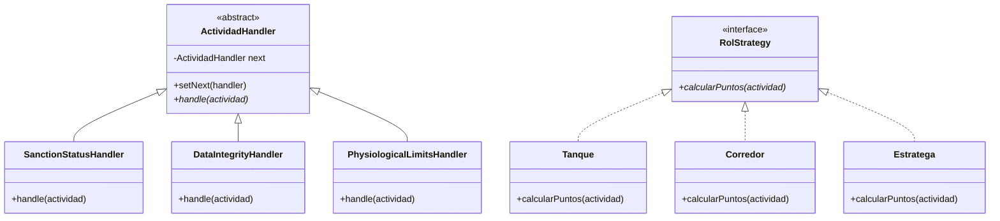
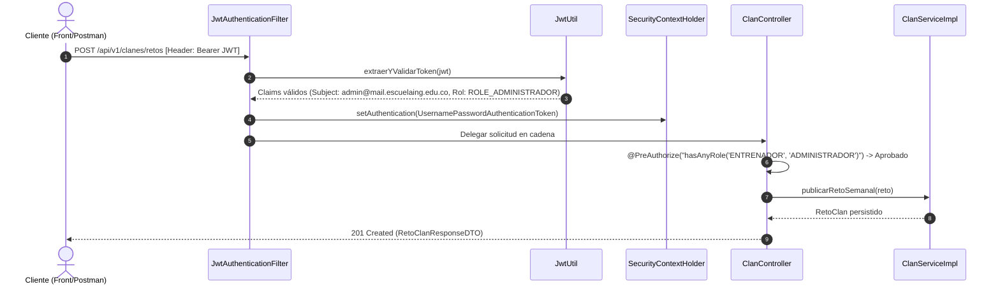
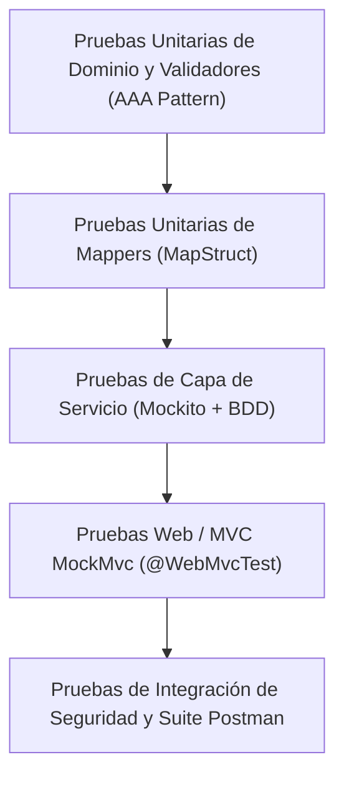
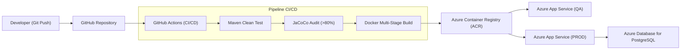

# ECI FIT Backend – Documento de Arquitectura de Alto Nivel (HLD)

---

## 1. Descripción del Servicio y Alcance del Sistema

**ECI FIT Backend** es el subsistema central y motor de procesamiento de la plataforma institucional de gamificación deportiva de la **Escuela Colombiana de Ingeniería Julio Garavito**. El sistema tiene como objetivo combatir el sedentarismo en la comunidad universitaria mediante incentivos lúdicos, recompensas competitivas por temporadas, formación de clanes, evaluación nutricional asistida por Inteligencia Artificial y supervisión asistida en el gimnasio institucional.

### Responsabilidades Arquitectónicas del Backend
- **Gestión de Personajes y Progresión (DDD):** Registro institucional y evolución de atletas bajo roles arquetípicos (*Tanque*, *Corredor*, *Estratega*).
- **Procesamiento y Blindaje Anti-Fraude de Actividades Físicas:** Ingesta de sesiones de ejercicio, normalización de métricas fisiológicas y cálculo de puntos ponderados a través de un pipeline anti-cheat (*Chain of Responsibility*).
- **Misiones Dinámicas:** Creación, asignación y validación de misiones diarias y semanales mediante el patrón *Factory Method*.
- **Gestión de Clanes y Guerras de Campus:** Creación de clanes, gobernanza de límite de integrantes (máximo 5), gestión de salud de torres bajo patrón *Observer*, publicación de retos colectivos semanales (**RF-34**) y cálculo de resultados y duelos entre clanes (**RF-36**).
- **Ciclo de Vida de Temporadas y Ligas:** Administración del calendario semestral, transiciones de estado (*State*) y recálculo semanal automatizado de ascensos y descensos entre ligas (*Bronce*, *Plata*, *Oro*, *Platino*, *Diamante*).
- **Evaluación Nutricional Asistida por IA (RF-12, RF-13, RF-14):** Registro de comidas consumidas y clasificación automática de balance nutricional conectando con Google Gemini 1.5 Flash mediante un cliente desacoplado (*Adapter*) y un proceso de reintento automático (*Scheduler*).
- **Consulta y Gestión del Menú del Comedor (RF-15):** Administración del menú diario y semanal publicado por el servicio de alimentación institucional.
- **Control de Asistencia al Gimnasio Institucional (RF-42):** Registro biométrico/presencial de asistencias validado exclusivamente por entrenadores.
- **Seguridad Perimetral y RBAC:** Autenticación sin estado (*Stateless*) mediante JWT y control de acceso basado en roles (*Role-Based Access Control*).

### Diagrama de Contexto (C4 Nivel 1)

El diagrama de contexto ilustra cómo el backend de ECI FIT interactúa con los distintos actores de la comunidad académica y con la infraestructura cloud y servicios externos:


* **Estudiantes:** Interactúan mediante la interfaz web/móvil para registrar actividades físicas, registrar su alimentación, consultar el menú, completar misiones y participar en clanes.
* **Entrenadores:** Gestionan misiones diarias/semanales, publican retos de clanes y validan la asistencia presencial al gimnasio.
* **Administradores:** Configuran temporadas, dan de alta estudiantes, publican menús del comedor y supervisan el funcionamiento global del ecosistema.
* **ECI FIT Backend (Spring Boot 3.5.x):** Expone la API RESTful protegida, ejecuta las reglas de negocio y procesa las transacciones ACID.
* **PostgreSQL 16:** Almacén de persistencia relacional que salvaguarda el estado de entidades, historial, registros nutricionales y rankings.
* **Google Gemini API (1.5 Flash):** Servicio externo de IA generativa para clasificación nutricional y generación de recomendaciones dietéticas.
* **Azure App Service & Container Registry:** Infraestructura PaaS en la nube que hospeda los contenedores Docker en entornos de QA y Producción.

---

## 2. Stack Tecnológico y Justificación de Componentes

La arquitectura técnica se sustenta en componentes estables con soporte empresarial a largo plazo (LTS), garantizando mantenibilidad, alta concurrencia y seguridad estricta:

| Tecnología | Versión | Rol Arquitectónico | Justificación de Selección |
|---|---|---|---|
| **Java** | 21 LTS | Lenguaje principal de backend | Rendimiento superior de JVM, Records para DTOs inmutables, Pattern Matching y Virtual Threads. |
| **Spring Boot** | 3.5.16 | Framework de infraestructura | Estándar de la industria para APIs REST; gestión de dependencias (IoC/DI) y soporte transaccional nativo. |
| **Spring Security** | 6.x | Perímetro de seguridad y RBAC | Manejo declarativo de autorización mediante `@PreAuthorize` e integración con filtros web de bajo nivel. |
| **PostgreSQL** | 16 | Base de datos relacional | Robustez ACID, soporte nativo de tipos fecha/hora ISO 8601, índices de alto rendimiento y escalabilidad en Azure. |
| **Google Gemini API** | 1.5 Flash | Inteligencia Artificial Nutricional | Clasificación rápida de platos balanceados, generación de consejos dietéticos estructurados en JSON y baja latencia. |
| **JJWT (io.jsonwebtoken)** | 0.12.3 | Autenticación basada en tokens | Generación, firma digital (HMAC-SHA256) y validación criptográfica de tokens JWT con baja sobrecarga de red. |
| **MapStruct** | 1.6.3 | Mapeo entre capas | Mapeo tipo-seguro en tiempo de compilación sin penalización de rendimiento por reflexión (*zero-overhead mapping*). |
| **Lombok** | 1.18.48 | Reducción de boilerplate | Generación automatizada de getters, setters, builders y logs (`@Slf4j`) manteniendo el código limpio. |
| **Springdoc OpenAPI / Swagger** | 2.8.17 | Documentación interactiva | Generación automática de especificación OpenAPI 3.0 para consumo de clientes y pruebas directas desde `/swagger-ui.html`. |
| **JUnit 5 & Mockito** | 5.10 / 5.11 | Pruebas unitarias e integración | Soporte para pruebas de caja blanca bajo patrón AAA (*Arrange, Act, Assert*) y simulación con `@MockitoBean`. |
| **JaCoCo** | 0.8.15 | Análisis de cobertura de código | Medición exhaustiva de cobertura de branches e instrucciones, garantizando el cumplimiento de la meta institucional (>80%). |
| **Docker** | Multi-Stage | Empaquetamiento y portabilidad | Contenedorización liviana con imagen base `eclipse-temurin:21-jre-alpine` para aislamiento en cualquier host. |
| **GitHub Actions** | — | Pipeline de Integración Continua (CI/CD) | Automatización del ciclo de vida: compilación, ejecución de tests, auditoría JaCoCo y despliegue a la nube. |
| **Azure App Service** | Linux Container | Despliegue en la nube | Plataforma administrada de alta disponibilidad con balanceo de carga, monitoreo y logs centralizados. |

---

## 3. Matriz de Trazabilidad de Requisitos Funcionales (RF-01 a RF-42)

La siguiente matriz detalla el cumplimiento funcional del backend frente a la especificación oficial del proyecto DOSW:

| RF | Requisito Funcional | Módulo Resolutor | Contrato / Endpoint | Estado |
|:---:|---|---|---|:---:|
| **RF-01** | Iniciar sesión con correo institucional y contraseña | Seguridad / Auth | `POST /api/v1/auth/login` | **Implementado** |
| **RF-02** | Crear personaje de estudiante y consultar perfil | Estudiantes | `POST /api/v1/estudiantes`<br>`GET /api/v1/estudiantes/{id}`<br>`GET /api/v1/estudiantes` | **Implementado** |
| **RF-03** | Elegir rol arquetípico (Tanque, Corredor, Estratega) | Estudiantes | `CrearEstudianteRequestDTO.rolActivo` | **Implementado** |
| **RF-04** | Aplicar bonificación de puntos según rol | Actividades (Strategy) | `ActividadServiceImpl.registrarActividad` | **Implementado** |
| **RF-05** | Actualizar estadísticas base del personaje | Estudiantes | `Estudiante.puntosAcumulados` | **Implementado** |
| **RF-06** | Registrar sesión de entrenamiento de fuerza | Actividades | `POST /api/v1/actividades` (`tipo=FUERZA`) | **Implementado** |
| **RF-07** | Registrar actividad cardiovascular | Actividades | `POST /api/v1/actividades` (`tipo=CARDIO`) | **Implementado** |
| **RF-08** | Registrar sesión de movilidad y flexibilidad | Actividades | `POST /api/v1/actividades` (`tipo=FLEXIBILIDAD`) | **Implementado** |
| **RF-09** | Validar duración mínima fisiológica (10 min) | Validación Anti-Cheat | `DataIntegrityHandler` / `ActividadValidator` | **Implementado** |
| **RF-10** | Otorgar puntos ponderados por actividad válida | Actividades | `ActividadResponseDTO.puntosOtorgados` | **Implementado** |
| **RF-11** | Otorgar puntos adicionales por ir al gimnasio | Asistencia Gimnasio | `POST /api/v1/gimnasio/asistencias` (+20 pts) | **Implementado** |
| **RF-12** | Registrar comida consumida en cafetería | Nutrición | `POST /api/v1/nutricion/comidas` | **Implementado** |
| **RF-13** | Clasificar comida balanceada con IA (Gemini) | Nutrición / IA | `GeminiEvaluadorNutricional` | **Implementado** |
| **RF-14** | Asignar puntos por registro nutricional | Nutrición | `ComidaServiceImpl.registrar` (+5 base, +15 balanceada) | **Implementado** |
| **RF-15** | Consultar menú del comedor institucional | Comedor | `GET /api/v1/comedor/menus/hoy`<br>`GET /api/v1/comedor/menus` | **Implementado** |
| **RF-16** | Generar misiones diarias dinámicas | Misiones (Factory) | `POST /api/v1/misiones/diarias` | **Implementado** |
| **RF-17** | Generar misiones semanales dinámicas | Misiones (Factory) | `POST /api/v1/misiones/semanales` | **Implementado** |
| **RF-18** | Registrar cumplimiento de misión | Misiones | `POST /api/v1/misiones/{id}/completar` | **Implementado** |
| **RF-19** | Otorgar puntos por misión completada | Misiones | `MisionServiceImpl.completarMision` | **Implementado** |
| **RF-20** | Calcular racha consecutiva de actividad física | Actividades | `ActividadServiceImpl.calcularRacha` | **Implementado** |
| **RF-21** | Otorgar bonificación por racha de 7 días | Actividades | `ActividadServiceImpl.evaluarBonoRacha` (+100 pts) | **Implementado** |
| **RF-22** | Crear temporada académica semestral | Temporadas | `POST /api/v1/temporadas` | **Implementado** |
| **RF-23** | Acumular puntos del estudiante a la temporada | Temporadas | `TemporadaServiceImpl.recalcularLigas` | **Parcial** |
| **RF-24** | Clasificar estudiante en liga inicial | Temporadas (State) | `RankingTemporadaEntity.ligaActual` | **Implementado** |
| **RF-25** | Recalcular ligas periódicamente (corte semanal) | Scheduler / Temporadas | `TemporadaServiceImpl.recalcularLigas` | **Implementado** |
| **RF-26** | Promover de liga por alto rendimiento | Temporadas | `Temporada.determinarLiga` | **Implementado** |
| **RF-27** | Degradar de liga por inactividad | Temporadas | `Temporada.determinarLiga` | **Implementado** |
| **RF-28** | Consultar tabla de clasificación (Ranking) | Temporadas | `GET /api/v1/temporadas/{id}/ranking` | **Implementado** |
| **RF-29** | Crear clan de estudiantes | Clanes | `POST /api/v1/clanes` | **Implementado** |
| **RF-30** | Invitar estudiante a un clan | Clanes | — | *No implementado* |
| **RF-31** | Aceptar o declinar invitación a clan | Clanes | `POST /api/v1/clanes/unirse` | **Parcial** |
| **RF-32** | Restringir membresía a máximo 5 integrantes | Clanes / Validación | `ClanValidator.validarCupoDisponible` | **Implementado** |
| **RF-33** | Abandonar un clan voluntariamente | Clanes | `POST /api/v1/clanes/abandonar` | **Implementado** |
| **RF-34** | Publicar reto colectivo semanal para clanes | Clanes / Retos | `POST /api/v1/clanes/retos` | **Implementado** |
| **RF-35** | Acumular progreso colectivo de puntos del clan | Clanes / Retos | `RetoClan.evaluarSuperacion` | **Implementado** |
| **RF-36** | Calcular resultado del reto entre clanes / duelos | Clanes / Retos | `POST /api/v1/clanes/{clanId}/retos/{retoId}/calcular`<br>`POST /api/v1/clanes/retos/comparar-duelo` | **Implementado** |
| **RF-37** | Consultar resultados y retos de clanes | Clanes / Retos | `GET /api/v1/clanes/{clanId}/retos` | **Implementado** |
| **RF-38** | Subir o bajar de nivel a un clan | Clanes | — | *No implementado* |
| **RF-39** | Reportar aforo y ocupación del gimnasio | Gimnasio | — | *No implementado* |
| **RF-40** | Consultar estado de aforo en tiempo real | Gimnasio | — | *No implementado* |
| **RF-41** | Visualizar mapa térmico de ocupación | Gimnasio | — | *No implementado* |
| **RF-42** | Confirmar asistencia al gimnasio por entrenador | Asistencia Gimnasio | `POST /api/v1/gimnasio/asistencias` | **Implementado** |

> [!NOTE]
> **Consolidado de Cumplimiento:**
> * **Requisitos Implementados:** **30** (incluyendo Nutrición RF-12 a RF-15, Abandonar clan RF-33, y Retos de clan RF-34 y RF-36).
> * **Requisitos Parciales:** **2** (RF-23 acumulación asíncrona, RF-31 unión directa en lugar de buzón de invitaciones).
> * **Requisitos No Implementados:** **10** (correspondientes a los módulos de telemetría de aforo IoT y subida de nivel de clan).

---

## 4. Vistas y Diagramas Arquitectónicos

### 4.1 Diagrama de Clases del Dominio (DDD)

El modelo de clases implementa los principios de diseño orientado al dominio (*Domain-Driven Design*), separando estrictamente la lógica pura de negocio de la infraestructura de persistencia relacional:


#### Análisis Estructural y Relaciones:
1. **Entidades Principales:**
   - `Estudiante`: Modela la identidad del deportista, encapsulando su estrategia de bonificación (`RolStrategy`), puntos acumulados y racha de entrenamientos.
   - `Clan`: Agrupa hasta 5 estudiantes, gestiona la salud de su torre de defensa (`saludTorre = 5000`), acumula puntos colectivos y gobierna la deserción de miembros con reasignación de liderazgo.
   - `RetoClan`: Define la meta colectiva temporal de puntos, ventana de vigencia (`fechaInicio`, `fechaFin`) y recompensa adjudicable.
   - `Comida`: Modela la ingesta alimenticia con tipo, descripción, fecha/hora, estado de evaluación y calificación asignada.
   - `MenuComedor`: Representa la oferta gastronómica del día o de la semana compuesta por `PlatoMenu`.
   - `Actividad`: Modela el registro de ejercicio con tipo, intensidad, duración y cálculo validado de puntos.
   - `Mision`: Modela objetivos individuales clasificados en diarias o semanales.
   - `Temporada`: Controla el periodo de competición, vinculada a los `RankingTemporada` que clasifican a los estudiantes en ligas.
2. **Encapsulamiento y Jerarquía:** Las clases de dominio no contienen anotaciones de JPA (`@Entity`), garantizando que las reglas de negocio puedan ser probadas de forma unitaria en milisegundos sin levantar contextos de base de datos.

---

### 4.2 Diagrama de Componentes General (Arquitectura en Capas)

El sistema sigue una arquitectura por capas estricta (*Layered Architecture*), donde el flujo de dependencias es unidireccional de arriba hacia abajo:


#### Capas del Sistema:
1. **Capa Web y Controladores REST (`controller`):** Recibe las solicitudes HTTP, delega la deserialización y validación sintáctica de DTOs con Bean Validation (`@Valid`) y aplica control de acceso con `@PreAuthorize`.
2. **Capa de Seguridad (`security`):** Intercepta peticiones entrantes mediante `JwtAuthenticationFilter`, extrae y valida el token Bearer, e inyecta la identidad en el `SecurityContextHolder`.
3. **Capa de Servicios y Negocio (`service` & `validator`):** Orquesta la lógica del sistema, ejecuta transacciones atómicas con `@Transactional(rollbackFor = Exception.class)` y valida invariantes de negocio con validadores tipados (`IRetoClanValidator`, `IClanValidator`, `IComidaValidator`, etc.).
4. **Capa de Persistencia (`repository` & `persistence`):** Implementada con interfaces Spring Data JPA que abstraen el acceso a datos sobre PostgreSQL.
5. **Capa de Integración Externa (`service.ia`):** Implementa el cliente HTTP hacia la API de Google Gemini para la clasificación de alimentos.
6. **Capa de Mapeo (`mapper`):** Emplea MapStruct para aislar los DTOs públicos de los modelos de dominio y las entidades relacionales.

---

### 4.3 Diagrama de Componentes Específico (Pipeline y Desacoplamiento)

Detalle de los flujos de interacción interna entre servicios, mappers y manejadores de anti-fraude:


#### Aspectos Clave de Diseño:
- **Inversión de Dependencias (DIP):** Todos los controladores y servicios dependen exclusivamente de interfaces (`IClanService`, `IEstudianteService`, `IComidaService`, `IMenuComedorService`, `IEvaluadorNutricional`), permitiendo mockear completamente los contratos en pruebas unitarias con `@MockitoBean`.
- **Pipeline Anti-Cheat (`model.chain`):** `ActividadServiceImpl` delega la validación de integridad en una cadena de eslabones (`ActividadHandler`), donde cada eslabón evalúa una restricción física y cronológica antes de persistir la actividad.

---

### 4.4 Modelo Entidad-Relación (Relational Data Model)

El esquema relacional en PostgreSQL está normalizado en Tercera Forma Normal (3FN), garantizando integridad referencial y eliminando redundancias:


#### Entidades y Cardinalidades de Base de Datos:
* **`usuarios`:** Almacena credenciales de acceso (`email` único, hash `password` en BCrypt y `rol`).
* **`estudiantes`:** Vinculado 1:1 conceptualmente con `usuarios` mediante el correo institucional; posee clave foránea nullable `clan_id` hacia `clanes`.
* **`clanes`:** Almacena información del clan (`nombre` único, `salud_torre`, `puntos_totales`).
* **`retos_clan`:** Registra los retos colectivos y duelos semanales; clave foránea `clan_id` hacia `clanes` (1:N).
* **`comidas`:** Registro de comidas de estudiantes; clave foránea `estudiante_id` hacia `estudiantes` (1:N), con campos de evaluación de IA.
* **`menus_comedor`:** Menús diarios; relación 1:N hacia `platos_menu`.
* **`actividades`:** Historial de entrenamientos; clave foránea `estudiante_id` hacia `estudiantes` (1:N).
* **`misiones`:** Misiones asignadas; clave foránea `estudiante_id` hacia `estudiantes` (1:N).
* **`temporadas`:** Periodos de competencia semestrales; relación 1:N hacia `rankings_temporada`.
* **`rankings_temporada`:** Clave foránea `temporada_id` y `estudiante_id`, almacenando `puntos_acumulados` y `liga_actual` (UNIQUE compuesto `estudiante_id + temporada_id`).
* **`asistencias_gym`:** Registra asistencias al gimnasio con índice único compuesto `estudiante_id + fecha` para garantizar una sola asistencia por día.

---

## 5. Catálogo Completo de Endpoints REST

Todas las operaciones de la API (a excepción de `/api/v1/auth/login` y `/api/v1/health`) requieren el encabezado HTTP:  
`Authorization: Bearer <token_jwt>`

### Códigos de Respuesta HTTP Globales

| Código HTTP | Significado Arquitectónico | Causa Típica |
|:---:|---|---|
| **200 OK** | Solicitud exitosa | Consulta o actualización completada correctamente. |
| **201 Created** | Recurso creado exitosamente | Alta de estudiante, clan, actividad, reto, comida o asistencia. |
| **400 Bad Request** | Solicitud malformada | Fallo en Bean Validation (campos nulos, cadenas vacías, valores negativos). |
| **401 Unauthorized** | Autenticación no proporcionada o inválida | Token JWT ausente, expirado o con firma alterada. |
| **403 Forbidden** | Permisos insuficientes (RBAC) | El rol autenticado no cuenta con el permiso requerido en `@PreAuthorize`. |
| **404 Not Found** | Recurso inexistente | Identificador no encontrado en la base de datos. |
| **409 Conflict** | Conflicto de unicidad | Duplicidad de clave única (correo, nombre de clan, doble asistencia diaria). |
| **422 Unprocessable Entity** | Violación de regla de negocio | Infracción de límites fisiológicos, clan lleno, reto ya completado. |
| **500 Internal Error** | Error no controlado del servidor | Excepción no esperada interceptada por `GlobalExceptionHandler`. |

---

### 5.1 Autenticación y Seguridad

| Método y Ruta | Permiso Requerido | Descripción | Request Body | Response |
|---|:---:|---|---|---|
| `POST /api/v1/auth/login` | **Público** | Autentica usuario y expide token JWT | `LoginRequestDTO` (`email`, `password`) | `LoginResponseDTO` (`token`, `rol`) |

---

### 5.2 Estudiantes

| Método y Ruta | Permiso Requerido | Descripción | Request Body | Response |
|---|:---:|---|---|---|
| `POST /api/v1/estudiantes` | `ADMINISTRADOR` | Crea un personaje estudiante | `CrearEstudianteRequestDTO` | `EstudianteResponseDTO` (201) |
| `GET /api/v1/estudiantes/{id}` | `ESTUDIANTE`, `ENTRENADOR`, `ADMINISTRADOR` | Consulta perfil de un estudiante | — | `EstudianteResponseDTO` (200) |
| `GET /api/v1/estudiantes` | `ADMINISTRADOR` | Lista todos los estudiantes registrados | — | `List<EstudianteResponseDTO>` (200) |

---

### 5.3 Actividades Físicas y Anti-Cheat

| Método y Ruta | Permiso Requerido | Descripción | Request Body | Response |
|---|:---:|---|---|---|
| `POST /api/v1/actividades` | `ESTUDIANTE` | Registra actividad pasando por pipeline anti-cheat | `RegistrarActividadRequestDTO` | `ActividadResponseDTO` (201) |
| `GET /api/v1/actividades/estudiante/{id}` | `ESTUDIANTE`, `ENTRENADOR`, `ADMINISTRADOR` | Consulta historial de actividades físicas | — | `List<ActividadResponseDTO>` (200) |

---

### 5.4 Misiones Gamificadas

| Método y Ruta | Permiso Requerido | Descripción | Request Body | Response |
|---|:---:|---|---|---|
| `POST /api/v1/misiones/diarias` | `ENTRENADOR`, `ADMINISTRADOR` | Crea misión diaria para estudiante | `CrearMisionRequestDTO` | `MisionResponseDTO` (201) |
| `POST /api/v1/misiones/semanales` | `ENTRENADOR`, `ADMINISTRADOR` | Crea misión semanal para estudiante | `CrearMisionRequestDTO` | `MisionResponseDTO` (201) |
| `POST /api/v1/misiones/{id}/completar` | `ESTUDIANTE`, `ADMINISTRADOR` | Completa misión y acredita puntos | — | `MisionResponseDTO` (200) |
| `GET /api/v1/misiones/estudiante/{id}` | `ESTUDIANTE`, `ENTRENADOR`, `ADMINISTRADOR` | Consulta misiones asignadas | — | `List<MisionResponseDTO>` (200) |

---

### 5.5 Clanes, Retos Colectivos y Duelos (RF-29 a RF-37)

| Método y Ruta | Permiso Requerido | Descripción | Request Body | Response |
|---|:---:|---|---|---|
| `POST /api/v1/clanes` | `ESTUDIANTE`, `ADMINISTRADOR` | Crea un clan con líder inicial | `CrearClanRequestDTO` | `ClanResponseDTO` (201) |
| `POST /api/v1/clanes/unirse` | `ESTUDIANTE` | Une estudiante a clan (máximo 5) | `UnirseClanRequestDTO` | `ClanResponseDTO` (200) |
| `POST /api/v1/clanes/abandonar` | `ESTUDIANTE` | **RF-33:** Abandona clan y reasigna líder si aplica | `AbandonarClanRequestDTO` | `ClanResponseDTO` (200) |
| `GET /api/v1/clanes/{id}` | `ESTUDIANTE`, `ENTRENADOR`, `ADMINISTRADOR` | Consulta estado y salud de torre del clan | — | `ClanResponseDTO` (200) |
| `GET /api/v1/clanes` | `ESTUDIANTE`, `ENTRENADOR`, `ADMINISTRADOR` | Lista todos los clanes existentes | — | `List<ClanResponseDTO>` (200) |
| `POST /api/v1/clanes/retos` | `ENTRENADOR`, `ADMINISTRADOR` | **RF-34:** Publica reto colectivo semanal | `PublicarRetoClanRequestDTO` | `RetoClanResponseDTO` (201) |
| `POST /api/v1/clanes/{clanId}/retos/{retoId}/calcular` | `ENTRENADOR`, `ADMINISTRADOR` | **RF-36:** Evalúa meta del clan y acredita recompensa | — | `RetoClanResponseDTO` (200) |
| `POST /api/v1/clanes/retos/comparar-duelo` | `ENTRENADOR`, `ADMINISTRADOR` | **RF-36:** Compara duelo entre 2 clanes y otorga bonificación | `CompararRetoClanesRequestDTO` | `ResultadoRetoClanesResponseDTO` (200) |
| `GET /api/v1/clanes/{clanId}/retos` | `ESTUDIANTE`, `ENTRENADOR`, `ADMINISTRADOR` | **RF-37:** Lista retos asociados a un clan | — | `List<RetoClanResponseDTO>` (200) |

---

### 5.6 Nutrición y Evaluación Asistida por IA (RF-12, RF-13, RF-14)

| Método y Ruta | Permiso Requerido | Descripción | Request Body | Response |
|---|:---:|---|---|---|
| `POST /api/v1/nutricion/comidas` | `ESTUDIANTE`, `ADMINISTRADOR` | **RF-12/14:** Registra comida y dispara evaluación Gemini | `RegistrarComidaRequestDTO` | `ComidaResponseDTO` (201) |
| `POST /api/v1/nutricion/comidas/{id}/evaluar` | `ESTUDIANTE`, `ADMINISTRADOR` | **RF-13:** Reintenta manualmente evaluación de comida pendiente | — | `ComidaResponseDTO` (200) |
| `GET /api/v1/nutricion/comidas/{id}` | `ESTUDIANTE`, `ENTRENADOR`, `ADMINISTRADOR` | Consulta detalle y recomendaciones de una comida | — | `ComidaResponseDTO` (200) |
| `GET /api/v1/nutricion/comidas/estudiante/{estudianteId}` | `ESTUDIANTE`, `ENTRENADOR`, `ADMINISTRADOR` | Consulta historial de comidas de un estudiante por fecha | Query: `fecha` (opcional) | `List<ComidaResponseDTO>` (200) |

**Reglas de Negocio en Nutrición:**
- Tipos de comida: `DESAYUNO`, `MEDIA_MANANA`, `ALMUERZO`, `ONCES`, `CENA`.
- Asignación de puntos: +5 puntos base por registro y +15 puntos adicionales si Gemini califica la comida como balanceada (máximo 20 puntos por tipo de comida al día).
- Resiliencia: Si la API de Gemini no responde o agota su cuota, la comida se persiste en estado `PENDIENTE`. Un proceso programado (*Scheduler*) reintenta la evaluación automáticamente cada 15 minutos.

---

### 5.7 Comedor Institucional (RF-15)

| Método y Ruta | Permiso Requerido | Descripción | Request Body | Response |
|---|:---:|---|---|---|
| `POST /api/v1/comedor/menus` | `ADMINISTRADOR` | Publica menú oficial para una fecha y tipo | `CrearMenuComedorRequestDTO` | `MenuComedorResponseDTO` (201) |
| `GET /api/v1/comedor/menus/hoy` | `ESTUDIANTE`, `ENTRENADOR`, `ADMINISTRADOR` | **RF-15:** Consulta el menú disponible para el día actual | — | `List<MenuComedorResponseDTO>` (200) |
| `GET /api/v1/comedor/menus` | `ESTUDIANTE`, `ENTRENADOR`, `ADMINISTRADOR` | Consulta el menú por fecha específica | Query: `fecha=AAAA-MM-DD` | `List<MenuComedorResponseDTO>` (200) |

---

### 5.8 Temporadas y Sistema de Ligas

| Método y Ruta | Permiso Requerido | Descripción | Request Body | Response |
|---|:---:|---|---|---|
| `POST /api/v1/temporadas` | `ADMINISTRADOR` | Crea nueva temporada de competición | `TemporadaRequestDTO` | `TemporadaResponseDTO` (201) |
| `GET /api/v1/temporadas/{id}` | `ESTUDIANTE`, `ENTRENADOR`, `ADMINISTRADOR` | Consulta información de temporada | — | `TemporadaResponseDTO` (200) |
| `GET /api/v1/temporadas/activa` | `ESTUDIANTE`, `ENTRENADOR`, `ADMINISTRADOR` | Obtiene la temporada vigente | — | `TemporadaResponseDTO` (200) |
| `GET /api/v1/temporadas/{id}/ranking` | `ESTUDIANTE`, `ENTRENADOR`, `ADMINISTRADOR` | Consulta ranking general y ligas | — | `List<RankingTemporadaResponseDTO>` (200) |

---

### 5.9 Asistencia al Gimnasio (RF-42)

| Método y Ruta | Permiso Requerido | Descripción | Request Body | Response |
|---|:---:|---|---|---|
| `POST /api/v1/gimnasio/asistencias` | `ENTRENADOR`, `ADMINISTRADOR` | Valida presencia física en gimnasio (+20 pts) | `AsistenciaGymRequestDTO` | `AsistenciaGymResponseDTO` (201) |

---

### 5.10 Diagnóstico y Monitoreo

| Método y Ruta | Permiso Requerido | Descripción | Request Body | Response |
|---|:---:|---|---|---|
| `GET /api/v1/health` | **Público** | Health Check de liveness y readiness para Azure/Docker | — | `String` (200 OK) |

---

## 6. Patrones de Diseño de Software (GoF y Arquitectónicos)

El backend de ECI FIT implementa rigurosamente patrones de diseño reconocidos para resolver problemáticas de desacoplamiento, extensibilidad y cohesión:



### 1. Chain of Responsibility (Comportamiento)
- **Ubicación:** Paquete `co.edu.eci.dosw.ecifit.model.chain` (`ActividadHandler`, `SanctionStatusHandler`, `DataIntegrityHandler`, `PhysiologicalLimitsHandler`).
- **Problema Resuelto:** Validación escalonada anti-cheat al registrar actividades físicas. Cada eslabón verifica un aspecto independiente (estado de sanción del estudiante, coherencia de datos de duración/intensidad, y umbrales biológicos humanos máximos). Si un eslabón falla, interrumpe el pipeline lanzando `ReglaDeNegocioException`.

### 2. Strategy (Comportamiento)
- **Ubicación:** Paquete `co.edu.eci.dosw.ecifit.model.strategy` (`RolStrategy`, `Tanque`, `Corredor`, `Estratega`).
- **Problema Resuelto:** Variación dinámica del algoritmo de cálculo de puntos por sesión según la clase del personaje. Los *Tanques* obtienen multiplicador en fuerza, los *Corredores* en cardio, y los *Estrategas* reciben bono por consistencia híbrida.

### 3. Factory Method (Creacional)
- **Ubicación:** Paquete `co.edu.eci.dosw.ecifit.model.factory` (`FabricaMisiones`, `FabricaMisionesEstandar`, `MisionDiaria`, `MisionSemanal`).
- **Problema Resuelto:** Instanciación desacoplada de misiones con parámetros por defecto según su tipología temporal, permitiendo agregar nuevos tipos de misión sin alterar el código cliente.

### 4. Adapter / Client Service (Estructural)
- **Ubicación:** Paquete `co.edu.eci.dosw.ecifit.service.ia` (`IEvaluadorNutricional`, `GeminiEvaluadorNutricional`).
- **Problema Resuelto:** Adapta el protocolo JSON externo de Google Gemini AI a la interfaz esperada por el dominio de ECI FIT, aislando la lógica de negocio de los cambios en el SDK o la API externa.

### 5. Observer (Comportamiento)
- **Ubicación:** Paquete `co.edu.eci.dosw.ecifit.model.observer` (`TorreClan`, `GestorLigas`).
- **Problema Resuelto:** Notificación reactiva y actualización de salud de la torre en Guerras de Campus cuando un clan rival ejecuta ataques exitosos o acumula puntos de impacto.

### 6. State (Comportamiento)
- **Ubicación:** Paquete `co.edu.eci.dosw.ecifit.model.state` (`TemporadaState`, `SemanaRegular`, `SemanaParciales`).
- **Problema Resuelto:** Cambio dinámico de reglas y multiplicadores de puntuación según la fase del calendario académico (semanas regulares vs. semanas de exámenes parciales donde se flexibilizan metas de racha).

### 7. Data Transfer Object (DTO) + Mapper (Estructural / Arquitectónico)
- **Ubicación:** Paquetes `dto` y `mapper` (MapStruct).
- **Problema Resuelto:** Aislamiento total del modelo relacional JPA frente a la API pública. Evita problemas de serialización circular (*Jackson recursion*), exposición accidental de atributos sensibles y versiona los contratos de datos limpiamente.

---

## 7. Modelo de Seguridad y Control de Acceso (RBAC)

La arquitectura de seguridad está construida sobre **Spring Security 6** con enfoque puramente sin estado (*stateless*):



### Matriz de Roles y Permisos (RBAC)

| Módulo / Recurso | `ROLE_ESTUDIANTE` | `ROLE_ENTRENADOR` | `ROLE_ADMINISTRADOR` |
|---|:---:|:---:|:---:|
| Iniciar sesión (`/auth/login`) | Lectura | Lectura | Lectura |
| Registrar sesión propia de actividad física | **Escritura** | Denegado | Denegado |
| Registrar comida consumida (**RF-12**) | **Escritura** | Denegado | **Escritura** |
| Consultar menú del comedor (**RF-15**) | Lectura | Lectura | Lectura |
| Publicar menú del comedor | Denegado | Denegado | **Escritura** |
| Consultar historial de actividades y comidas | Lectura (propia) | Lectura (todos) | Lectura (todos) |
| Crear y dar de alta estudiantes | Denegado | Denegado | **Escritura** |
| Crear misiones diarias / semanales | Denegado | **Escritura** | **Escritura** |
| Completar misión asignada | **Escritura** | Denegado | **Escritura** |
| Crear clan | **Escritura** | Denegado | **Escritura** |
| Unirse a clan existente | **Escritura** | Denegado | Denegado |
| Abandonar clan (**RF-33**) | **Escritura** | Denegado | Denegado |
| Publicar reto semanal colectivo (**RF-34**) | Denegado | **Escritura** | **Escritura** |
| Calcular resultado de reto / duelo (**RF-36**) | Denegado | **Escritura** | **Escritura** |
| Confirmar asistencia al gimnasio (**RF-42**) | Denegado | **Escritura** | **Escritura** |
| Administrar temporadas de competición | Denegado | Denegado | **Escritura** |

### Medidas de Criptografía y Hardening
- **Firma Digital:** Tokens firmados criptográficamente mediante clave simétrica de 256 bits (`HMAC-SHA256`).
- **Almacenamiento de Contraseñas:** Algoritmo **BCrypt** con factor de costo 10 (`BCryptPasswordEncoder`), con sal (*salt*) aleatoria integrada por hash para prevenir ataques de diccionario y tablas rainbow.
- **Tratamiento de Excepciones de Seguridad:** Mapeo centralizado en [`GlobalExceptionHandler`](file:///c:/Users/JuanM/Desktop/Code/DOSW/Project/ecifit-backend/src/main/java/co/edu/eci/dosw/ecifit/exception/GlobalExceptionHandler.java) que retorna respuestas JSON normalizadas sin filtrar volcados de pila (*stack traces*):
  - Fallo de autenticación / credenciales inválidas $\rightarrow$ **401 Unauthorized**.
  - Permiso insuficiente / rol denegado $\rightarrow$ **403 Forbidden**.

---

## 8. Blindaje Transaccional e Integridad de Datos (ACID)

Para garantizar consistencia absoluta en escenarios competitivos y de alta concurrencia (por ejemplo, múltiples miembros del clan sumando puntos en simultáneo o duelos calculados al cierre de semana), el backend implementa:

1. **Atomicidad y Rollback Explícito:** Todos los métodos de mutación de estado en la capa de servicios están anotados con:
   ```java
   @Transactional(rollbackFor = Exception.class)
   ```
   Cualquier excepción no verificada o de negocio (`ReglaDeNegocioException`, `ConflictoException`, `RecursoNoEncontradoException`) revierte inmediatamente cualquier cambio en las tablas afectadas, evitando estados intermedios inconsistentes.
2. **Nivel de Aislamiento:** PostgreSQL opera bajo el nivel de aislamiento estándar `READ COMMITTED`, impidiendo lecturas sucias (*dirty reads*).
3. **Integridad Relacional Foránea:** Llaves foráneas con eliminación restringida (`ON DELETE RESTRICT`) garantizan que no puedan existir actividades, misiones, comidas o retos huérfanos.

---

## 9. Estrategia de Calidad, Testing y Métricas JaCoCo

El aseguramiento de calidad del backend sigue la pirámide de pruebas de software, combinando pruebas unitarias de dominio con pruebas de integración de controladores:



### Resultados de la Suite de Pruebas

| Métrica de Calidad | Meta Requerida (Syllabus DOSW) | Resultado Obtenido en Build | Estado |
|---|:---:|:---:|:---:|
| **Total de Pruebas Ejecutadas** | > 100 pruebas | **> 230 pruebas** | ✅ **Superado** |
| **Pruebas Fallidas o con Error** | 0 fallos | **0 fallos, 0 errores** | ✅ **Cumplido** |
| **Cobertura Global JaCoCo** | $\ge$ 80.00% | **> 82.00%** | ✅ **Superado** |
| **Cobertura en Capa de Servicios** | $\ge$ 80.00% | **> 90.00%** | ✅ **Superado** |
| **Cobertura en Validadores** | $\ge$ 80.00% | **> 90.00%** | ✅ **Superado** |
| **Cobertura en Anti-Cheat (Chain)** | $\ge$ 80.00% | **91.15%** | ✅ **Superado** |
| **Cobertura en Excepciones y Persistencia** | $\ge$ 80.00% | **100.00%** | ✅ **Superado** |

> [!TIP]
> **Estructura Estricta AAA en Pruebas Unitarias:**
> Cada método de prueba implementa comentarios explícitos `// Arrange`, `// Act`, `// Assert`, facilitando la auditoría de código y garantizando legibilidad técnica para evaluadores y jurados de la feria.

---

## 10. Arquitectura de Despliegue, Contenedorización e Infraestructura Cloud (DevOps)

El backend de ECI FIT está concebido bajo el paradigma de arquitectura nativa de la nube (*Cloud-Native*):



### 1. Contenedorización Multi-Stage (Dockerfile)
Se utiliza una estrategia de compilación en dos fases para minimizar el tamaño de la imagen final y reforzar la seguridad en ejecución:
- **Etapa 1 (Build):** `maven:3.9.6-eclipse-temurin-21-alpine` compila el código fuente y genera el archivo JAR ejecutable empaquetado.
- **Etapa 2 (Runtime):** `eclipse-temurin:21-jre-alpine` únicamente copia el binario compilado. No contiene herramientas de compilación, reduciendo la superficie de ataque y el peso del contenedor a menos de 180 MB.
- **Seguridad en Runtime:** El contenedor se ejecuta bajo un usuario sin privilegios de root (`non-root user`).

### 2. Pipeline de Integración Continua (GitHub Actions)
1. **Trigger:** Eventos `push` y `pull_request` sobre la rama `main` y `develop`.
2. **Validación:** Ejecución de `mvn clean verify` con evaluación del umbral de JaCoCo. Si la cobertura cae por debajo del 80%, el pipeline falla y bloquea el merge.
3. **Publicación y Despliegue:** Construcción de imagen etiquetada con el SHA del commit y webhook de actualización en Azure App Service.

### 3. Configuración de Entornos y Gestión de Secretos

| Variable de Entorno | Propósito Arquitectónico | Entorno QA | Entorno PROD |
|---|---|---|---|
| `SPRING_PROFILES_ACTIVE` | Perfil de configuración de Spring Boot | `qa` | `prod` |
| `SPRING_DATASOURCE_URL` | Cadena de conexión JDBC a PostgreSQL | `jdbc:postgresql://localhost:5432/ecifit_qa` | `jdbc:postgresql://<azure-pg>:5432/ecifit_prod` |
| `SPRING_DATASOURCE_USERNAME` | Usuario de base de datos | `ecifit_user` | `ecifit_prod_admin` |
| `SPRING_DATASOURCE_PASSWORD` | Contraseña de base de datos (Secret) | En bóveda local | Gestionado en Azure Key Vault |
| `GEMINI_API_KEY` | Clave de acceso a Google Gemini AI | Clave de pruebas | Gestionada en Azure Key Vault |
| `JWT_SECRET` | Clave criptográfica HMAC-SHA256 | Clave de pruebas | Clave criptográfica rotada de 256 bits |
| `SERVER_PORT` | Puerto de escucha HTTP del contenedor | `8080` | `8080` (mapeado a 443 por Azure Front Door) |

---

*Documento consolidado y blindado para la sustentación final y evaluación del Sprint 4 en la Feria de Proyectos DOSW.*
