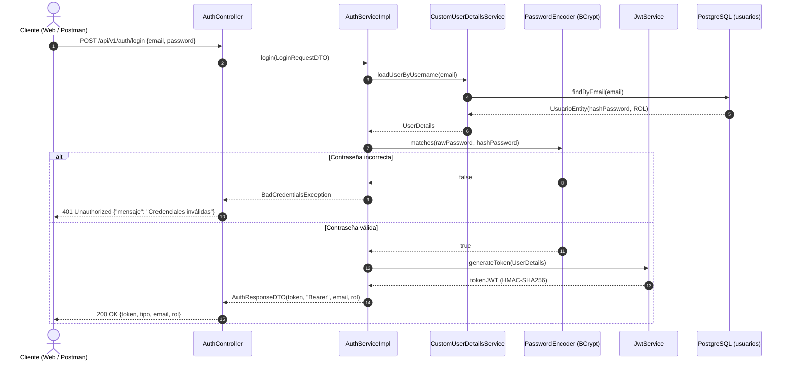
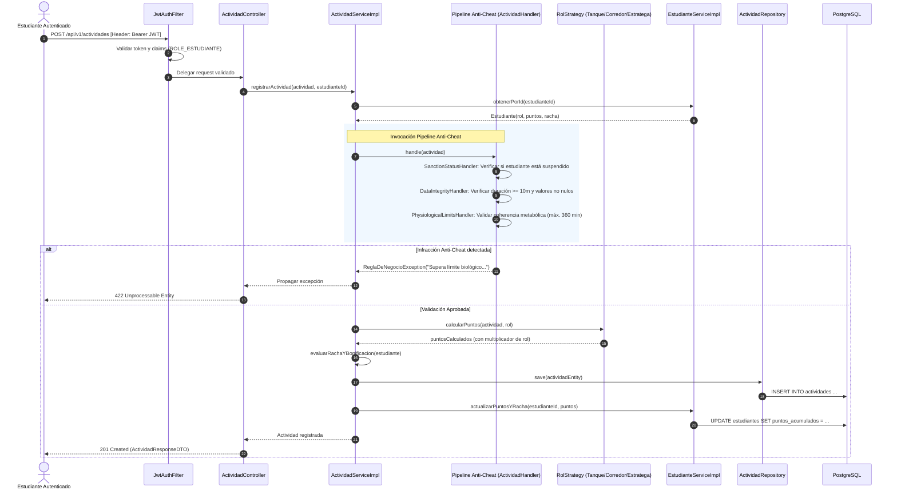
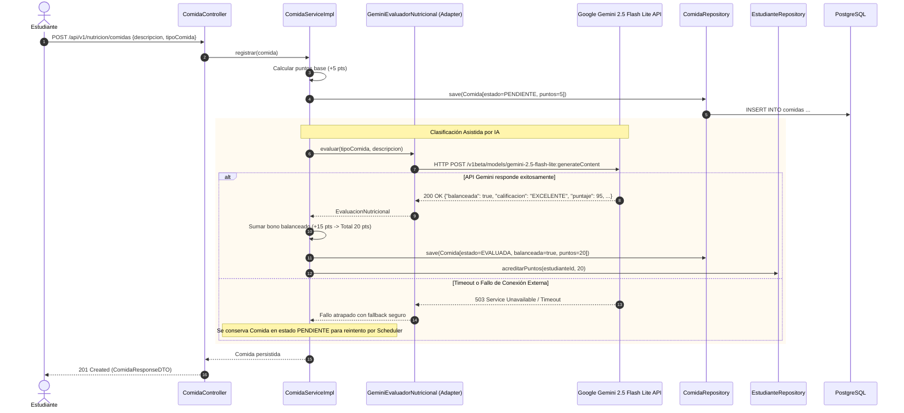
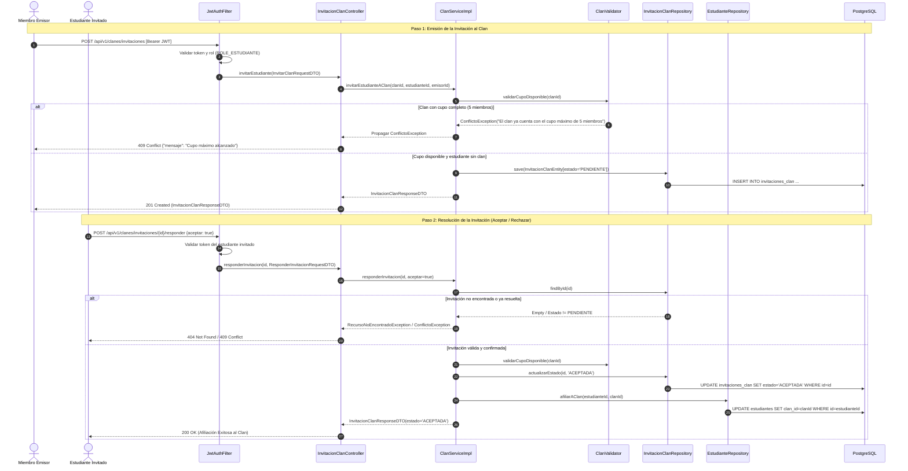
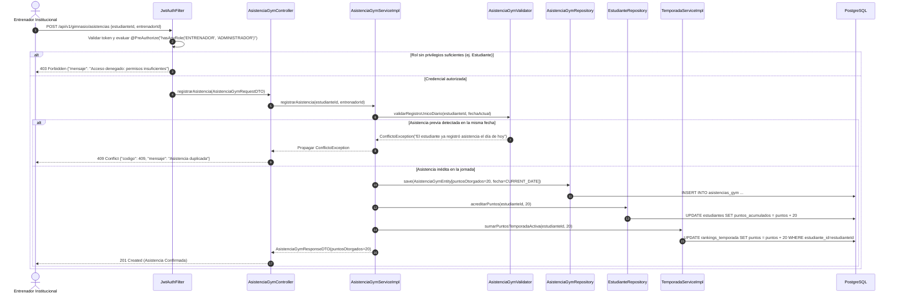
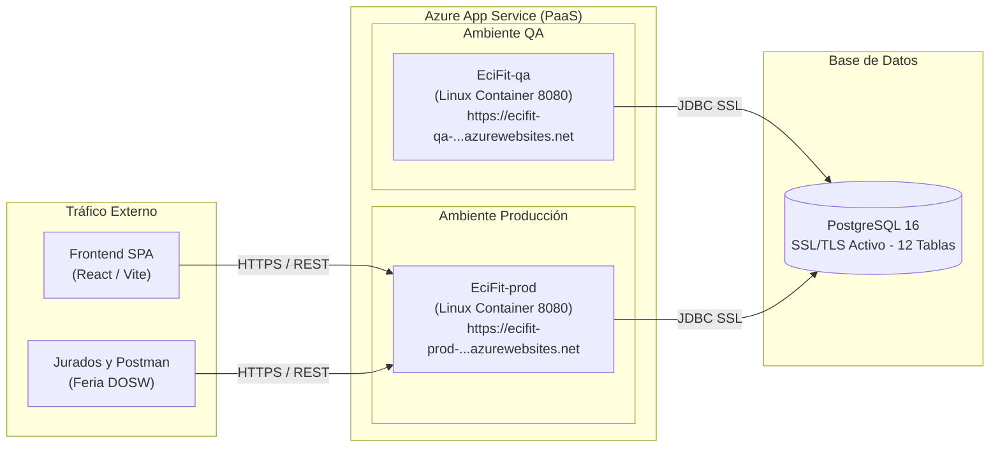

# ECI FIT Backend – Documento de Arquitectura de Alto Nivel (HLD)

---

## 1. Descripción del Servicio y Diagrama de Contexto

### 1.1 Propósito y Alcance del Sistema
**ECI FIT Backend** es el núcleo de cómputo, reglas de negocio y orquestación de la plataforma institucional de gamificación deportiva y bienestar para la **Escuela Colombiana de Ingeniería Julio Garavito**. El sistema combate el sedentarismo universitario convirtiendo el entrenamiento físico, la constancia de hábitos y la nutrición balanceada en una experiencia competitiva inspirada en juegos de rol (RPG) y batallas de campus.

Sus responsabilidades esenciales abarcan:
1. **Gestión de Personajes y Progresión:** Creación de atletas institucionales bajo arquetipos de juego (*Tanque*, *Corredor*, *Estratega*) y trazabilidad de estadísticas.
2. **Pipeline Anti-Fraude de Actividades:** Validación fisiológica estricta y blindaje contra registros ficticios mediante el patrón *Chain of Responsibility*.
3. **Misiones Gamificadas:** Generación desacoplada de objetivos diarios y semanales mediante *Factory Method*.
4. **Guerras de Clanes y Asedios:** Gestión de clanes (límite estricto de 5 miembros), defensa reactiva de la torre (*Observer*), publicación de retos colectivos (**RF-34**) y resolución de duelos entre clanes (**RF-36**).
5. **Gobernanza de Membresía e Invitaciones a Clanes (RF-30, RF-31, RF-33):** Sistema completo de invitaciones directas por miembros, aceptación/rechazo y abandono con reasignación automática de líder.
6. **Ciclo de Ligas y Temporadas:** Control de calendario académico (*State*) y recálculo semanal de ascensos y descensos (*Bronce*, *Plata*, *Oro*, *Diamante*).
7. **Nutrición Asistida por Inteligencia Artificial (RF-12, RF-13, RF-14):** Evaluación dietética automática y consejos nutricionales conectando de forma resiliente con **Google Gemini 2.5 Flash Lite**.
8. **Menú del Comedor Institucional (RF-15):** Exposición del menú saludable diario publicado por bienestar universitario.
9. **Asistencia Verificada al Gimnasio (RF-42):** Registro presencial validado exclusivamente por entrenadores institucionales.
10. **Seguridad Stateless y RBAC:** Protección perimetral con tokens JWT y control de acceso basado en roles (*Estudiante*, *Entrenador*, *Administrador*).

### 1.2 Diagrama de Contexto del Sistema (C4 Nivel 1)

El siguiente diagrama delimita las fronteras del backend con los actores del campus y los subsistemas externos:


---

## 2. Tecnologías a Usar

La selección tecnológica prioriza componentes LTS con soporte corporativo, compatibilidad nativa con contenedores y bajo consumo de recursos en Azure:

| Tecnología | Versión | Rol Arquitectónico | Justificación Técnica de Selección |
|---|---|---|---|
| **Java** | 21 LTS | Lenguaje de desarrollo backend | Aprovechamiento de Records (DTOs inmutables), Pattern Matching en switch, colecciones secuenciadas y soporte nativo para Virtual Threads. |
| **Spring Boot** | 3.5.16 | Framework de infraestructura | Estándar de la industria; contenedor IoC/DI, soporte transaccional `@Transactional`, integración de properties dinámicas y métricas. |
| **Spring Security** | 6.x | Perímetro de seguridad y RBAC | Control de acceso declarativo en controladores mediante `@PreAuthorize`, filtros en cadena sin estado (*Stateless*) y codificación BCrypt. |
| **Spring Data JPA** | 3.5.x | Abstracción de persistencia relacional | Implementación ORM sobre Hibernate; consultas optimizadas mediante JPQL y métodos derivados para auditoría de integridad. |
| **PostgreSQL** | 16 | Motor de base de datos relacional | Cumplimiento estricto de propiedades ACID, soporte nativo de tipos temporales ISO-8601, índices compuestos únicos y transacciones concurrentes. |
| **Google Gemini API** | 2.5 Flash Lite | Inteligencia Artificial generativa | Clasificación dietética de alta velocidad, bajo costo y estructuración JSON para validación de comidas balanceadas (`gemini-2.5-flash-lite`). |
| **JJWT (io.jsonwebtoken)** | 0.12.3 | Generación y validación de tokens | Creación y firma criptográfica HMAC-SHA256 de JSON Web Tokens con validación estricta de claims y tiempos de expiración. |
| **MapStruct** | 1.6.3 | Mapeo entre capas de datos | Transformación tipo-segura en tiempo de compilación entre DTOs, Entidades de Dominio y Entidades JPA con costo de reflexión cero (*Zero-Overhead*). |
| **Lombok** | 1.18.48 | Reducción de código repetitivo | Generación automática de Getters, Setters, Builders inmutables y trazabilidad de logs estructurados con `@Slf4j`. |
| **Springdoc OpenAPI** | 2.8.17 | Documentación viva y contratos Swagger | Generación automatizada de OpenAPI 3.0 mediante interfaces desacopladas (`*Api.java`) y UI interactiva en `/swagger-ui.html`. |
| **JUnit 5 & Mockito** | 5.10 / 5.11 | Pruebas unitarias e integración | Validación de lógica pura con patrón AAA (*Arrange, Act, Assert*), aislamiento de servicios con `@MockitoBean` y pruebas MVC con `MockMvc`. |
| **JaCoCo** | 0.8.15 | Medición de cobertura de pruebas | Auditoría automatizada de cobertura de instrucciones y ramas durante el ciclo de empaquetado Maven, exigiendo umbral mínimo del 80%. |
| **Docker** | Multi-Stage | Empaquetamiento y aislamiento | Construcción liviana en dos etapas (`build` y `runtime` con JRE Alpine) reduciendo la imagen a menos de 180 MB y eliminando vulnerabilidades. |
| **GitHub Actions** | — | Automatización CI/CD | Orquestación de pipelines automatizados de calidad, ejecución de pruebas, auditoría JaCoCo y despliegue continuo a Azure. |
| **Azure App Service** | Linux PaaS | Entorno de ejecución en la nube | Plataforma administrada de alta disponibilidad con monitoreo integrado, gestión de probes de health check y soporte de variables secretas. |

---

## 3. Funcionalidades y Matriz de Trazabilidad (RF-01 a RF-42)

Alineación formal y exhaustiva entre el catálogo canónico de los 42 requerimientos funcionales del proyecto y su estado real en el código fuente:

| RF | Requisito Funcional | Módulo Resolutor | Componente / Endpoint | Estado Real |
|:---:|---|---|---|:---:|
| **RF-01** | Autenticar estudiante mediante correo institucional | Autenticación / Auth | `POST /api/v1/auth/login` | **Implementado** |
| **RF-02** | Crear personaje del estudiante | Estudiantes | `POST /api/v1/estudiantes/personaje`<br>`POST /api/v1/estudiantes` | **Implementado** |
| **RF-03** | Seleccionar rol de temporada (Tanque, Corredor, Estratega) | Estudiantes | `CrearEstudianteRequestDTO.rol` | **Implementado** |
| **RF-04** | Aplicar bonificación según el rol seleccionado | Actividades / Strategy | `ActividadServiceImpl` / `RolStrategy` | **Implementado** |
| **RF-05** | Actualizar estadísticas del personaje (Fuerza, Cardio, etc.) | Estudiantes / Dominio | `Estudiante.puntosAcumulados` | **Limitación Conocida** |
| **RF-06** | Registrar sesión de entrenamiento de fuerza | Actividades | `POST /api/v1/actividades` (`FUERZA`) | **Implementado** |
| **RF-07** | Registrar actividad cardiovascular | Actividades | `POST /api/v1/actividades` (`CARDIO`) | **Implementado** |
| **RF-08** | Registrar sesión de flexibilidad o movilidad | Actividades | `POST /api/v1/actividades` (`FLEXIBILIDAD`) | **Implementado** |
| **RF-09** | Validar duración mínima de una actividad (10 min) | Anti-Cheat / Chain | `DataIntegrityHandler` / `ActividadValidator` | **Implementado** |
| **RF-10** | Otorgar puntos por actividad física válida | Actividades | `ActividadResponseDTO.puntosOtorgados` | **Implementado** |
| **RF-11** | Otorgar puntos adicionales por asistencia al gimnasio | Asistencia Gimnasio | `POST /api/v1/gimnasio/asistencias` (+20 pts) | **Implementado** |
| **RF-12** | Registrar comida consumida por el estudiante | Nutrición | `POST /api/v1/nutricion/comidas` | **Implementado** |
| **RF-13** | Clasificar un registro como comida balanceada (IA Gemini) | Nutrición / IA | `GeminiEvaluadorNutricional` | **Implementado** |
| **RF-14** | Otorgar puntos por registro nutricional válido | Nutrición | `ComidaServiceImpl` (+5 base, +15 balanceada) | **Implementado** |
| **RF-15** | Consultar menú disponible del comedor ECI | Comedor | `GET /api/v1/comedor/menus/hoy`<br>`GET /api/v1/comedor/menus` | **Implementado** |
| **RF-16** | Generar misiones diarias para los estudiantes | Misiones / Factory | `POST /api/v1/misiones/diarias` | **Implementado** |
| **RF-17** | Generar misiones semanales | Misiones / Factory | `POST /api/v1/misiones/semanales` | **Implementado** |
| **RF-18** | Registrar cumplimiento de una misión | Misiones | `POST /api/v1/misiones/{id}/cumplimiento`<br>`POST /api/v1/misiones/{id}/completar` | **Implementado** |
| **RF-19** | Otorgar puntos al completar una misión | Misiones | `MisionServiceImpl.completarMision` | **Implementado** |
| **RF-20** | Calcular racha de actividad consecutiva | Actividades | `ActividadServiceImpl.calcularRacha` | **Implementado** |
| **RF-21** | Otorgar bonificación por alcanzar racha de 7 días | Actividades | `ActividadServiceImpl.evaluarBonoRacha` (+200 pts) | **Implementado** |
| **RF-22** | Crear temporada asociada al semestre académico | Temporadas | `POST /api/v1/temporadas` | **Implementado** |
| **RF-23** | Acumular puntos del estudiante durante la temporada | Temporadas | `TemporadaServiceImpl.sumarPuntosTemporadaActiva` | **Implementado** |
| **RF-24** | Calcular liga individual del estudiante | Temporadas | `RankingTemporadaEntity.ligaActual` | **Implementado** |
| **RF-25** | Recalcular semanalmente la liga (corte semanal) | Scheduler / Temporadas | `TemporadaServiceImpl.recalcularLigasSemanal` | **Implementado** |
| **RF-26** | Ascender estudiante de liga al cumplir el umbral | Temporadas | `Temporada.determinarLiga` | **Implementado** |
| **RF-27** | Descender estudiante de liga cuando corresponda | Temporadas | `Temporada.determinarLiga` | **Implementado** |
| **RF-28** | Consultar ranking de la temporada | Temporadas | `GET /api/v1/temporadas/{id}/ranking` | **Implementado** |
| **RF-29** | Crear clan | Clanes | `POST /api/v1/clanes` | **Implementado** |
| **RF-30** | Invitar estudiante a un clan | Clanes / Invitaciones | Prototipo `POST /api/v1/clanes/invitaciones`; flujo formal con notificación asíncrona aplazado | **Limitación Conocida** |
| **RF-31** | Aceptar o rechazar invitación a clan | Clanes / Invitaciones | `POST /api/v1/clanes/invitaciones/{id}/responder`<br>`POST /api/v1/clanes/unirse` | **Implementado** |
| **RF-32** | Limitar el clan a máximo cinco integrantes | Clanes / Validator | `ClanValidator.validarCupoDisponible` | **Implementado** |
| **RF-33** | Abandonar un clan voluntariamente | Clanes | `POST /api/v1/clanes/abandonar` | **Implementado** |
| **RF-34** | Publicar reto colectivo semanal | Clanes / Retos | `POST /api/v1/clanes/retos` | **Implementado** |
| **RF-35** | Acumular progreso colectivo del clan | Clanes / Retos | `RetoClan.evaluarSuperacion` | **Implementado** |
| **RF-36** | Calcular resultado de reto entre clanes / duelos | Clanes / Retos | `POST /api/v1/clanes/{id}/retos/{rId}/calcular`<br>`POST /api/v1/clanes/retos/comparar-duelo` | **Implementado** |
| **RF-37** | Publicar resultados semanales de clanes | Clanes / Retos | `GET /api/v1/clanes/{clanId}/retos` | **Implementado** |
| **RF-38** | Aplicar ascenso o descenso del clan según resultado | Clanes | — | **Limitación Conocida** |
| **RF-39** | Reportar ocupación actual del gimnasio | Gimnasio IoT | — | **Limitación Conocida** |
| **RF-40** | Consultar ocupación reportada del gimnasio | Gimnasio IoT | — | **Limitación Conocida** |
| **RF-41** | Actualizar mapa colaborativo de ocupación | Gimnasio IoT | — | **Limitación Conocida** |
| **RF-42** | Confirmar asistencia de estudiante por entrenador | Asistencia Gimnasio | `POST /api/v1/gimnasio/asistencias` | **Implementado** |


> ### Balance de Requerimientos:
> $$\text{Requerimientos Implementados (36)} + \text{Requerimientos Parciales (0)} + \text{Limitaciones Conocidas (6)} = 42\text{ Requerimientos Totales}$$
> 
> * **Completamente Implementados (36):** RF-01, RF-02, RF-03, RF-04, RF-06, RF-07, RF-08, RF-09, RF-10, RF-11, RF-12, RF-13, RF-14, RF-15, RF-16, RF-17, RF-18, RF-19, RF-20, RF-21, RF-22, RF-23, RF-24, RF-25, RF-26, RF-27, RF-28, RF-29, RF-31, RF-32, RF-33, RF-34, RF-35, RF-36, RF-37, RF-42.
> * **Parciales (0):** Ninguno (todos los requerimientos parciales fueron implementados y verificados con pruebas automatizadas).
> * **Limitaciones Conocidas (6):** RF-05 (estadísticas desglosadas por atributo), RF-30 (sistema de invitaciones formal con notificaciones y expiración temporal), RF-38 (niveles de clan), RF-39 (reporte IoT de aforo), RF-40 (consulta IoT de aforo), RF-41 (mapa colaborativo térmico).

---

## 4. Diagramas Arquitectónicos

### 4.1 Modelo Entidad-Relación de Base de Datos (ERD)
Representación de las **12 tablas relacionales** en PostgreSQL 16 normalizadas en Tercera Forma Normal (3FN), con llaves primarias, llaves foráneas e índices únicos:


#### Entidades y Tablas JPA del Esquema Relacional (12 Tablas):
1. **`usuarios` (`UsuarioEntity`):** Credenciales de autenticación (`email` UNIQUE, `password` BCrypt Hash, `rol`, `activo`).
2. **`estudiantes` (`EstudianteEntity`):** Perfil del jugador (`correo_institucional` UNIQUE, `rol_activo`, `puntos_acumulados`, `clan_id` FK nullable).
3. **`clanes` (`ClanEntity`):** Información de agrupaciones (`nombre` UNIQUE, `salud_torre`, `puntos_totales`, `lider_id`).
4. **`retos_clan` (`RetoClanEntity`):** Retos colectivos semanales (`clan_id` FK hacia `clanes.id`, `objetivo_puntos`, `progreso_actual`, `recompensa`, `completado`).
5. **`actividades` (`ActividadEntity`):** Historial deportivo (`estudiante_id` FK, `tipo`, `duracion_minutos`, `intensidad`, `puntos_otorgados`, `fecha`).
6. **`comidas` (`ComidaEntity`):** Registros nutricionales (`estudiante_id` FK, `tipo_comida`, `estado_evaluacion`, `balanceada`, `justificacion_ia`, `recomendacion_ia`, `puntos_otorgados`).
7. **`menus_comedor` (`MenuComedorEntity`):** Menú diario institucional (`fecha`, `tipo_comida`).
8. **`platos_menu` (`PlatoMenuEntity`):** Ítems del menú (`menu_id` FK hacia `menus_comedor.id`, `nombre`, `categoria`, `calorias_aproximadas`).
9. **`misiones` (`MisionEntity`):** Retos individuales (`estudiante_id` FK, `descripcion`, `recompensa`, `tipo`, `completada`).
10. **`temporadas` (`TemporadaEntity`):** Periodos semestrales (`nombre`, `fecha_inicio`, `fecha_fin`, `estado_activo`).
11. **`rankings_temporada` (`RankingTemporadaEntity`):** Posiciones competitivas (`temporada_id` FK, `estudiante_id` FK, `puntos_acumulados`, `liga_actual`, restricción `UNIQUE(temporada_id, estudiante_id)`).
12. **`asistencias_gym` (`AsistenciaGymEntity`):** Registro de visitas (`estudiante_id` FK, `entrenador_id`, `fecha`, restricción `UNIQUE(estudiante_id, fecha)`).

---

### 4.2 Diagrama de Clases del Dominio
Modelo orientado a dominio puro (DDD) libre de dependencias de persistencia:


---

### 4.3 Diagrama de Componentes General (Arquitectura en Capas)
Flujo de dependencias desacoplado y unidireccional:


---

### 4.4 Diagrama de Componentes Específico (Servicios, Mappers y Anti-Cheat)
Desacoplamiento entre interfaces de controlador, adaptadores de IA, cadena de validación y repositorios:


---

## 5. Funcionalidades Expuestas (Catálogo Exhaustivo de Endpoints REST)

Cada endpoint operativo está asegurado con Spring Security 6. Las peticiones a rutas protegidas exigen la cabecera HTTP:  
`Authorization: Bearer <token_jwt>`

---

### 5.1 Módulo de Autenticación (`/api/v1/auth`)

#### `POST /api/v1/auth/login` · Rol: Público (`PermitAll`) · Respuesta exitosa: `200 OK`
Autentica las credenciales del usuario y genera un token JWT firmado con algoritmo HMAC-SHA256 (validez de 24 horas).

| Campo | Tipo | Obligatorio | Restricciones | Descripción |
|---|---|:---:|---|---|
| `email` | String | Sí | Formato RFC 5322 `@mail.escuelaing.edu.co` o `@escuelaing.edu.co` | Correo institucional del usuario registrado |
| `password` | String | Sí | No vacío, mínimo 6 caracteres | Contraseña en texto plano para validación BCrypt |

```json
{
  "token": "eyJhbGciOiJIUzI1NiJ9.eyJzdWIiOiJjYXJsb3MucmFtaXJleiIsImF1dGhvcml0aWVzIjpbIlJPTEVfRVNUVURJQU5URSJdfQ.ex...",
  "tipo": "Bearer",
  "email": "carlos.ramirez@mail.escuelaing.edu.co",
  "rol": "ROLE_ESTUDIANTE",
  "expiresIn": 86400000
}
```

---

### 5.2 Módulo de Estudiantes (`/api/v1/estudiantes`)

#### `POST /api/v1/estudiantes` · Rol: `ADMINISTRADOR` · Respuesta exitosa: `201 Created`
Registra un nuevo estudiante en el sistema y le asigna su arquetipo deportivo.

| Campo | Tipo | Obligatorio | Restricciones | Descripción |
|---|---|:---:|---|---|
| `nombre` | String | Sí | 3 – 100 caracteres, no vacío | Nombre completo del estudiante |
| `correoInstitucional` | String | Sí | Formato institucional, valor único en BD | Correo electrónico de la Escuela |
| `rol` | Enum `Rol` | Sí | `TANQUE · CORREDOR · ESTRATEGA` | Arquetipo deportivo asignado al atleta |

```json
{
  "id": "cd9fbaf4-2cf6-4b58-91f1-147329b84d90",
  "nombre": "Carlos Ramirez",
  "correoInstitucional": "carlos.ramirez@mail.escuelaing.edu.co",
  "puntosAcumulados": 0,
  "rolActivo": "TANQUE",
  "clanId": null
}
```

#### `POST /api/v1/estudiantes/personaje` · Rol: `ESTUDIANTE` · Respuesta exitosa: `201 Created`
Crea y vincula el personaje del estudiante en su primer ingreso (**RF-02**). Lanza HTTP 409 si el estudiante autenticado ya posee un personaje creado.

| Campo | Tipo | Obligatorio | Restricciones | Descripción |
|---|---|:---:|---|---|
| `nombre` | String | Sí | 3 – 80 caracteres | Nombre visible del personaje del jugador |
| `rol` | Enum `Rol` | Sí | `TANQUE · CORREDOR · ESTRATEGA` | Rol o especialidad deportiva para la temporada activa |

```json
{
  "id": "cd9fbaf4-2cf6-4b58-91f1-147329b84d90",
  "nombre": "Carlos Ramirez",
  "correoInstitucional": "carlos.ramirez@mail.escuelaing.edu.co",
  "puntosAcumulados": 0,
  "rolActivo": "CORREDOR",
  "clanId": null
}
```

#### `GET /api/v1/estudiantes/{id}` · Rol: `ESTUDIANTE`, `ENTRENADOR`, `ADMINISTRADOR` · Respuesta exitosa: `200 OK`
Consulta el perfil detallado y puntos acumulados de un estudiante específico.

| Parámetro Ruta | Tipo | Obligatorio | Restricciones | Descripción |
|---|---|:---:|---|---|
| `id` | String | Sí | UUID o ID alfanumérico registrado | Identificador único del estudiante |

```json
{
  "id": "cd9fbaf4-2cf6-4b58-91f1-147329b84d90",
  "nombre": "Carlos Ramirez",
  "correoInstitucional": "carlos.ramirez@mail.escuelaing.edu.co",
  "puntosAcumulados": 350,
  "rolActivo": "TANQUE",
  "clanId": "CLAN-01"
}
```

#### `GET /api/v1/estudiantes` · Rol: `ADMINISTRADOR`, `ENTRENADOR` · Respuesta exitosa: `200 OK`
Retorna el listado completo de estudiantes registrados en la plataforma. *(Sin cuerpo de solicitud)*.

```json
[
  {
    "id": "cd9fbaf4-2cf6-4b58-91f1-147329b84d90",
    "nombre": "Carlos Ramirez",
    "correoInstitucional": "carlos.ramirez@mail.escuelaing.edu.co",
    "puntosAcumulados": 350,
    "rolActivo": "TANQUE",
    "clanId": "CLAN-01"
  },
  {
    "id": "e3171714-53a0-4558-af20-a61d983623d3",
    "nombre": "Laura Gomez",
    "correoInstitucional": "laura.gomez@mail.escuelaing.edu.co",
    "puntosAcumulados": 520,
    "rolActivo": "CORREDOR",
    "clanId": null
  }
]
```

---

### 5.3 Módulo de Actividades Físicas (`/api/v1/actividades`)

#### `POST /api/v1/actividades` · Rol: `ESTUDIANTE` · Respuesta exitosa: `201 Created`
Registra un entrenamiento físico. Pasa obligatoriamente por el pipeline Anti-Cheat (*Chain of Responsibility*) y aplica multiplicador según rol (*Strategy*).

| Campo | Tipo | Obligatorio | Restricciones | Descripción |
|---|---|:---:|---|---|
| `estudianteId` | String | Sí | ID de estudiante registrado | Identificador del estudiante que entrenó |
| `tipo` | Enum `TipoActividad` | Sí | `CARDIO · FUERZA · FLEXIBILIDAD` | Tipo de entrenamiento realizado |
| `duracionMinutos` | Integer | Sí | $\ge 10$ y $\le 360$ minutos | Duración continua de la sesión deportiva |
| `intensidad` | Integer | Sí | Rango entero de 1 a 10 | Escala de esfuerzo percibido |

```json
{
  "id": "840e819d-4aa8-4397-bd7f-17f6388c1e97",
  "tipo": "CARDIO",
  "duracionMinutos": 45,
  "intensidad": 8,
  "fecha": "2026-10-19T07:30:00",
  "estudianteId": "cd9fbaf4-2cf6-4b58-91f1-147329b84d90",
  "puntosOtorgados": 67
}
```

#### `GET /api/v1/actividades/estudiante/{estudianteId}` · Rol: `ESTUDIANTE`, `ENTRENADOR`, `ADMINISTRADOR` · Respuesta exitosa: `200 OK`
Consulta el historial de sesiones físicas registradas por un estudiante.

| Parámetro Ruta | Tipo | Obligatorio | Restricciones | Descripción |
|---|---|:---:|---|---|
| `estudianteId` | String | Sí | ID de estudiante existente | Identificador del atleta |

```json
[
  {
    "id": "840e819d-4aa8-4397-bd7f-17f6388c1e97",
    "tipo": "CARDIO",
    "duracionMinutos": 45,
    "intensidad": 8,
    "fecha": "2026-10-19T07:30:00",
    "estudianteId": "cd9fbaf4-2cf6-4b58-91f1-147329b84d90",
    "puntosOtorgados": 67
  }
]
```

---

### 5.4 Módulo de Clanes y Retos Colectivos (`/api/v1/clanes`)

#### `POST /api/v1/clanes` · Rol: `ESTUDIANTE`, `ADMINISTRADOR` · Respuesta exitosa: `201 Created`
Funda un nuevo clan estudiantil en la plataforma y designa al creador como líder fundador (**RF-29**).

| Campo | Tipo | Obligatorio | Restricciones | Descripción |
|---|---|:---:|---|---|
| `nombre` | String | Sí | 3 – 60 caracteres, valor único en BD | Nombre identificador del clan |
| `liderEstudianteId` | String | Sí | Estudiante registrado sin clan actual | Identificador del estudiante que funda y lidera el clan |

```json
{
  "id": "CLAN-01",
  "nombre": "Espartanos ECI",
  "saludTorre": 1000,
  "puntosTotales": 0,
  "cantidadMiembros": 1,
  "liderId": "cd9fbaf4-2cf6-4b58-91f1-147329b84d90"
}
```

#### `POST /api/v1/clanes/unirse` · Rol: `ESTUDIANTE` · Respuesta exitosa: `200 OK`
Afilia a un estudiante a un clan existente. Valida que el estudiante no pertenezca ya a un clan y que el clan destino tenga cupo disponible ($< 5$ miembros, **RF-32**).

| Campo | Tipo | Obligatorio | Restricciones | Descripción |
|---|---|:---:|---|---|
| `estudianteId` | String | Sí | Estudiante registrado sin clan | Identificador del estudiante que ingresa |
| `clanId` | String | Sí | Clan existente con cupo disponible | Identificador del clan destino |

```json
{
  "id": "CLAN-01",
  "nombre": "Espartanos ECI",
  "saludTorre": 1000,
  "puntosTotales": 120,
  "cantidadMiembros": 2,
  "liderId": "cd9fbaf4-2cf6-4b58-91f1-147329b84d90"
}
```

#### `POST /api/v1/clanes/abandonar` · Rol: `ESTUDIANTE` · Respuesta exitosa: `200 OK`
Permite a un estudiante retirarse voluntariamente de su clan (**RF-33**). Si quien abandona es el líder, el sistema transfiere automáticamente el liderazgo al miembro más antiguo.

| Campo | Tipo | Obligatorio | Restricciones | Descripción |
|---|---|:---:|---|---|
| `estudianteId` | String | Sí | Estudiante perteneciente al clan | Identificador del estudiante que se retira |
| `clanId` | String | Sí | Clan actual del estudiante | Identificador del clan abandonado |

```json
{
  "id": "CLAN-01",
  "nombre": "Espartanos ECI",
  "saludTorre": 1000,
  "puntosTotales": 120,
  "cantidadMiembros": 1,
  "liderId": "e3171714-53a0-4558-af20-a61d983623d3"
}
```

#### `GET /api/v1/clanes` · Rol: `ESTUDIANTE`, `ENTRENADOR`, `ADMINISTRADOR` · Respuesta exitosa: `200 OK`
Consulta el listado general de clanes con salud de torre y cantidad de miembros. *(Sin cuerpo de solicitud)*.

```json
[
  {
    "id": "CLAN-01",
    "nombre": "Espartanos ECI",
    "saludTorre": 1000,
    "puntosTotales": 480,
    "cantidadMiembros": 4,
    "liderId": "cd9fbaf4-2cf6-4b58-91f1-147329b84d90"
  }
]
```

#### `GET /api/v1/clanes/{id}` · Rol: `ESTUDIANTE`, `ENTRENADOR`, `ADMINISTRADOR` · Respuesta exitosa: `200 OK`
Consulta la información detallada de un clan en particular.

| Parámetro Ruta | Tipo | Obligatorio | Restricciones | Descripción |
|---|---|:---:|---|---|
| `id` | String | Sí | ID de clan registrado | Identificador único del clan |

```json
{
  "id": "CLAN-01",
  "nombre": "Espartanos ECI",
  "saludTorre": 1000,
  "puntosTotales": 480,
  "cantidadMiembros": 4,
  "liderId": "cd9fbaf4-2cf6-4b58-91f1-147329b84d90"
}
```

#### `POST /api/v1/clanes/retos` · Rol: `ENTRENADOR`, `ADMINISTRADOR` · Respuesta exitosa: `201 Created`
Publica un reto colectivo semanal para un clan determinado (**RF-34**).

| Campo | Tipo | Obligatorio | Restricciones | Descripción |
|---|---|:---:|---|---|
| `clanId` | String | Sí | ID de clan registrado | Clan al que se le impone el reto semanal |
| `descripcion` | String | Sí | 5 – 255 caracteres | Detalle del objetivo y disciplina deportiva exigida |
| `objetivoPuntos` | Integer | Sí | Entero $> 0$ | Meta de puntos colectivos a alcanzar |
| `recompensa` | Integer | Sí | Entero $> 0$ | Puntos acreditados al clan si supera la meta |
| `fechaInicio` | LocalDate | Sí | Formato `YYYY-MM-DD` | Fecha de inicio de la vigencia del reto |
| `fechaFin` | LocalDate | Sí | Posterior a `fechaInicio` | Fecha de cierre del reto semanal |

```json
{
  "id": "RETO-01",
  "clanId": "CLAN-01",
  "descripcion": "Acumular 500 puntos colectivos en actividades de fuerza",
  "objetivoPuntos": 500,
  "progresoActual": 0,
  "recompensa": 150,
  "fechaInicio": "2026-10-18",
  "fechaFin": "2026-10-25",
  "completado": false,
  "estadoResultado": "EN_PROGRESO: 0/500 puntos acumulados"
}
```

#### `POST /api/v1/clanes/{clanId}/retos/{retoId}/calcular` · Rol: `ENTRENADOR`, `ADMINISTRADOR` · Respuesta exitosa: `200 OK`
Calcula el progreso colectivo acumulado por los miembros del clan y dictamina si el reto semanal fue superado (**RF-35, RF-36**).

| Parámetro Ruta | Tipo | Obligatorio | Restricciones | Descripción |
|---|---|:---:|---|---|
| `clanId` | String | Sí | ID del clan evaluado | Identificador del clan |
| `retoId` | String | Sí | ID del reto asignado | Identificador del reto semanal |

```json
{
  "id": "RETO-01",
  "clanId": "CLAN-01",
  "descripcion": "Acumular 500 puntos colectivos en actividades de fuerza",
  "objetivoPuntos": 500,
  "progresoActual": 540,
  "recompensa": 150,
  "fechaInicio": "2026-10-18",
  "fechaFin": "2026-10-25",
  "completado": true,
  "estadoResultado": "SUPERADO: +150 pts asignados al clan"
}
```

#### `POST /api/v1/clanes/retos/comparar-duelo` · Rol: `ENTRENADOR`, `ADMINISTRADOR` · Respuesta exitosa: `200 OK`
Resuelve y compara un enfrentamiento directo entre dos clanes rivales (**RF-36**), otorgando bonificación de victoria.

| Campo | Tipo | Obligatorio | Restricciones | Descripción |
|---|---|:---:|---|---|
| `clanId1` | String | Sí | ID del primer clan | Identificador del clan retador |
| `clanId2` | String | Sí | ID del segundo clan (distinto a clanId1) | Identificador del clan adversario |
| `bonificacionVictoria` | Integer | Sí | Entero $> 0$ | Puntos transferidos al clan ganador |

```json
{
  "clanId1": "CLAN-01",
  "nombreClan1": "Espartanos ECI",
  "puntosClan1": 850,
  "clanId2": "CLAN-02",
  "nombreClan2": "Titanes de Sistemas",
  "puntosClan2": 620,
  "clanGanadorId": "CLAN-01",
  "bonificacionOtorgada": 200,
  "esEmpate": false,
  "mensajeResultado": "¡Victoria para Espartanos ECI! +200 pts otorgados."
}
```

#### `GET /api/v1/clanes/{clanId}/retos` · Rol: `ESTUDIANTE`, `ENTRENADOR`, `ADMINISTRADOR` · Respuesta exitosa: `200 OK`
Consulta el historial de retos semanales y resultados de un clan (**RF-37**).

| Parámetro Ruta | Tipo | Obligatorio | Restricciones | Descripción |
|---|---|:---:|---|---|
| `clanId` | String | Sí | ID de clan registrado | Identificador del clan |

```json
[
  {
    "id": "RETO-01",
    "clanId": "CLAN-01",
    "descripcion": "Acumular 500 puntos colectivos en actividades de fuerza",
    "objetivoPuntos": 500,
    "progresoActual": 540,
    "recompensa": 150,
    "fechaInicio": "2026-10-18",
    "fechaFin": "2026-10-25",
    "completado": true,
    "estadoResultado": "SUPERADO: +150 pts asignados al clan"
  }
]
```

---

### 5.5 Sub-Módulo de Invitaciones a Clanes (`/api/v1/clanes/invitaciones`)

#### `POST /api/v1/clanes/invitaciones` · Rol: `ESTUDIANTE` · Respuesta exitosa: `201 Created`
Envía una invitación formal a un estudiante para que se incorpore al clan (**RF-30**). Valida que quien invita pertenezca al clan y que el invitado no tenga clan ni invitación activa.

| Campo | Tipo | Obligatorio | Restricciones | Descripción |
|---|---|:---:|---|---|
| `clanId` | String | Sí | Clan con cupo disponible ($< 5$) | Identificador del clan que invita |
| `estudianteId` | String | Sí | Estudiante registrado sin clan | Identificador del estudiante invitado |
| `invitadoPorId` | String | Sí | Miembro activo del clanId | Identificador del estudiante emisor |

```json
{
  "id": "INV-01",
  "clanId": "CLAN-01",
  "estudianteId": "e3171714-53a0-4558-af20-a61d983623d3",
  "invitadoPorId": "cd9fbaf4-2cf6-4b58-91f1-147329b84d90",
  "estado": "PENDIENTE",
  "fecha": "2026-10-19T10:15:00"
}
```

#### `POST /api/v1/clanes/invitaciones/{id}/responder` · Rol: `ESTUDIANTE` · Respuesta exitosa: `200 OK`
Resuelve una invitación pendiente (**RF-31**). Si `aceptar = true`, incorpora al estudiante al clan; si `aceptar = false`, registra el rechazo.

| Parámetro Ruta | Tipo | Obligatorio | Restricciones | Descripción |
|---|---|:---:|---|---|
| `id` | String | Sí | ID de invitación pendiente | Identificador único de la invitación |

| Campo | Tipo | Obligatorio | Restricciones | Descripción |
|---|---|:---:|---|---|
| `aceptar` | Boolean | Sí | Booleano `true` o `false` | Aceptar (`true`) o rechazar (`false`) la invitación |

```json
{
  "id": "INV-01",
  "clanId": "CLAN-01",
  "estudianteId": "e3171714-53a0-4558-af20-a61d983623d3",
  "invitadoPorId": "cd9fbaf4-2cf6-4b58-91f1-147329b84d90",
  "estado": "ACEPTADA",
  "fecha": "2026-10-19T10:15:00"
}
```

#### `GET /api/v1/clanes/invitaciones/estudiante/{estudianteId}` · Rol: `ESTUDIANTE`, `ADMINISTRADOR` · Respuesta exitosa: `200 OK`
Consulta todas las invitaciones dirigidas a un estudiante.

| Parámetro Ruta | Tipo | Obligatorio | Restricciones | Descripción |
|---|---|:---:|---|---|
| `estudianteId` | String | Sí | ID de estudiante registrado | Identificador del estudiante |

```json
[
  {
    "id": "INV-01",
    "clanId": "CLAN-01",
    "estudianteId": "e3171714-53a0-4558-af20-a61d983623d3",
    "invitadoPorId": "cd9fbaf4-2cf6-4b58-91f1-147329b84d90",
    "estado": "PENDIENTE",
    "fecha": "2026-10-19T10:15:00"
  }
]
```

---

### 5.6 Módulo de Nutrición e IA Gemini (`/api/v1/nutricion/comidas`)

#### `POST /api/v1/nutricion/comidas` · Rol: `ESTUDIANTE`, `ADMINISTRADOR` · Respuesta exitosa: `201 Created`
Registra una comida (**RF-12**), otorga +5 puntos base y ejecuta la evaluación nutricional inteligente con Google Gemini 2.5 Flash Lite (+15 puntos adicionales si es balanceada) (**RF-13, RF-14**).

| Campo | Tipo | Obligatorio | Restricciones | Descripción |
|---|---|:---:|---|---|
| `estudianteId` | String | Sí | ID de estudiante registrado | Identificador del comensal |
| `tipo` | Enum `TipoComida` | Sí | `DESAYUNO · ALMUERZO · CENA · SNACK` | Tipo de servicio de alimentación |
| `descripcion` | String | Sí | 3 – 500 caracteres | Descripción textual de los alimentos ingeridos |
| `fechaHora` | LocalDateTime | No | Formato ISO-8601 (opcional) | Fecha y hora de consumo |

- **Enumeraciones de Respuesta:**
  - `EstadoEvaluacion`: `PENDIENTE · EVALUADA · FALLIDA`
  - `CalificacionComida`: `EXCELENTE · BUENA · REGULAR · DEFICIENTE`

```json
{
  "id": "a537e692-93fd-4771-bfaa-d97b3bd1e90b",
  "estudianteId": "cd9fbaf4-2cf6-4b58-91f1-147329b84d90",
  "tipo": "ALMUERZO",
  "descripcion": "Pechuga a la plancha con quinoa, ensalada de espinaca y tomate, y agua",
  "fechaHora": "2026-10-19T12:45:00",
  "estado": "EVALUADA",
  "balanceada": true,
  "calificacion": "EXCELENTE",
  "puntaje": 95,
  "consejo": "Excelente ingesta de proteína magra y vegetales.",
  "recomendaciones": [
    "Mantener la hidratación constante con agua",
    "Añadir frutos secos para grasas saludables"
  ],
  "puntosOtorgados": 20,
  "aviso": null
}
```

#### `POST /api/v1/nutricion/comidas/{id}/evaluar` · Rol: `ESTUDIANTE`, `ADMINISTRADOR` · Respuesta exitosa: `200 OK`
Reintenta la clasificación por IA de una comida que quedó en estado `PENDIENTE` por timeout o intermitencia de red externa.

| Parámetro Ruta | Tipo | Obligatorio | Restricciones | Descripción |
|---|---|:---:|---|---|
| `id` | String | Sí | UUID de la comida | Identificador de la comida a revaluar |

```json
{
  "id": "a537e692-93fd-4771-bfaa-d97b3bd1e90b",
  "estudianteId": "cd9fbaf4-2cf6-4b58-91f1-147329b84d90",
  "tipo": "ALMUERZO",
  "descripcion": "Pechuga a la plancha con quinoa",
  "fechaHora": "2026-10-19T12:45:00",
  "estado": "EVALUADA",
  "balanceada": true,
  "calificacion": "EXCELENTE",
  "puntaje": 95,
  "consejo": "Excelente ingesta.",
  "recomendaciones": [],
  "puntosOtorgados": 20,
  "aviso": null
}
```

#### `GET /api/v1/nutricion/comidas/estudiante/{estudianteId}` · Rol: `ESTUDIANTE`, `ENTRENADOR`, `ADMINISTRADOR` · Respuesta exitosa: `200 OK`
Consulta el historial de comidas registradas por un estudiante.

| Parámetro Ruta | Tipo | Obligatorio | Restricciones | Descripción |
|---|---|:---:|---|---|
| `estudianteId` | String | Sí | ID de estudiante registrado | Identificador del estudiante |

```json
[
  {
    "id": "a537e692-93fd-4771-bfaa-d97b3bd1e90b",
    "estudianteId": "cd9fbaf4-2cf6-4b58-91f1-147329b84d90",
    "tipo": "ALMUERZO",
    "descripcion": "Pechuga a la plancha con quinoa",
    "fechaHora": "2026-10-19T12:45:00",
    "estado": "EVALUADA",
    "balanceada": true,
    "calificacion": "EXCELENTE",
    "puntaje": 95,
    "consejo": "Excelente ingesta.",
    "recomendaciones": [],
    "puntosOtorgados": 20,
    "aviso": null
  }
]
```

---

### 5.7 Módulo del Comedor Institucional (`/api/v1/comedor/menus`)

#### `POST /api/v1/comedor/menus` · Rol: `ADMINISTRADOR` · Respuesta exitosa: `201 Created`
Publica la oferta del menú saludable del comedor universitario para una fecha determinada (**RF-15**).

| Campo | Tipo | Obligatorio | Restricciones | Descripción |
|---|---|:---:|---|---|
| `fecha` | LocalDate | Sí | Formato ISO `YYYY-MM-DD` | Fecha programada para servir el menú |
| `tipo` | Enum `TipoComida` | Sí | `DESAYUNO · ALMUERZO · CENA · SNACK` | Tipo de servicio de comida |
| `platos` | List<`PlatoMenuRequestDTO`> | Sí | Mínimo 1 plato en la lista | Lista de platos que conforman el menú |

##### Objeto Anidado: `PlatoMenuRequestDTO`
| Campo | Tipo | Obligatorio | Restricciones | Descripción |
|---|---|:---:|---|---|
| `nombre` | String | Sí | 1 – 120 caracteres | Nombre visible del plato |
| `descripcion` | String | No | Máximo 300 caracteres | Ingredientes principales o acompañamientos |
| `precio` | Integer | No | Entero $\ge 0$ (en COP) | Precio subsidiado del plato institucional |

```json
{
  "id": "MENU-20261020-01",
  "fecha": "2026-10-20",
  "tipo": "ALMUERZO",
  "platos": [
    {
      "id": "PLATO-01",
      "nombre": "Bowl Fitness Proteico",
      "descripcion": "Salmón a la plancha, arroz integral, aguacate y vegetales al vapor",
      "precio": 14000
    },
    {
      "id": "PLATO-02",
      "nombre": "Jugo Verde Desintoxicante",
      "descripcion": "Espinaca, manzana verde, pepino y jengibre sin azúcar añadida",
      "precio": 3500
    }
  ]
}
```

#### `GET /api/v1/comedor/menus/hoy` · Rol: `ESTUDIANTE`, `ENTRENADOR`, `ADMINISTRADOR` · Respuesta exitosa: `200 OK`
Consulta los menús saludables programados para la fecha actual del sistema (**RF-15**). *(Sin cuerpo de solicitud)*.

```json
[
  {
    "id": "MENU-20261020-01",
    "fecha": "2026-10-20",
    "tipo": "ALMUERZO",
    "platos": [
      {
        "id": "PLATO-01",
        "nombre": "Bowl Fitness Proteico",
        "descripcion": "Salmón a la plancha, arroz integral, aguacate y vegetales al vapor",
        "precio": 14000
      }
    ]
  }
]
```

#### `GET /api/v1/comedor/menus` · Rol: `ESTUDIANTE`, `ENTRENADOR`, `ADMINISTRADOR` · Respuesta exitosa: `200 OK`
Consulta el histórico completo de menús publicados por Bienestar. *(Sin cuerpo de solicitud)*.

---

### 5.8 Módulo de Misiones Gamificadas (`/api/v1/misiones`)

#### `POST /api/v1/misiones/diarias` · Rol: `ENTRENADOR`, `ADMINISTRADOR` · Respuesta exitosa: `201 Created`
Crea una misión diaria con meta de sesión única para un estudiante mediante *Abstract Factory* (**RF-16**).

| Campo | Tipo | Obligatorio | Restricciones | Descripción |
|---|---|:---:|---|---|
| `estudianteId` | String | Sí | ID de estudiante existente | Identificador del estudiante asignado |
| `descripcion` | String | Sí | 5 – 255 caracteres | Reto deportivo a cumplir en la jornada |
| `recompensa` | Integer | Sí | Entero $> 0$ | Puntos acreditados al cumplir la misión |

```json
{
  "id": "MIS-DIA-01",
  "descripcion": "Activación ECI Diaria: Completa al menos 30 minutos de actividad física hoy",
  "recompensa": 50,
  "completada": false,
  "estudianteId": "cd9fbaf4-2cf6-4b58-91f1-147329b84d90"
}
```

#### `POST /api/v1/misiones/semanales` · Rol: `ENTRENADOR`, `ADMINISTRADOR` · Respuesta exitosa: `201 Created`
Crea una misión semanal con meta acumulativa de esfuerzo continuo (**RF-17**). *(Parámetros idénticos a `CrearMisionRequestDTO`)*.

```json
{
  "id": "MIS-SEM-01",
  "descripcion": "Reto Semanal de Constancia: Acumula 150 minutos de ejercicio antes del domingo",
  "recompensa": 150,
  "completada": false,
  "estudianteId": "cd9fbaf4-2cf6-4b58-91f1-147329b84d90"
}
```

#### `POST /api/v1/misiones/{id}/cumplimiento` · Rol: `ESTUDIANTE`, `ADMINISTRADOR` · Respuesta exitosa: `200 OK`
Registra el cumplimiento de una misión aportando evidencia o actividad física vinculada (**RF-18**).

| Parámetro Ruta | Tipo | Obligatorio | Restricciones | Descripción |
|---|---|:---:|---|---|
| `id` | String | Sí | ID de misión asignada | Identificador único de la misión |

| Campo | Tipo | Obligatorio | Restricciones | Descripción |
|---|---|:---:|---|---|
| `actividadId` | String | No | ID de actividad deportiva existente | Identificador opcional de la sesión física que cumple la misión |
| `evidencia` | String | No | Texto descriptivo | Comentario explicativo del logro alcanzado |

```json
{
  "id": "MIS-DIA-01",
  "descripcion": "Activación ECI Diaria: Completa al menos 30 minutos de actividad física hoy",
  "recompensa": 50,
  "completada": true,
  "estudianteId": "cd9fbaf4-2cf6-4b58-91f1-147329b84d90"
}
```

#### `POST /api/v1/misiones/{id}/completar` · Rol: `ESTUDIANTE`, `ADMINISTRADOR` · Respuesta exitosa: `200 OK`
Marca la misión como completada y acredita los puntos de recompensa al estudiante y a la temporada activa (**RF-19**).

| Parámetro Ruta | Tipo | Obligatorio | Restricciones | Descripción |
|---|---|:---:|---|---|
| `id` | String | Sí | ID de misión asignada | Identificador de la misión |

```json
{
  "id": "MIS-DIA-01",
  "descripcion": "Activación ECI Diaria: Completa al menos 30 minutos de actividad física hoy",
  "recompensa": 50,
  "completada": true,
  "estudianteId": "cd9fbaf4-2cf6-4b58-91f1-147329b84d90"
}
```

#### `GET /api/v1/misiones/estudiante/{estudianteId}` · Rol: `ESTUDIANTE`, `ENTRENADOR`, `ADMINISTRADOR` · Respuesta exitosa: `200 OK`
Consulta el listado de misiones asignadas a un estudiante.

| Parámetro Ruta | Tipo | Obligatorio | Restricciones | Descripción |
|---|---|:---:|---|---|
| `estudianteId` | String | Sí | ID de estudiante registrado | Identificador del estudiante |

```json
[
  {
    "id": "MIS-DIA-01",
    "descripcion": "Activación ECI Diaria: Completa al menos 30 minutos de actividad física hoy",
    "recompensa": 50,
    "completada": true,
    "estudianteId": "cd9fbaf4-2cf6-4b58-91f1-147329b84d90"
  }
]
```

---

### 5.9 Módulo de Temporadas y Ligas (`/api/v1/temporadas`)

#### `POST /api/v1/temporadas` · Rol: `ADMINISTRADOR` · Respuesta exitosa: `201 Created`
Crea una nueva temporada semestral académica (**RF-22**).

| Campo | Tipo | Obligatorio | Restricciones | Descripción |
|---|---|:---:|---|---|
| `nombre` | String | Sí | No vacío, 3 – 80 caracteres | Nombre oficial del ciclo de temporada |
| `fechaInicio` | LocalDate | Sí | Formato `YYYY-MM-DD` | Fecha de apertura de la temporada |
| `fechaFin` | LocalDate | Sí | Posterior a `fechaInicio` | Fecha de cierre y corte de calificaciones |

```json
{
  "id": "e50e6451-01b8-45ef-ae95-26542c7688b0",
  "nombre": "Temporada 2026-2: Batalla de Facultades",
  "fechaInicio": "2026-08-01",
  "fechaFin": "2026-11-30",
  "estadoActivo": true
}
```

#### `GET /api/v1/temporadas/{id}` · Rol: `ESTUDIANTE`, `ENTRENADOR`, `ADMINISTRADOR` · Respuesta exitosa: `200 OK`
Consulta los datos de una temporada por su identificador.

| Parámetro Ruta | Tipo | Obligatorio | Restricciones | Descripción |
|---|---|:---:|---|---|
| `id` | UUID | Sí | UUID de temporada registrado | Identificador único de la temporada |

```json
{
  "id": "e50e6451-01b8-45ef-ae95-26542c7688b0",
  "nombre": "Temporada 2026-2: Batalla de Facultades",
  "fechaInicio": "2026-08-01",
  "fechaFin": "2026-11-30",
  "estadoActivo": true
}
```

#### `GET /api/v1/temporadas/activa` · Rol: `ESTUDIANTE`, `ENTRENADOR`, `ADMINISTRADOR` · Respuesta exitosa: `200 OK`
Obtiene los metadatos de la temporada vigente en curso (**RF-28**). *(Sin cuerpo de solicitud)*.

```json
{
  "id": "e50e6451-01b8-45ef-ae95-26542c7688b0",
  "nombre": "Temporada 2026-2: Batalla de Facultades",
  "fechaInicio": "2026-08-01",
  "fechaFin": "2026-11-30",
  "estadoActivo": true
}
```

#### `GET /api/v1/temporadas/{temporadaId}/ranking` · Rol: `ESTUDIANTE`, `ENTRENADOR`, `ADMINISTRADOR` · Respuesta exitosa: `200 OK`
Consulta el escalafón competitivo y las divisiones de liga de los atletas (**RF-28**).

| Parámetro Ruta | Tipo | Obligatorio | Restricciones | Descripción |
|---|---|:---:|---|---|
| `temporadaId` | UUID | Sí | UUID de temporada activa | Identificador de la temporada |

- **Enumeración de Liga (`LigaEnum`):** `BRONCE · PLATA · ORO · DIAMANTE`

```json
[
  {
    "id": "1d86d634-b258-4098-99e2-d7b1aef59e8f",
    "estudianteId": "cd9fbaf4-2cf6-4b58-91f1-147329b84d90",
    "puntosAcumulados": 980,
    "ligaActual": "DIAMANTE"
  },
  {
    "id": "f51a42b1-5e8b-4977-87ef-3286dbfa8012",
    "estudianteId": "e3171714-53a0-4558-af20-a61d983623d3",
    "puntosAcumulados": 640,
    "ligaActual": "ORO"
  }
]
```

---

### 5.10 Módulo de Asistencia al Gimnasio (`/api/v1/gimnasio/asistencias`)

#### `POST /api/v1/gimnasio/asistencias` · Rol: `ENTRENADOR`, `ADMINISTRADOR` · Respuesta exitosa: `201 Created`
Registra y valida la presencia física del estudiante en el gimnasio del campus (**RF-42**). Otorga automáticamente +20 puntos de bonificación (**RF-11**) y los suma a la temporada activa (**RF-23**). Si ya existe una asistencia registrada para el estudiante en la fecha actual, retorna HTTP 409 Conflicto.

| Campo | Tipo | Obligatorio | Restricciones | Descripción |
|---|---|:---:|---|---|
| `estudianteId` | String | Sí | ID de estudiante registrado | Identificador del estudiante que asiste |
| `entrenadorId` | String | Sí | ID de entrenador autenticado | Identificador del instructor institucional que certifica la asistencia |

```json
{
  "id": "ASIST-20261019-01",
  "estudianteId": "cd9fbaf4-2cf6-4b58-91f1-147329b84d90",
  "entrenadorId": "COACH-01",
  "fechaHora": "2026-10-19T14:30:00",
  "puntosOtorgados": 20
}
```

---

### 5.11 Diagnóstico y Monitoreo Cloud (`/api/v1/health`)

#### `GET /api/v1/health` · Rol: Público (`PermitAll`) · Respuesta exitosa: `200 OK`
Endpoint de liveness y readiness para los probes de orquestación de Azure App Service y balanceadores de carga. No exige cabecera `Authorization`. *(Sin cuerpo de solicitud)*.

```text
ECI FIT backend is running
```

---

## 6. Manejo Global de Errores

El sistema intercepta cualquier error mediante un `@RestControllerAdvice` centralizado (`co.edu.eci.dosw.ecifit.exception.GlobalExceptionHandler`), garantizando que el cliente reciba siempre un contrato uniforme sin exponer volcados de pila (*stack traces*):

### 6.1 Estructura Estándar de Error (`ErrorResponseDTO`)

```json
{
  "codigo": 409,
  "mensaje": "El estudiante ya tiene una invitación pendiente a este clan",
  "ruta": "/api/v1/clanes/invitaciones"
}
```

### 6.2 Matriz Formal de Excepciones del Sistema

| Código HTTP | Nombre HTTP | Excepción Origen de Spring / Dominio | Causa de Negocio / Técnica | Mensaje Retornado al Cliente |
|:---:|---|---|---|---|
| **400** | Bad Request | `MethodArgumentNotValidException` | Fallo de validación sintáctica `@Valid` en DTO de entrada | `"campo: mensaje de restricción fallida"` |
| **400** | Bad Request | `HttpMessageNotReadableException`, `MethodArgumentTypeMismatchException` | Payload JSON malformado o incompatibilidad de tipos | `"La solicitud tiene un formato inválido"` |
| **401** | Unauthorized | `BadCredentialsException`, `InternalAuthenticationServiceException` | Credenciales inválidas o token expirado/alterado | `"Credenciales inválidas"` |
| **403** | Forbidden | `AccessDeniedException` | Token válido con rol insuficiente en `@PreAuthorize` | `"Acceso denegado: permisos insuficientes"` |
| **404** | Not Found | `RecursoNoEncontradoException`, `NoResourceFoundException` | Identificador no encontrado en la base de datos | `"No se encontró el recurso solicitado: <detalle>"` |
| **409** | Conflict | `ConflictoException` | Violación de restricciones de unicidad o invitaciones duplicadas | `"Ya existe un registro con esos datos: <detalle>"` |
| **422** | Unprocessable Entity | `ReglaDeNegocioException`, `EstadoInvalidoException` | Infracción de límites de juego o pipeline anti-cheat | Mensaje explícito de la regla violada |
| **500** | Internal Server Error | `Exception.class` | Falla imprevista no capturada en tiempo de ejecución | `"Error interno del servidor"` *(Stack trace confinado en log del servidor)* |

---

## 7. Diagramas de Secuencia de Flujos Clave

### 7.1 Flujo A: Autenticación, Firma de Token JWT y Control Perimetral



---

### 7.2 Flujo B: Registro de Actividad Física con Pipeline Anti-Cheat (*Chain of Responsibility*)



---

### 7.3 Flujo C: Registro y Evaluación Nutricional Asistida por IA (*Google Gemini 2.5 Flash Lite*)



---

### 7.4 Flujo D: Gobernanza de Clanes — Invitación, Validación de Cupo y Aceptación Transaccional (*RF-30, RF-31, RF-32*)

Este flujo modela el ciclo de vida de membresía en un clan: envío de invitación formal por un miembro activo, validación de la regla de negocio de cupo máximo (máximo 5 integrantes, **RF-32**), y la posterior respuesta del estudiante invitado con afiliación atómica o rechazo.



**Explicación del Flujo:**
1. **Control Perimetral:** `JwtAuthFilter` autentica al emisor y asegura que posea el rol `ROLE_ESTUDIANTE`.
2. **Validación de Cupo:** `ClanValidator` audita la cardinalidad de la relación; si el clan ya registra 5 integrantes en la base de datos, interrumpe el flujo y el `GlobalExceptionHandler` genera un código **409 Conflict**, impidiendo sobrecupos.
3. **Respuesta Atómica:** Al recibir la confirmación (`aceptar=true`), `ClanServiceImpl` ejecuta la actualización bajo `@Transactional(rollbackFor = Exception.class)`, garantizando que el cambio de estado de la invitación y la asignación del `clan_id` en `EstudianteEntity` ocurran en una única transacción ACID.

---

### 7.5 Flujo E: Confirmación de Asistencia al Gimnasio por Entrenador con Bonificación (*RF-42, RF-11, RF-23*)

Este flujo modela la certificación presencial de actividad deportiva en el gimnasio del campus por parte de un entrenador institucional, con validación de rol restringido, control de unicidad diaria y bonificación multirrecurso.



**Explicación del Flujo:**
1. **Control de Acceso RBAC:** El decorador `@PreAuthorize("hasAnyRole('ENTRENADOR', 'ADMINISTRADOR')")` rechaza en la capa web cualquier intento de suplantación si la petición proviene de un token de estudiante (retorna **403 Forbidden**).
2. **Restricción de Integridad Única:** `AsistenciaGymValidator` verifica si ya existe una tupla `(estudiante_id, fecha)` en la tabla `asistencias_gym`. Si ya asistió, previene fraudes de puntos retornando **409 Conflict**.
3. **Bonificación Multirrecurso:** Al ser válida, la asistencia acredita de manera atómica +20 puntos en la tabla `estudiantes` (**RF-11**) y replica el impacto inmediatamente sobre la tabla `rankings_temporada` de la temporada activa (**RF-23**).

---

## 8. Despliegue y Seguridad

### 8.1 Topología en Azure Cloud y Entornos

El sistema opera bajo una arquitectura de contenedores Docker en Azure App Service (Linux B1):



### 8.2 URLs Oficiales de Producción y QA
- **Swagger UI Producción:** https://ecifit-prod-e9fafke4eyebbxh2.canadacentral-01.azurewebsites.net/swagger-ui/index.html
- **API Base Producción:** https://ecifit-prod-e9fafke4eyebbxh2.canadacentral-01.azurewebsites.net/api/v1
- **Health Check Probe:** https://ecifit-prod-e9fafke4eyebbxh2.canadacentral-01.azurewebsites.net/api/v1/health
- **Swagger UI QA:** https://ecifit-qa-bxhdd4a0dkc4bma0.canadacentral-01.azurewebsites.net/swagger-ui/index.html

### 8.3 Estrategia de Ramificación (Git Flow) y CI/CD
- `main`: Refleja el código en Producción. Cada release se marca con un tag semántico `vX.Y.Z` que dispara el workflow `.github/workflows/ci-prod.yml`.
- `develop`: Rama troncal de integración de características. Cada push dispara `.github/workflows/ci-qa.yml` ejecutando `mvn clean verify` antes del despliegue.
- `feature/*`: Ramas de desarrollo temporal con merges vía Pull Request y revisión obligatoria.

---

## 9. Limitaciones Conocidas (Deuda Técnica Declarada)

En estricto cumplimiento de la **Regla 3 de Deuda Técnica** del Sprint 4, el equipo declara con transparencia técnica y madurez ingenieril las **6 limitaciones conocidas** que no formaron parte del alcance de entrega de este corte:

1. **RF-05 — Desglose de Estadísticas por Atributo Físico:**
   - *Impacto:* La entidad `Estudiante` y la tabla `estudiantes` almacenan `puntosAcumulados` de forma global y consolidada, pero no dividen el rendimiento en 4 columnas separadas (Fuerza, Cardio, Flexibilidad y Nutrición).
   - *Mitigación / Solución Futura:* Creación de una entidad `EstadisticaAtleta` vinculada 1:1 con `Estudiante` que discrimine el puntaje por cada disciplina deportiva.
2. **RF-30 — Flujo Completo de Invitaciones a Clanes con Notificación y Expiración:**
   - *Impacto:* La vinculación de estudiantes al clan se garantiza de forma directa y atómica (`POST /api/v1/clanes/unirse`). El flujo formal asíncrono de invitaciones con ciclo de vida, notificaciones push/correo y caducidad temporal (TTL) fue pospuesto para la fase de cliente móvil.
   - *Mitigación / Solución Futura:* Integración de mensajería push (Firebase Cloud Messaging) o WebSockets, complementado con un job Quartz/Spring Scheduler que expire invitaciones tras 48 horas de inactividad.
3. **RF-38 — Escalamiento Jerárquico de Nivel de Clanes:**
   - *Impacto:* Los clanes acumulan puntos colectivos y salud de torre en guerras de campus, pero no poseen un árbol de habilidades o niveles desbloqueables (ej. Clan Nivel 1 a 10).
   - *Mitigación / Solución Futura:* Extensión del modelo `Clan` con experiencia grupal acumulada y multiplicadores defensivos progresivos sobre la torre.
4. **RF-39 — Reporte de Ocupación y Aforo del Gimnasio con Sensores IoT:**
   - *Impacto:* El reporte de ocupación del gimnasio requiere infraestructura física de torniquetes inteligentes o cámaras con visión artificial que exceden el alcance del backend software del MVP.
   - *Mitigación / Solución Futura:* Integración de un broker MQTT / WebSockets y persistencia temporal en Redis para transmitir telemetría de presencia sin saturar PostgreSQL.
5. **RF-40 — Consulta de Aforo en Tiempo Real del Gimnasio:**
   - *Impacto:* Al no existir sensores de presencia instalados, no se expone endpoint de consulta de ocupación en vivo.
   - *Mitigación / Solución Futura:* Endpoint `GET /api/v1/gimnasio/aforo` conectado a Redis para consulta con latencia menor a 15 ms.
6. **RF-41 — Mapa Colaborativo Térmico de Zonas del Gimnasio:**
   - *Impacto:* La representación visual de zonas (mancuernas, máquinas, cardio) requiere telemetría de balizas BLE o reportes de usuarios por micro-zonas.
   - *Mitigación / Solución Futura:* Servicio espacial en PostgreSQL (PostGIS) o matriz de calor matricial por estaciones de entrenamiento.

---

## 10. Bibliografía

1. **Oracle Corporation.** (2023). *Java Platform, Standard Edition Java SE 21 Development Kit Documentation*. Oracle Help Center. https://docs.oracle.com/en/java/javase/21/
2. **Spring Authors & Broadcom.** (2024). *Spring Framework 6 Reference Documentation*. VMware Tanzu. https://docs.spring.io/spring-framework/reference/
3. **Spring Boot Authors & Broadcom.** (2024). *Spring Boot 3.5 Reference Documentation*. VMware Tanzu. https://docs.spring.io/spring-boot/docs/current/reference/html/
4. **The PostgreSQL Global Development Group.** (2024). *PostgreSQL 16.3 Documentation*. PostgreSQL.org. https://www.postgresql.org/docs/16/
5. **Jones, M., Bradley, J., & Sakimura, N.** (2015). *JSON Web Token (JWT)* (RFC 7519). Internet Engineering Task Force (IETF). https://datatracker.ietf.org/doc/html/rfc7519
6. **Google Cloud & Google AI.** (2024). *Gemini REST API Reference and Developer Guides (gemini-2.5-flash-lite)*. Google for Developers. https://ai.google.dev/api/rest
7. **Docker Inc.** (2024). *Docker Documentation: Multi-stage builds and best practices*. Docker Docs. https://docs.docker.com/build/building/multi-stage/
8. **Microsoft Azure.** (2024). *Azure App Service Linux Container Documentation*. Microsoft Learn. https://learn.microsoft.com/en-us/azure/app-service/
9. **OpenAPI Initiative.** (2021). *OpenAPI Specification Version 3.0.3*. https://spec.openapis.org/oas/v3.0.3
10. **Escuela Colombiana de Ingeniería Julio Garavito.** (2026). *Guía Oficial de DOSW — Sprint 4: Cierre Final, Documentación, Marketing y Feria de Proyectos*. Decanatura de Ingeniería de Sistemas.
